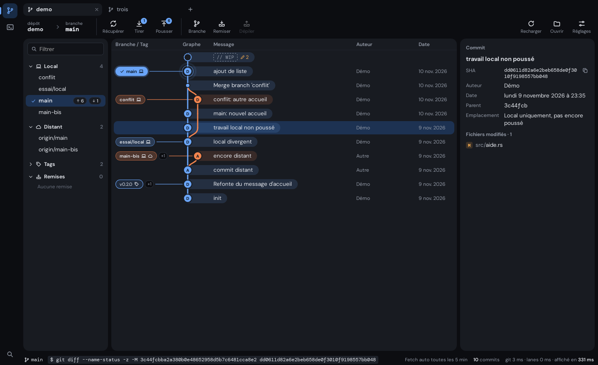
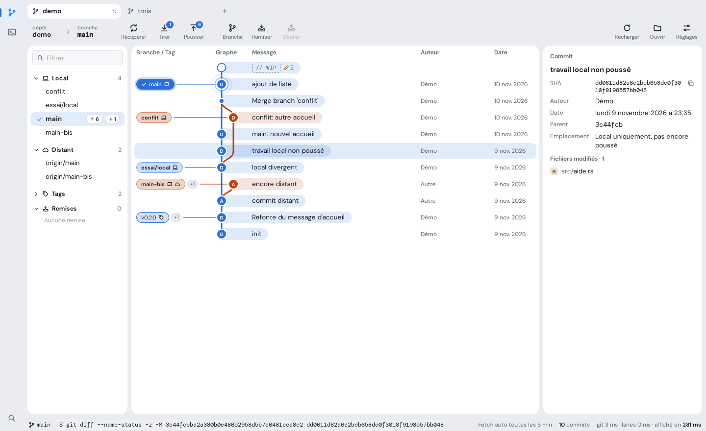
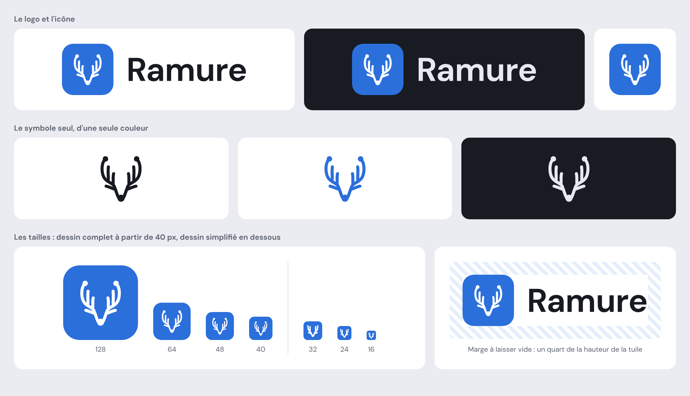

# Charte graphique de Ramure

La référence du design de Ramure. Elle fixe les règles de la direction retenue, **Clairière**.
Le choix de cette direction est raconté dans [`design/directions.md`](design/directions.md).

- **Statut :** version 1, à relire.
- **Portée :** toute l'interface, modules Git et SSH.
- **Règle du jeu :** quand le code et la charte divergent, la charte a raison. On change la
  charte d'abord, par une PR, et le code ensuite.

Les jetons du code suivent cette charte (issue #5) et l'interface a la forme de Clairière
(issue #10). La revue des écrans, règle par règle, est l'objet de l'issue #6.

| Sombre | Clair |
|---|---|
|  |  |

## Sommaire

1. [Principes](#1-principes)
2. [Couleurs](#2-couleurs)
3. [Typographie](#3-typographie)
4. [Espacements et dimensions](#4-espacements-et-dimensions)
5. [Formes](#5-formes)
6. [Surfaces et ombres](#6-surfaces-et-ombres)
7. [Icônes](#7-icônes)
8. [Mouvement](#8-mouvement)
9. [Composants](#9-composants)
10. [Graphe des commits](#10-graphe-des-commits)
11. [Accessibilité](#11-accessibilité)
12. [Ton des textes](#12-ton-des-textes)
13. [Logo](#13-logo)
14. [Faire évoluer la charte](#14-faire-évoluer-la-charte)

## 1. Principes

Ce que l'interface privilégie :

1. **Le contenu d'abord.** Le graphe, le diff et le terminal occupent l'écran. Le reste
   s'efface : pas de décor dans les écrans de travail.
2. **La couleur a un sens.** Une couleur vive désigne une branche, un état ou l'action
   principale. Rien d'autre.
3. **Des surfaces plutôt que des traits.** Les zones se séparent par leur fond et par l'espace.
   Les traits ne servent qu'à l'intérieur d'une carte.
4. **Une forme, un rôle.** Un rectangle légèrement arrondi se clique. Une pilule ou un rond
   informe.
5. **Dense et lisible.** Beaucoup d'information à l'écran, mais aucun texte sous 10,5 px et
   aucune cible sous 24 px.
6. **Calme.** Un mouvement est bref et explique un changement. Rien ne bouge sans action de
   l'utilisateur.

Ce qu'elle s'interdit :

- une couleur écrite en dur dans un composant ;
- une bordure ou une ombre autour d'une carte ;
- un trait de couleur sur le bord d'une carte ou d'une ligne, pour marquer une sélection ou un
  état ;
- une pilule pour un élément qui se clique ;
- un élément qui change de taille quand on clique dessus, en dehors des boutons ;
- un dégradé décoratif ;
- un texte tout en capitales ;
- une animation en boucle, sauf les deux cas de la [section 8](#8-mouvement).

## 2. Couleurs

Toutes les couleurs passent par des jetons, définis dans `src/app.css`. Les valeurs ci-dessous
sont celles du thème par défaut, **Ardoise**.

Cela vaut pour tous les jetons de cette charte : couleurs, tailles et graisses de texte, rayons
et durées. `src/app.css` est le seul fichier qui écrit ces valeurs, et `npm run check` refuse un
composant qui en écrit une en dur.

### 2.1 Jetons

| Jeton | Rôle | Clair | Sombre |
|---|---|---|---|
| `--side` | Fond de la fenêtre : rail, onglets, barre d'outils, barre d'état, espace entre les cartes. | `#eaecf1` | `#0c0d11` |
| `--panel` | Fond des cartes et de l'onglet actif. | `#ffffff` | `#181b21` |
| `--bg` | Fond en creux, dans une carte : champs de saisie. | `#f6f7f9` | `#111318` |
| `--raised` | Fond des boutons et de ce qui flotte : menus, boîtes de dialogue, notifications. | `#ffffff` | `#20242c` |
| `--line` | Bordure des boutons, des champs et des éléments flottants. | `#d9dce3` | `#2b303a` |
| `--line-soft` | Séparateur discret à l'intérieur d'une carte. | `#e7e9ee` | `#21252d` |
| `--ink` | Texte courant. | `#171a21` | `#e6e9ef` |
| `--muted` | Texte secondaire : légendes, métadonnées, libellés. | `#5c6370` | `#959ca9` |
| `--faint` | Indication dans un champ vide, élément désactivé, repère décoratif. | `#8f95a1` | `#676e7b` |
| `--hover` | Fond d'un élément survolé. | `#eef0f4` | `#1e222a` |
| `--sel` | Fond d'un élément sélectionné. | `#e1ecfb` | `#1d3252` |
| `--accent` | Action principale, focus, élément actif, lien. | `#2b6fdb` | `#6aa5f8` |
| `--accent-soft` | Fond teinté d'accent : élément de menu survolé, module actif du rail. | `#e4eefc` | `#182b45` |
| `--on-accent` | Texte posé sur l'accent ou sur une couleur de branche. | `#ffffff` | `#08131f` |
| `--ok` / `--ok-soft` | Succès, ligne ajoutée. | `#1f7a45` / `#e2f3e8` | `#5cc48d` / `#12301f` |
| `--warn` / `--warn-soft` | Avertissement, opération en attente. | `#8f5708` / `#fbf0dc` | `#f0a94f` / `#3a2b14` |
| `--bad` / `--bad-soft` | Erreur, action destructrice, ligne retirée. | `#b42318` / `#fbe5e2` | `#f2776d` / `#3a1715` |
| `--term-bg` / `--term-ink` | Fond et texte du terminal. | `#fbfbfc` / `#1c1f27` | `#0b0c10` / `#d5dae3` |
| `--scrim` | Voile derrière une boîte de dialogue. | `rgb(18 22 30 / 0.32)` | `rgb(0 0 0 / 0.55)` |

### 2.2 Couleurs des branches

Huit couleurs, réservées au graphe. Une branche prend la couleur de sa colonne : colonne 0 pour
`--l0`, colonne 1 pour `--l1`, et ainsi de suite, en reprenant à `--l0` après `--l7`.

| Jeton | Clair | Sombre |
|---|---|---|
| `--l0` | `#2b6fdb` | `#6aa5f8` |
| `--l1` | `#c2410c` | `#f2844e` |
| `--l2` | `#1b7f53` | `#55c68b` |
| `--l3` | `#8447c7` | `#b98aeb` |
| `--l4` | `#8a6500` | `#e8be45` |
| `--l5` | `#c33a6f` | `#ee79a2` |
| `--l6` | `#0f808a` | `#3fc4cc` |
| `--l7` | `#5d6b17` | `#b0c25a` |

- `--l0` est la couleur de l'accent : la première colonne et l'accent se répondent.
- Hors du graphe, ces couleurs ne servent qu'à un repère choisi par l'utilisateur, comme la
  couleur d'un hôte SSH.

### 2.3 Règles d'emploi

- Aucune couleur n'est écrite en dur dans un composant. Une nuance intermédiaire se fait avec
  `color-mix()` entre deux jetons.
- **L'accent** désigne une seule chose à la fois : le bouton principal d'une vue ou d'une boîte
  de dialogue, le focus, l'élément actif. Jamais deux boutons principaux côte à côte.
- **Les couleurs d'état** (`--ok`, `--warn`, `--bad`) ne disent que l'état. Elles ne décorent
  pas.
- **`--faint`** ne porte jamais une information nécessaire : son contraste est trop faible pour
  un texte qu'il faut lire.
- Un fond teinté d'état se fait avec le jeton `-soft`, ou avec 13 à 15 % de la couleur sur le
  fond.

### 2.4 Contrastes minimaux

Chaque thème doit les respecter, en clair et en sombre.

| Paire | Minimum |
|---|---|
| `--ink` sur `--panel`, `--bg`, `--sel`, `--hover` | 7:1 |
| `--ink` dans une capsule de message ou une étiquette de branche | 7:1 |
| `--muted` sur `--panel`, `--side`, `--sel` | 4,5:1 |
| `--on-accent` sur `--accent` et sur chaque couleur de branche | 4,5:1 |
| `--ok`, `--warn`, `--bad` sur `--panel` et `--bg` | 4,5:1 |
| `--accent` et chaque couleur de branche sur `--panel` | 3:1 |

### 2.5 Thèmes de couleurs

- L'application suit le réglage clair ou sombre du système.
- Un thème de couleurs redéfinit les jetons des sections 2.1 et 2.2, en clair et en sombre, et
  rien d'autre : ni forme, ni police, ni taille, ni ombre. Il ne change pas non plus les
  couleurs du logo (section 13).
- Quatre thèmes sont prévus : Ardoise (par défaut), Encre, Sous-bois et Braise. Leurs valeurs
  sont dans [`design/themes.css`](design/themes.css) ; leur mise en œuvre est l'issue #9.

## 3. Typographie

### 3.1 Polices

| Usage | Police | Jeton |
|---|---|---|
| Interface | DM Sans (variable) | `--f-ui` |
| Code | DM Mono | `--f-mono` |

- Les deux polices sont embarquées dans l'application. Aucune police n'est chargée du réseau.
- **La police de code** sert à ce qui se copie ou se tape dans un terminal : SHA, commandes git,
  contenu des fichiers (diff, éditeur de conflits), terminal, nom de la branche courante dans la
  barre d'outils.
- Dans une liste de fichiers, le chemin est en police d'interface : le dossier en `--muted`, le
  nom du fichier en `--ink`.
- DM Mono s'arrête à la graisse 500. Un texte de code appuyé est rendu en 500 ; le navigateur ne
  fabrique pas de faux gras.

### 3.2 Tailles

| Jeton | Taille | Usage |
|---|---|---|
| `--fs-micro` | 10,5 px | Compteurs, badges, touches de raccourci. |
| `--fs-small` | 11,5 px | Légendes, libellés de la barre d'outils, barre d'état, étiquettes du graphe, métadonnées. |
| `--fs-label` | 12 px | Libellés de champ, en-têtes de colonne, titres de section, colonnes secondaires d'une liste (auteur, date). |
| `--fs-body` | 13,5 px | Texte, lignes de liste, boutons, menus. |
| `--fs-title` | 15 px | Titre d'une boîte de dialogue ou d'un panneau, saisie de la palette de commandes. |
| `--fs-display` | 24 px | Page d'accueil seulement. |
| `--fs-code` | 12 px | Diff, éditeur de conflits, SHA. |
| `--fs-term` | 13 px | Terminal : une taille entière, pour que la grille de caractères reste nette. |

- Aucune autre taille. Aucun texte sous 10,5 px.
- Interligne : 1,35 pour l'interface.

### 3.3 Graisses

Deux graisses, pas plus.

| Jeton | Graisse | Usage |
|---|---|---|
| `--fw-regular` | 400 | Texte courant. |
| `--fw-strong` | 650 | Titres, libellés, bouton principal, élément courant (onglet actif, branche courante), étiquette d'une branche locale. |

### 3.4 Règles

- Une majuscule en début de phrase, et c'est tout : pas de titre en capitales, pas de capitales
  espacées.
- Les nombres qui s'alignent ou qui changent (compteurs, dates, colonnes) sont en chiffres
  tabulaires (`font-variant-numeric: tabular-nums`).
- Un texte trop long est coupé à droite par des points de suspension, et sa valeur entière
  apparaît dans une infobulle.

## 4. Espacements et dimensions

### 4.1 Échelle

Les marges et les écarts prennent leurs valeurs dans cette échelle : **2, 4, 6, 8, 10, 12, 16,
20, 24 px**.

| Écart | Valeur |
|---|---|
| Entre deux cartes, et entre les cartes et le bord de la fenêtre | 8 px |
| Marge intérieure d'une carte | 12 px |
| Entre une icône et son texte | 6 px |
| Entre deux boutons | 8 px |
| Entre un libellé et son champ | 6 px |
| Entre deux champs d'un formulaire | 12 px |

### 4.2 Structure de l'écran

De gauche à droite et de haut en bas :

| Zone | Dimension | Fond |
|---|---|---|
| Rail des modules (Git, SSH) | 48 px de large | `--side` |
| Barre d'onglets | onglets de 30 px de haut | `--side` |
| Barre d'outils | sur toute la largeur | `--side` |
| Trois cartes : barre latérale, centre, détail | écartées de 8 px ; les deux cartes latérales se règlent (9.16) | `--panel` |
| Barre d'état | 26 px de haut | `--side` |

- Aucun trait ne sépare ces zones : le fond et l'espace suffisent.
- La fenêtre fait au moins 1000 × 600 px ; aucune zone ne doit déborder à cette taille.

### 4.3 Hauteurs

| Élément | Hauteur |
|---|---|
| Ligne du graphe | 34 px |
| Ligne de la barre latérale | 28 px |
| Ligne d'une liste de fichiers | 24 px |
| Bouton | 30 px ; 24 px pour un petit bouton |
| Champ | 32 px |
| Étiquette de branche | 22 px |
| Cible cliquable, au minimum | 24 × 24 px |

## 5. Formes

| Jeton | Rayon | Pour |
|---|---|---|
| `--radius-xs` | 4 px | Petits repères : touche de raccourci, lettre d'état d'un fichier, surlignage dans une ligne de diff. |
| `--radius-s` | 6 px | Ce qui se clique : boutons, champs, étiquettes de branche et de tag, éléments de menu, cases. |
| `--radius` | 8 px | Lignes sélectionnables, onglets, notifications, boutons du rail. |
| `--radius-l` | 12 px | Ce qui flotte : boîtes de dialogue, menus, palette de commandes. |
| `--radius-card` | 14 px | Cartes. |
| `--radius-pill` | 999 px | Ce qui informe : compteurs, capsule d'un message de commit. |

- **Tout ce qui se clique est un rectangle légèrement arrondi.** La pilule est réservée à ce qui
  informe sans se cliquer.
- Le rond est réservé à la pastille d'un commit, au badge d'un bouton de la barre d'outils et à
  l'icône d'une notification.
- Un élément placé dans un autre n'a jamais un rayon plus grand que celui qui le contient.

## 6. Surfaces et ombres

L'interface a quatre niveaux. Chacun se reconnaît à son fond.

| Niveau | Élément | Fond | Bordure | Ombre |
|---|---|---|---|---|
| 0 | Fenêtre | `--side` | aucune | aucune |
| 1 | Carte | `--panel` | aucune | aucune |
| 2 | Bouton, champ (dans une carte) | `--raised`, `--bg` | 1 px `--line` | `--shadow-soft` pour un bouton |
| 3 | Menu, boîte de dialogue, notification, palette | `--raised` | 1 px `--line` | `--shadow-pop` |

| Jeton | Clair | Sombre |
|---|---|---|
| `--shadow-soft` | `0 1px 2px rgb(18 22 30 / 0.06)` | `0 1px 2px rgb(0 0 0 / 0.3)` |
| `--shadow-pop` | `0 18px 44px -14px rgb(18 22 30 / 0.3), 0 2px 6px rgb(18 22 30 / 0.08)` | `0 22px 50px -14px rgb(0 0 0 / 0.7), 0 2px 8px rgb(0 0 0 / 0.4)` |

- Une ombre dit « ceci flotte ». Une carte n'en a jamais.
- Pas de carte dans une carte. À l'intérieur d'une carte, on sépare par l'espace ou par un trait
  `--line-soft`.
- Les ombres sont neutres : elles ne prennent pas la teinte du thème.
- Une boîte de dialogue est posée sur le voile `--scrim`, avec un flou de 2 px.

## 7. Icônes

- Un seul jeu, celui de l'application (`src/lib/ui/Icon.svelte`). Pas d'émoji, pas d'icône d'une
  autre bibliothèque.
- Dessin : grille de 16 × 16, trait de 1,4 sans remplissage, extrémités et angles arrondis,
  couleur du texte (`currentColor`).

| Taille | Usage |
|---|---|
| 14 px | Dans une étiquette, un compteur ou une ligne dense. |
| 16 px | Par défaut : menus, boutons, listes. |
| 18 px | Barre d'outils et rail. |

- Une notion, une icône, partout : l'ordinateur pour « local », le nuage pour « distant »,
  l'étiquette pour un tag.
- Un bouton fait d'une icône seule a une infobulle et un nom accessible (`aria-label`). Une
  icône qui accompagne un texte est masquée aux lecteurs d'écran (`aria-hidden`).
- Une icône ne porte jamais seule une information d'état : elle est doublée d'un texte ou d'une
  infobulle.

## 8. Mouvement

| Jeton | Valeur | Usage |
|---|---|---|
| `--ease` | `cubic-bezier(0.2, 0.8, 0.2, 1)` | La seule courbe de l'application. Seuls une rotation et un défilement continus sont linéaires. |
| `--t-fast` | 110 ms | Survol, pression, focus, changement de couleur, disparition. |
| `--t-med` | 200 ms | Apparition d'un menu ou d'une boîte de dialogue, repli d'une section. |
| `--t-slow` | 340 ms | Déplacement long : repère du rail, réorganisation d'une liste. |
| `--t-step` | 14 ms | Décalage entre deux éléments d'une entrée en cascade. |
| `--t-spin` | 800 ms | Un tour de l'indicateur de chargement. |
| `--t-wait` | 1,1 s | Un cycle d'une barre ou d'un point d'attente. |
| `--t-halo` | 2,4 s | Un cycle du halo du commit courant. |

Les transitions écrites en script lisent ces mêmes jetons, par `src/lib/ui/motion.ts`.

**Ce qui s'anime.** L'opacité, la position (`transform`) et les couleurs. Une apparition vient
de près : 6 à 10 px de décalage au plus.

**L'effet de pression.** Un bouton se réduit à 97 % pendant le clic. Cela vaut pour les boutons,
les boutons de la barre d'outils et ceux du rail, et pour rien d'autre.

**Ce qui ne s'anime pas.**

- Les étiquettes de branche et de tag, les lignes de liste, les onglets et les éléments de menu
  ne changent jamais de taille, ni au clic ni au survol.
- Le défilement du graphe, du diff et du terminal.
- Le déplacement de la sélection au clavier : il est immédiat.
- Le texte d'un diff ou d'un terminal.

**Les deux seules boucles.** L'indicateur d'attente, tant que dure l'opération ou l'attente :
une icône qui tourne, une barre, un point qui clignote. Le halo du commit courant dans le
graphe : un anneau qui s'élargit et s'efface, en 2,4 s.

**À l'ouverture d'un dépôt** ou après un rechargement complet, les lignes du graphe entrent en
cascade, une fois. Jamais au défilement.

**Moins d'animations.** Quand le système demande de réduire les animations
(`prefers-reduced-motion`), les durées tombent à 1 ms et les boucles s'arrêtent. Aucune
information ne doit dépendre d'une animation.

## 9. Composants

Les états sont les mêmes partout :

| État | Rendu |
|---|---|
| Survol | Fond `--hover`, en `--t-fast`. |
| Focus au clavier | Contour de 2 px en `--accent`, décalé de 1 px. Voir les exceptions des champs et des listes. |
| Sélection | Fond `--sel`. |
| Désactivé | Opacité de 45 %, curseur « interdit », aucune réaction au survol. |

### 9.1 Boutons

| Variante | Rendu | Usage |
|---|---|---|
| Standard | Fond `--raised`, bordure `--line`, ombre `--shadow-soft`. | Action courante. |
| Principal | Fond `--accent`, texte `--on-accent`, graisse 650. | L'action attendue. Un seul par vue ou par boîte de dialogue. |
| Danger | Fond `--bad`, texte `--on-accent`, graisse 650. | Confirmer une action destructrice, dans une boîte de dialogue. |
| Discret | Sans fond ni bordure au repos. | Action secondaire, dans un en-tête ou une ligne. |
| Petit | 24 px de haut, texte de 12 px. | Dans un en-tête de carte ou une ligne. |

- Angles de 6 px. Marges intérieures : 5 px en haut et en bas, 12 px sur les côtés.
- Survol : fond `--hover` et bordure plus marquée ; un bouton principal ou danger s'éclaircit de
  10 %.
- Pression : réduction à 97 %.
- Le libellé est un verbe à l'infinitif, avec son objet si le contexte ne le donne pas :
  « Créer la branche », pas « OK ».

### 9.2 Barre d'outils

- Chaque action est une icône de 18 px au-dessus d'un libellé de 11,5 px, sur 58 px de large au
  moins.
- Au repos, ni fond ni bordure : le bouton est posé sur le fond de la fenêtre. Au survol, fond
  `--hover` et angles de 6 px.
- Un compteur (commits à tirer, à pousser) est un badge rond en `--accent`, en haut à droite de
  l'icône.
- Pendant une opération, l'icône tourne et le bouton est désactivé.
- Le dépôt et la branche courante sont à gauche, la branche en police de code.

### 9.3 Champs

- Fond `--bg`, bordure `--line`, angles de 6 px, marges intérieures de 6 px et 9 px.
- Survol : bordure plus marquée.
- Focus : bordure `--accent` et halo de 3 px en `--accent` à 25 %. Pas de contour en plus.
- Erreur : bordure `--bad`, et un message en `--bad` de 11,5 px sous le champ.
- Le libellé est au-dessus du champ, en 12 px, graisse 650, couleur `--muted`. Une indication
  dans le champ vide ne remplace jamais le libellé.
- Une case à cocher fait 15 px, cochée en `--accent`, et son texte se clique aussi.

### 9.4 Étiquettes de branche et de tag

Les étiquettes de la colonne « Branche / Tag » du graphe. Ce sont des boutons : elles en ont la
forme.

| Type | Rendu |
|---|---|
| Branche locale | Fond : 24 % de la couleur de la branche sur `--panel`. Bordure : la même couleur à 55 %. Texte `--ink`, graisse 650. Icône « ordinateur ». |
| Branche courante | Fond plein de la couleur de la branche, entouré d'un liseré de la même couleur. Texte `--on-accent`, graisse 650, précédé d'une coche. |
| Branche distante | Fond à peine teinté, bordure en tirets, graisse 400. Icône « nuage ». |
| Tag | Fond à peine teinté, bordure de la couleur de la branche, graisse 400. Icône « étiquette ». |

- Rectangle à angles de 6 px, 22 px de haut, texte de 11,5 px. **Jamais de pilule.**
- **Une étiquette ne change jamais de taille** : ni au clic, ni au survol, ni quand on glisse une
  branche dessus.
- Survol : la teinte du fond se renforce.
- Cible d'un glisser-déposer : contour de 2 px en `--accent`, décalé de 2 px.
- Une branche locale et sa branche distante au même commit partagent une seule étiquette, avec
  les deux icônes.
- Quand un commit porte plusieurs étiquettes, la première est affichée et les autres sont
  comptées dans une pilule « +N ».
- Double-clic : basculer sur la branche. Clic droit : menu de la branche.

### 9.5 Compteurs

- Une pilule sur fond `--sel`, texte de 10,5 px en chiffres tabulaires.
- Un compteur informe : il ne se clique pas.

### 9.6 Lignes et listes

Barre latérale, listes de fichiers, graphe, résultats de la palette.

- Survol : un fond arrondi `--hover` sous la ligne, angles de 8 px.
- Sélection : le même fond, en `--sel`. Dans le graphe, il est en retrait de 6 px des bords de
  la carte.
- **Pas de trait de couleur sur le bord** pour marquer la sélection.
- Focus au clavier : un liseré intérieur de 1,5 px en `--accent` sur la ligne sélectionnée.
  **Jamais de contour autour de toute la liste.** Le focus reste sur la liste, qui gère les
  flèches ; si aucune ligne n'est sélectionnée quand elle le reçoit, la première le devient.
- Les actions d'une ligne (indexer, annuler) apparaissent au survol et au focus, à droite.
- L'état d'un fichier est une lettre sur fond teinté (M, A, D, R), jamais une couleur seule.

### 9.7 Onglets

- L'onglet actif est une petite carte : fond `--panel`, angles de 8 px, sans cadre ni trait.
- Un onglet inactif est du texte `--muted` sur le fond de la fenêtre ; au survol, fond `--hover`.
- 30 px de haut, 90 px de large au moins. Le nom est coupé par des points de suspension.
- La croix de fermeture est visible sur l'onglet actif, et au survol sur les autres.
- Le bouton « + » suit le dernier onglet.

### 9.8 Cartes

- Fond `--panel`, angles de 14 px, ni bordure ni ombre.
- Une carte défile à l'intérieur d'elle-même ; son contenu ne dépasse jamais ses angles.
- Le titre d'une carte ou d'une section est en 12 px, graisse 650.
- Un en-tête de colonnes est séparé du contenu par un trait `--line-soft`.

### 9.9 Menus contextuels

- Flottant : fond `--raised`, bordure `--line`, angles de 12 px, ombre `--shadow-pop`. Entre 220
  et 380 px de large.
- Un élément : icône de 16 px en `--muted` dans une colonne de 18 px, puis le texte. Angles de
  6 px.
- Survol et focus : fond `--accent-soft`.
- Une action destructrice est en `--bad`, en dernier, après un séparateur. Son survol est en
  `--bad-soft`.
- Un libellé se termine par « … » quand l'action ouvre une boîte de dialogue.
- Clavier : flèches pour se déplacer, Entrée pour choisir, Échap pour fermer.
- Apparition en `--t-fast`, depuis le point du clic.

### 9.10 Boîtes de dialogue

- Pour confirmer une action destructrice ou saisir quelques valeurs. Jamais pour une simple
  information : c'est le rôle d'une notification.
- Flottant : fond `--raised`, bordure `--line`, angles de 12 px, ombre `--shadow-pop`, 460 px de
  large au plus.
- Titre de 15 px, graisse 650 : le nom de l'action (« Nouvelle branche »). Texte d'explication
  en `--muted`.
- Un avertissement est un encadré sur fond `--warn-soft`, avec une icône.
- Les boutons sont en bas à droite : « Annuler » d'abord, l'action ensuite.
- Entrée valide, Échap annule. Un clic sur le voile annule aussi.
- À l'ouverture, le focus va au premier champ. Pour une action destructrice, il va à
  « Annuler ».
- Une action destructrice dit ce qui sera perdu, et si cela se récupère.

### 9.11 Notifications

- En bas, au centre de la fenêtre, à 40 px du bord. Cinq au plus, empilées. 480 px de large au
  plus.
- Flottant : fond `--raised`, bordure `--line`, angles de 8 px, ombre `--shadow-pop`.
- L'état est porté par une icône dans un rond teinté (succès, avertissement, erreur), pas par un
  trait de couleur sur le bord.
- Un titre court, puis le détail. La sortie de git est montrée telle quelle, en police de code
  de 11,5 px.

| Type | Durée |
|---|---|
| Succès | 4,5 s |
| Avertissement | 9 s |
| Erreur | Reste jusqu'à ce qu'on la ferme. |

### 9.12 Palette de commandes

- Flottant, centré, à 11 % du haut de la fenêtre, 640 px de large au plus.
- Saisie de 15 px. Résultats en lignes (9.6), le raccourci de chaque commande à droite.
- Une touche de raccourci est dessinée comme une touche : 10,5 px, angles de 4 px, bord
  inférieur plus épais.

### 9.13 Barre d'état

- 26 px de haut, texte de 11,5 px en `--muted`, sur le fond de la fenêtre.
- À gauche, la branche et la dernière commande git, en police de code. À droite, les mesures.

### 9.14 Diff

- Police de code, 12 px. Numéros de ligne en `--muted`.
- Ligne ajoutée : fond à 14 % de `--ok`, signe « + » en `--ok`. Ligne retirée : fond à 13 % de
  `--bad`, signe « − » en `--bad`.
- Le signe est toujours présent : la couleur ne dit jamais seule si une ligne est ajoutée ou
  retirée.
- Une ligne choisie pour être indexée seule a une teinte plus forte et son signe en gras. Pas
  de trait de couleur sur son bord.

### 9.15 Terminal

- Fond `--term-bg`, texte `--term-ink`, police de code de 13 px.
- Les onglets de terminal suivent la règle des onglets (9.7).

### 9.16 Poignée de redimensionnement

Entre deux cartes dont on règle la largeur : dans la vue d'un dépôt, de part et d'autre de la
carte centrale.

- La poignée occupe l'écart de 8 px entre les cartes. Au repos, elle ne se voit pas : le fond de
  la fenêtre sépare déjà les cartes.
- Survol : un repère vertical de 2 px en `--faint`, et le curseur de redimensionnement.
- Pendant le geste et au focus : le même repère, en `--accent`. Pas de cadre autour de la
  poignée.
- Clavier : flèches gauche et droite par pas de 16 px, Début et Fin pour la largeur minimale et
  maximale, Entrée pour la largeur par défaut.
- Double-clic : largeur par défaut.
- Chaque carte a une largeur minimale et une largeur maximale, et la carte centrale garde
  toujours 360 px. Les largeurs choisies sont retrouvées au lancement suivant.
- La poignée ne fait que 8 px de large : c'est la seule exception à la cible de 24 px, et le
  clavier la compense.

## 10. Graphe des commits

### 10.1 Colonnes

Dans l'ordre : Branche / Tag (164 px), Graphe (420 px au plus), Message, Auteur, Date, et SHA
quand la largeur le permet.

### 10.2 Dessin

| Paramètre | Valeur |
|---|---|
| Hauteur d'une ligne | 34 px |
| Largeur d'une colonne de branche | 24 px |
| Rayon d'un commit | 10 px |
| Rayon d'un commit de fusion | 5 px |
| Épaisseur d'un trait | 3 px |
| Bande derrière un commit | 24 px de haut, 15 % de la couleur de la branche |

- **Un commit** est une pastille ronde de la couleur de sa branche, avec l'initiale de son
  auteur en `--on-accent`. Un liseré de la couleur de la carte la détache des traits.
- **Un commit de fusion** est un point plus petit, sans initiale.
- **Les traits** sont droits tant que la branche garde sa colonne. Un changement de colonne est
  une courbe souple, sans angle.
- **Le message** est dans une capsule : un fond à 15 % de la couleur de la branche, arrondi en
  pilule à droite, large comme le texte. Une bande de la même teinte la relie à la pastille.
- **Une étiquette** est reliée à son commit par un trait fin de la couleur de la branche.
- **Le commit courant** porte un halo (section 8), et l'étiquette de sa branche est pleine.
- **Les modifications en cours** occupent la première ligne : un cercle vide, la mention
  `// WIP` en police de code dans un cadre en tirets, et le nombre de fichiers modifiés.

### 10.3 Règles

- La couleur d'un commit, de son trait, de sa capsule et de son étiquette est la même.
- Le survol et la sélection suivent la règle des lignes (9.6).
- Le graphe ne s'anime pas au défilement.
- Pas de texte sur les traits, pas de dégradé, pas plus de huit couleurs.
- Le rendu « Classique », proposé dans les Réglages, garde des points et des courbes plus
  compacts. Il suit les mêmes couleurs et les mêmes règles de sélection.

## 11. Accessibilité

- **Contrastes.** Ceux de la section 2.4, vérifiés en clair et en sombre.
- **Focus visible.** Tout élément qui prend le focus au clavier le montre. On ne retire jamais
  un contour sans le remplacer par un autre repère.
- **Clavier.** Toute action est possible sans souris. L'ordre de tabulation suit l'ordre visuel.
  Échap ferme l'élément flottant du dessus.
- **Cibles.** 24 × 24 px au moins.
- **Jamais la couleur seule.** Un état est doublé d'une icône, d'un signe ou d'un texte : « + »
  et « − » dans un diff, une lettre pour l'état d'un fichier, une icône pour local et distant.
- **Mouvement réduit.** Voir la section 8.
- **Lecteurs d'écran.** Une icône seule a un nom accessible. Une erreur est annoncée tout de
  suite (`role="alert"`), les autres notifications sans interrompre (`role="status"`). Les menus
  et la palette déclarent leur rôle.
- **Les deux thèmes.** Un écran n'est pas fini tant qu'il n'a pas été vérifié en clair et en
  sombre.

## 12. Ton des textes

- **On tutoie**, à l'impératif, en phrases courtes : « Indexe les fichiers à inclure dans le
  commit. »
- **Les boutons** sont des verbes à l'infinitif : « Créer la branche », « Tout indexer ».
  Jamais « OK » ni « Oui ».
- **Les titres** nomment l'action : « Nouvelle branche ».
- **Une erreur** dit ce qui s'est passé, puis quoi faire. La sortie de git suit, telle quelle.
  Pas de « Oups », pas de point d'exclamation, pas de reproche.
- **Une action destructrice** dit ce qui sera perdu, et si cela se récupère.
- **Les commandes git** exécutées sont toujours montrées telles quelles, dans la barre d'état et
  dans le journal.

Le vocabulaire de Git est traduit quand un mot français existe et se comprend. Le terme anglais
est rappelé entre parenthèses là où il aide.

| Git | Dans l'interface |
|---|---|
| fetch | Récupérer |
| pull | Tirer |
| push | Pousser |
| stash, stash pop | Remiser, dépiler ; une remise |
| stage, unstage | Indexer, retirer |
| merge | Fusionner |
| rebase | Rebaser |
| checkout, switch | Basculer |
| remote | Distant |
| revert | Annuler (revert) |
| commit, tag, cherry-pick, reset, HEAD | Gardés tels quels. |

Typographie :

- guillemets français « », apostrophe courbe ’, points de suspension en un seul caractère … ;
- une espace insécable avant « : », « ; », « ? » et « ! » ;
- les pluriels sont accordés : « 1 commit », « 10 commits » ;
- une date courte s'écrit « 9 nov. 2026 », une date complète « lundi 9 novembre 2026 à 23:35 ».

## 13. Logo

Le logo de Ramure est une tête de cerf dessinée d'un seul trait. Le museau est une pastille de
commit ; deux traits en partent, longent la tête, s'écartent et deviennent les bois. On y voit un
cerf, et un commit d'où partent deux branches. Le choix est raconté dans
[`design/logo.md`](design/logo.md).

### 13.1 Versions

| Version | Fichier | Usage |
|---|---|---|
| Icône | [`logo/ramure-icone.svg`](logo/ramure-icone.svg) | L'application : barre des tâches, fenêtre, page d'accueil. Le symbole en blanc sur une tuile bleue. |
| Icône, petites tailles | [`logo/ramure-icone-petit.svg`](logo/ramure-icone-petit.svg) | La même, en dessous de 40 px. Le dessin est simplifié : un andouiller par côté, un trait plus épais. |
| Logo | [`logo/ramure-logo.svg`](logo/ramure-logo.svg), [`logo/ramure-logo-sombre.svg`](logo/ramure-logo-sombre.svg) | L'icône suivie du nom. La version « sombre » a le nom en clair, pour un fond sombre. |
| Symbole | [`logo/ramure-symbole.svg`](logo/ramure-symbole.svg), [`logo/ramure-symbole-petit.svg`](logo/ramure-symbole-petit.svg) | Le dessin seul, d'une seule couleur, quand la tuile ne convient pas. |

### 13.2 Couleurs

| Jeton | Valeur | Rôle |
|---|---|---|
| `--brand` | `#2b6fdb` | La tuile. |
| `--on-brand` | `#ffffff` | Le symbole sur la tuile. |

- Ces deux couleurs sont fixes : elles ne changent ni en thème sombre, ni avec le thème de
  couleurs. L'icône est la même partout.
- Le nom est en `#171a21` sur un fond clair, en `#e6e9ef` sur un fond sombre.
- Le symbole seul prend la couleur du texte, le bleu de la tuile, ou le blanc. Aucune autre.

### 13.3 Construction

- **La tuile** est un carré dont les angles sont arrondis de 22 % du côté. Le symbole y est
  centré, avec une marge de 16 % du côté (12 % pour le dessin simplifié).
- **Le nom** est « Ramure », en DM Sans, graisse 650, approche de −0,01 em. Sa hauteur de
  capitale fait 45 % de la hauteur de la tuile, et elle est centrée sur la tuile.
- **L'écart** entre la tuile et le nom fait un quart de la hauteur de la tuile.
- Dans les fichiers, le nom est en tracés : il s'affiche sans que la police soit installée.

### 13.4 Tailles et marge

- Le dessin complet à partir de 40 px ; le dessin simplifié de 16 à 39 px ; rien en dessous de
  16 px.
- Le logo avec le nom ne s'emploie pas à moins de 40 px de haut.
- Autour du logo, une marge d'au moins un quart de la hauteur de la tuile reste vide.

### 13.5 Ce qui est interdit

- Déformer le logo, l'incliner ou le faire pivoter.
- Changer la couleur de la tuile ou du symbole ; ajouter un dégradé, une ombre ou un contour.
- Redessiner le symbole : ajouter ou retirer des andouillers, changer l'épaisseur du trait.
- Employer le dessin complet en dessous de 40 px.
- Poser le symbole seul sur une photo ou sur un fond chargé : c'est le rôle de la tuile.
- Écrire le nom dans une autre police, ou changer son écart avec la tuile.

### 13.6 Dans le code

- `src/lib/ui/Logo.svelte` affiche le symbole. Il lit les fichiers de `docs/logo`, qui sont la
  seule source du dessin.
- Les icônes de `src-tauri/icons` sont tirées de ces mêmes fichiers par
  `scripts/generer-icones.cjs`. Ce script n'est à relancer que si le dessin change.

## 14. Faire évoluer la charte

- Une règle change par une PR qui modifie ce fichier. Le code suit, dans la même PR ou dans la
  suivante.
- Avant de créer un composant, on cherche celui qui existe. S'il en faut un nouveau, il entre
  dans la section 9 avec ses états.
- Un nouveau jeton entre dans la section concernée, avec son rôle et ses deux valeurs, puis dans
  `src/app.css`.
- `npm run check` refuse une couleur, une taille de texte, une graisse, un rayon ou une durée
  écrits en dur dans un composant.
- Chaque PR qui touche à l'interface est relue contre cette charte.
