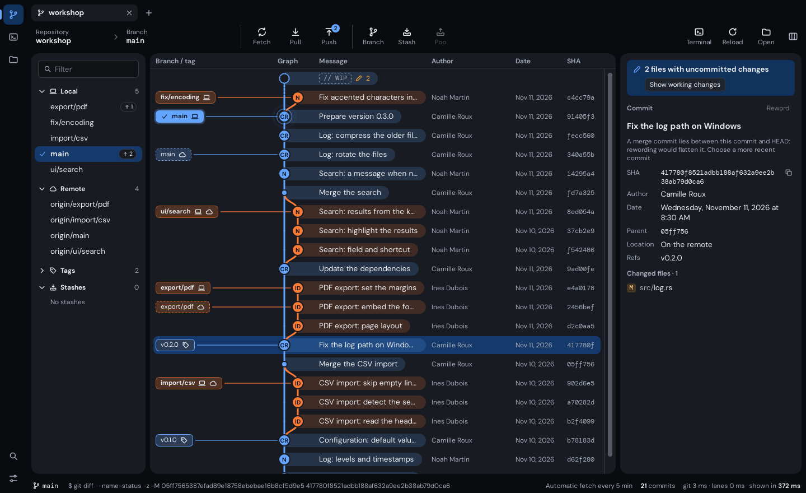
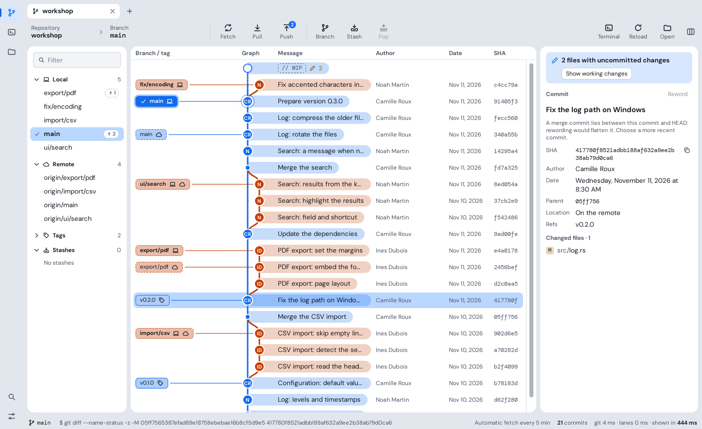
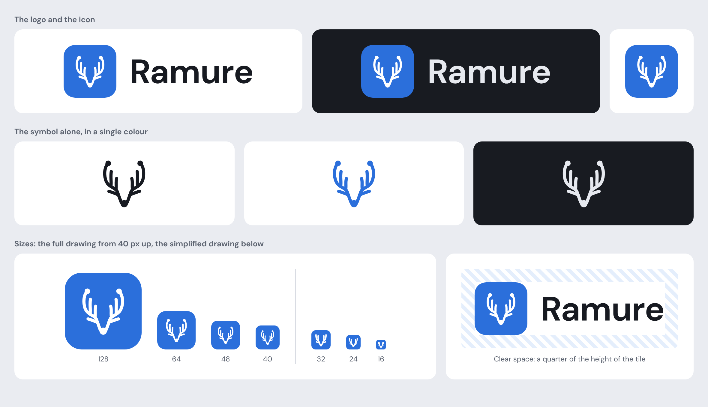

# Ramure design guidelines

The reference for Ramure's design: colors, type, spacing, shapes, motion, every component, the
tone of the interface text and the logo.

- **Scope:** the whole interface: the Git, SSH and Files modules.
- **Ground rule:** when the code and the guidelines disagree, the guidelines are right. A rule
  changes in the guidelines first, through a pull request, and in the code second
  ([section 14](#14-changing-the-guidelines)).
- **In the code:** the tokens are in `src/app.css`, and `npm run check` rejects a component that
  writes a value of its own.

The interface is in English, and so are the labels quoted in this document.

| Dark | Light |
|---|---|
|  |  |

The two screenshots show the application as it is, on a demonstration repository.

## Contents

1. [Principles](#1-principles)
2. [Colors](#2-colors)
3. [Typography](#3-typography)
4. [Spacing and dimensions](#4-spacing-and-dimensions)
5. [Shapes](#5-shapes)
6. [Surfaces and shadows](#6-surfaces-and-shadows)
7. [Icons](#7-icons)
8. [Motion](#8-motion)
9. [Components](#9-components)
   - [9.1 Buttons](#91-buttons)
   - [9.2 Toolbar](#92-toolbar)
   - [9.3 Fields](#93-fields)
   - [9.4 Branch and tag labels](#94-branch-and-tag-labels)
   - [9.5 Counters](#95-counters)
   - [9.6 Rows and lists](#96-rows-and-lists)
   - [9.7 Tabs](#97-tabs)
   - [9.8 Cards](#98-cards)
   - [9.9 Context menus](#99-context-menus)
   - [9.10 Dialogs](#910-dialogs)
   - [9.11 Notifications](#911-notifications)
   - [9.12 Command palette](#912-command-palette)
   - [9.13 Status bar](#913-status-bar)
   - [9.14 Diff](#914-diff)
   - [9.15 Terminal](#915-terminal)
   - [9.16 Resize handle](#916-resize-handle)
   - [9.17 Showing and hiding cards](#917-showing-and-hiding-cards)
   - [9.18 Settings page](#918-settings-page)
   - [9.19 Choice](#919-choice)
   - [9.20 Terminal of a repository](#920-terminal-of-a-repository)
   - [9.21 Host form](#921-host-form)
   - [9.22 Uncommitted changes](#922-uncommitted-changes)
   - [9.23 Updates](#923-updates)
   - [9.24 Files](#924-files)
   - [9.25 Rewording a commit](#925-rewording-a-commit)
   - [9.26 Conflict editor](#926-conflict-editor)
   - [9.27 Commit detail](#927-commit-detail)
10. [Commit graph](#10-commit-graph)
11. [Accessibility](#11-accessibility)
12. [Tone of the interface text](#12-tone-of-the-interface-text)
13. [Logo](#13-logo)
14. [Changing the guidelines](#14-changing-the-guidelines)
15. [History](#15-history)

## 1. Principles

What the interface favors:

1. **Content first.** The graph, the diff and the terminal fill the screen. Everything else
   steps back: no decoration on working screens.
2. **Color means something.** A bright color stands for a branch, a state or the main action,
   or for a marker that the user chose: the color of an SSH host. The accent also marks what
   opens in place: a folder of the Files module (2.3). Nothing else.
3. **Surfaces rather than lines.** Areas are separated by their background and by space. Lines
   are only used inside a card or a dialog.
4. **One shape, one role.** A slightly rounded rectangle can be clicked. A pill or a circle
   informs. One exception: a color swatch, a round dot of color that is chosen (9.21).
5. **Dense and readable.** A lot of information on screen, but no text under 10.5 px and no
   target under 24 px.
6. **Calm.** A movement is brief and explains a change. Nothing moves without an action from the
   user.

What it forbids:

- a color hard-coded in a component;
- a border or a shadow around a card;
- a colored bar on the edge of a card or of a row, to mark a selection or a state; the color
  that the user gives an SSH host is the one exception (9.21): it names the host, never a state;
- a pill for an element that can be clicked;
- an element that changes size when it is clicked, other than a button;
- a decorative gradient;
- text in all capitals;
- a looping animation, apart from the two cases of [section 8](#8-motion).

## 2. Colors

Every color goes through a token, defined in `src/app.css`. The values below are those of the
default theme, **Slate**.

This holds for every token in these guidelines: colors, text sizes and weights, radii and
durations. `src/app.css` is the only file that writes those values, and `npm run check` rejects a
component that hard-codes one.

### 2.1 Tokens

| Token | Role | Light | Dark |
|---|---|---|---|
| `--side` | Window background: rail, tabs, toolbar, status bar, space between the cards. | `#e2e6ed` | `#0a0b0f` |
| `--panel` | Background of the cards and of the active tab. | `#ffffff` | `#181b21` |
| `--bg` | Recessed background, inside a card: input fields. | `#f2f4f7` | `#101216` |
| `--raised` | Background of buttons and of what floats: menus, dialogs, notifications. | `#ffffff` | `#20242c` |
| `--line` | Border of buttons, fields and floating elements; separator inside a dialog, and between the zones of the detail panel of a commit (6, 9.27). | `#ccd1da` | `#343a46` |
| `--line-soft` | Discreet separator inside a card. | `#dfe3ea` | `#262b34` |
| `--ink` | Body text. | `#141820` | `#eceff4` |
| `--muted` | Secondary text: captions, metadata, labels. | `#4d5463` | `#a4abb8` |
| `--faint` | Hint in an empty field, disabled element, decorative marker. | `#7b8290` | `#707886` |
| `--hover` | Background of a hovered element, on a card or on what floats. | `#e0ebfd` | `#1f2d42` |
| `--hover-side` | Background of a hovered element on the window background: rail, toolbar, tabs, status bar. | `#ccdaf0` | `#13213a` |
| `--sel` | Background of a selected element. | `#b9d7ff` | `#14396a` |
| `--accent` | Main action, focus, active element, link. | `#126bed` | `#64a5ff` |
| `--accent-soft` | Accent-tinted background: hovered menu item, active module in the rail, pressed "Terminal" action of the toolbar, row of a shortcut being recorded, the strip of uncommitted changes (9.22), the box of an update (9.23), a folder row that receives a drop and the foot that says where it goes (9.24). | `#d8e7fe` | `#12325e` |
| `--on-accent` | Text placed on the accent or on a branch color. | `#ffffff` | `#08131f` |
| `--ok` / `--ok-soft` | Success, added line. | `#037c40` / `#cdf0d9` | `#42c887` / `#043d22` |
| `--warn` / `--warn-soft` | Warning, pending operation. | `#905601` / `#fde5b5` | `#f9a52c` / `#442e06` |
| `--bad` / `--bad-soft` | Error, destructive action, removed line. | `#bc0400` / `#ffd6cf` | `#fe6c62` / `#4e1513` |
| `--term-bg` / `--term-ink` | Background and text of the terminal. | `#fbfbfc` / `#1c1f27` | `#0b0c10` / `#d5dae3` |
| `--scrim` | Veil behind a dialog. | `rgb(18 22 30 / 0.32)` | `rgb(0 0 0 / 0.55)` |

### 2.2 Branch colors

Eight colors, reserved for the graph. A branch takes the color of its column: column 0 for
`--l0`, column 1 for `--l1`, and so on, starting again at `--l0` after `--l7`.

| Token | Light | Dark |
|---|---|---|
| `--l0` | `#126bed` | `#64a5ff` |
| `--l1` | `#c43e01` | `#fe7b35` |
| `--l2` | `#018051` | `#35ca84` |
| `--l3` | `#8939d6` | `#bd84f7` |
| `--l4` | `#8a6501` | `#eebc06` |
| `--l5` | `#ce216e` | `#f96ea2` |
| `--l6` | `#03808b` | `#07c6d0` |
| `--l7` | `#5d6c02` | `#afc340` |

- `--l0` is the accent color: the first column and the accent echo each other.
- Outside the graph, these colors are only used for a marker chosen by the user, such as the
  color of an SSH host, for the preview of the graph in the settings (9.19), and for the two sides
  of the conflict editor, `--l0` and `--l1` (9.26).

### 2.3 Rules of use

- No color is hard-coded in a component. An intermediate shade is made with `color-mix()`
  between two tokens.
- **The accent** stands for one thing at a time: the main button of a surface (9.1,
  "Hierarchy"), the focus, the active element, the changes not yet committed, which the
  "WIP" row and the strip of the detail panel show (9.22), a newer version that waits, which
  a dot and the box of the settings show (9.23), and in the Files module the icon of a folder,
  which opens in place, the outline of a folder that receives a drop and the border of the
  rectangle that selects (9.24). Never two main buttons in one surface.
- **State colors** (`--ok`, `--warn`, `--bad`) only say the state. They do not decorate.
- **`--faint`** never carries information that is needed: its contrast is too low for text that
  has to be read.
- A state-tinted background uses the `-soft` token, or a strength of tint of section 2.7: never a
  percentage written in a component.
- **Hover and selection are tints of the accent**, of growing strength: `--hover` on a card,
  `--hover-side` on the window background, darker in light and lighter in dark than the surface,
  and `--sel`, more saturated, so that the selection stays apart from the hover. Every theme
  makes them so, in the hue of its accent; their lightness is kept where `--ink` and `--muted`
  stay readable, the hover far enough from its background to be seen, and the selection far
  enough from its background and from the hover (2.4).

### 2.4 Minimum contrasts and color distances

Every theme must meet them, in light and in dark.

| Pair | Minimum |
|---|---|
| `--ink` on `--panel`, `--bg`, `--sel`, `--hover`, `--hover-side` | 7:1 |
| `--ink` in a message capsule or a branch label, at rest and on hover, the capsules of the lane under the pointer included | 7:1 |
| `--ink` on a line of a diff, added or removed, at rest, hovered to be picked and picked (9.14) | 7:1 |
| The letter of a file state on its tint, on a row at rest, hovered or selected (9.6) | 4.5:1 |
| The icon of a notification on its tint (9.11), and the initials of an author in "Classic" on theirs (10.3) | 3:1 |
| The line of a lane on its own sleeve, under the pointer, on a row at rest, hovered or selected (10.2): of the same color, the line stays apart from it; the sleeve carries no information | 2:1 |
| `--muted` on `--bg` (the header of a hunk, 9.14) | 4.5:1 |
| `--muted` on `--accent-soft` (a folder that receives a drop, 9.24) | 4.5:1 |
| `--ink` on the header of the pane of a host, tinted with its color (9.24) | 7:1 |
| The dot of a host, and the `--muted` icons (chevron, "Add pane", "Close pane"), on the header of its pane, tinted with its color (9.24) | 3:1 |
| `--warn` on `--warn-soft` (the icon of an incomplete transfer, 9.24) | 3:1 |
| `--muted` on `--bad-soft` (the way of a failed transfer, 9.24) | 4.5:1 |
| `--ink` on `--accent-soft`, `--ok-soft`, `--warn-soft`, `--bad-soft` | 7:1 |
| `--muted` on `--panel`, `--side`, `--sel`, `--raised`, `--hover`, `--hover-side`, `--warn-soft` | 4.5:1 |
| `--on-accent` on `--accent`, `--bad` and each branch color, at rest and on hover | 4.5:1 |
| `--ok`, `--warn`, `--bad` on `--panel`, `--bg` and `--raised` (the result of a test in a dialog) | 4.5:1 |
| `--bad` on `--bad-soft` and `--warn-soft` (ghost danger button, destructive menu item, the banner of an operation) | 4.5:1 |
| `--accent` and each branch color on `--panel` | 3:1 |
| `--accent` on `--accent-soft` (the icon of an active module or of a pressed action) | 3:1 |
| `--accent` on `--side`, `--hover-side`, `--sel` and `--hover` (the dot that says an update waits, 9.23) | 3:1 |
| `--term-ink` on `--term-bg`, and on a search result of the terminal | 7:1 |
| `--ink` on the tints of the two sides of the conflict editor, 10%, 24% and 30% of `--l0` and `--l1`, and on their "Keep" buttons, at rest and on hover (9.26) | 7:1 |
| `--muted`, the text of a side set aside, on its tint at rest in the conflict editor (9.26) | 4.5:1 |
| Each terminal color (2.6) on `--term-bg`, except black in dark and white in light | 4.5:1 |

A hover has to be seen, and the selection has to stand apart from its background and from the
hover. The second table gives the minimum distance between each hover and its background,
between the selection and its background (a card, or what floats, such as the command palette),
between the selection and the hover, and between the states of a line of a diff. The distance is the ΔE CIE76, in CIELAB, from sRGB with
a D65 white: below 2 it cannot be seen, around 10 it is plain.

Each minimum is the lowest value of the four themes, rounded down to a whole number: a later
change cannot make a hover or the selection more discreet than the four themes make them. A dark
screen shows the same distance less: in dark, a hover at 7 to 10 from the card was judged
discreet, and was strengthened to 10 at least. In dark, what floats is lighter than a card, so
closer to the hover: there, a hover at 7 was seen, discreet but visible.

| Pair | Light | Dark |
|---|---|---|
| `--hover` from `--panel` (a hovered row in a card) | 6 | 10 |
| `--hover` from `--raised` (a hovered element in what floats) | 8 | 6 |
| `--hover-side` from `--side` (a hovered element on the window background) | 5 | 9 |
| `--accent-soft` from `--raised` (a hovered menu item, 9.9) | 10 | 18 |
| `--sel` from `--panel` (a selected row in a card) | 18 | 24 |
| `--sel` from `--raised` (a selected row in what floats, such as the command palette) | 18 | 21 |
| `--sel` from `--hover` (the selection next to a hovered row) | 9 | 15 |
| A line of a diff, added or removed, from `--panel` (9.14) | 14 | 18 |
| A line of a diff from the same line hovered to be picked | 7 | 6 |
| A hovered line of a diff from the same line picked | 5 | 5 |

`npm run check` checks the contrasts and the distances of every theme, in light and in dark
(`scripts/check-contrasts.mjs`).

### 2.5 Color themes

- Light or dark is a setting: "System" (the default) follows the system, "Light" and "Dark"
  hold one whatever the system says. The choice applies at once, to the whole window.
- A color theme redefines the tokens of sections 2.1, 2.2 and 2.6, in light and in dark, and
  nothing else: no shape, no font, no size, no shadow. It does not change the colors of the logo
  either (section 13).
- Four themes: Slate (the default), Ink, Undergrowth and Ember. They are chosen under
  "Colors" in the settings, and the choice applies at once. Their values are in `src/app.css`,
  selected by the `data-palette` attribute: on the root for the whole window, on an element for
  a preview.
- A theme enters the application only if it meets the contrasts and the color distances of
  section 2.4, in light and in dark. `npm run check` computes them for every theme, branch
  labels and capsules included.
- In the settings, "Theme" is the choice of light or dark, and "Colors" the choice of the
  color theme. The interface keeps these two words.
- Worth knowing: in Undergrowth the accent is also the color of success, and in Ember it is
  close to the warning color. It is an exception to section 2.3, accepted for these two optional
  themes and said in the help text of their tile. Slate, the default, has neither flaw.

### 2.6 Terminal colors

Sixteen colors draw what a program asks for in a terminal: the eight ANSI colors (codes 30 to
37) and their bright versions (90 to 97), in text and in background. They are tokens like the
others, so they follow light and dark and the color theme. The values below are those of
Slate.

| Token | Color | Code | Light | Dark |
|---|---|---|---|---|
| `--ansi-0` | Black | 30 | `#1c1f27` | `#272a31` |
| `--ansi-1` | Red | 31 | `#ac190f` | `#e66c62` |
| `--ansi-2` | Green | 32 | `#046434` | `#38a46f` |
| `--ansi-3` | Yellow | 33 | `#7e4b02` | `#c7831f` |
| `--ansi-4` | Blue | 34 | `#0651ba` | `#5893e4` |
| `--ansi-5` | Magenta | 35 | `#7434b4` | `#ab7ddc` |
| `--ansi-6` | Cyan | 36 | `#076068` | `#09a1a8` |
| `--ansi-7` | White | 37 | `#d6dae5` | `#d5dae3` |
| `--ansi-8` | Bright black | 90 | `#3d4049` | `#91959e` |
| `--ansi-9` | Bright red | 91 | `#d33023` | `#fe9a8f` |
| `--ansi-10` | Bright green | 92 | `#138046` | `#53ca8e` |
| `--ansi-11` | Bright yellow | 93 | `#a06105` | `#f3a53b` |
| `--ansi-12` | Bright blue | 94 | `#1c6ae2` | `#85b7ff` |
| `--ansi-13` | Bright magenta | 95 | `#904bdb` | `#cea2fe` |
| `--ansi-14` | Bright cyan | 96 | `#077b85` | `#24c8d1` |
| `--ansi-15` | Bright white | 97 | `#585b65` | `#edf0f4` |

- **Every one is read on `--term-bg`**, at 4.5:1 at least, with two exceptions, which are
  backgrounds: black in dark and white in light, a shade of the terminal background. Text in
  those two colors stays readable all the same: see the safety net below.
- **Black and white swap their roles with the background.** In dark, the order from the background
  outwards is black, bright black, white, bright white. In light it is reversed: white, bright
  white, bright black, black. Bright black is the gray that programs use for what is secondary
  (a hint, a comment), so it reads in both. Bright black in dark and bright white in light stand
  at 6.5:1, well clear of the 4.5:1 to which the safety net raises black and white text: the two
  stay apart.
- **The bright version** of the six colors stands further from the background in dark (9.5:1
  against 6.2:1), and closer in light (4.8:1 against 7:1).
- **The hues come from the theme**: red is the hue of `--bad`, green that of `--ok`, yellow that
  of `--warn`; blue, magenta and cyan those of the branch colors (2.2) that come nearest. The
  grays take the hue of `--term-ink`.
- **The safety net.** Any text that would read under 4.5:1 on the background of its cell is
  lightened or darkened by the terminal until it reaches it: a text in any other color (256
  colors, true colors), a text in black on the dark background or in white on the light one,
  and the default text on a colored background.

### 2.7 Tint strengths

How much of a color is laid over its background, when an element is tinted by a color rather than
by a `-soft` token: a branch label, the capsule of a message, the letter of a file state, a line of
a diff. They are tokens, as the colors are: the elements below never write a percentage of their
own.

They are stronger in light, where a light tint washes out on white and makes the screen look pale;
capped in dark, where a stronger tint would take the contrast of the text (2.4). A color theme does
not change them: they hold for the four, which `npm run check` checks.

| Token | Use | Light | Dark |
|---|---|---|---|
| `--tint-veil` | The capsule of a message and the band that links it to its commit (10.2); the header of the pane of a host (9.24) | 24% | 18% |
| `--tint-label` | A branch or tag label at rest, "Ribbon" rendering (9.4) | 34% | 24% |
| `--tint-lane` | The sleeve of the lane under the pointer (10.2) | 34% | 24% |
| `--tint-lane-veil` | The capsules and bands of the commits of the lane under the pointer (10.2): in dark, no stronger than `--tint-veil`, which keeps `--ink` at 7:1 on a hovered or selected row | 34% | 18% |
| `--tint-label-soft` | A label at rest, "Classic" rendering | 24% | 18% |
| `--tint-label-hover` | A hovered label; the current branch in "Classic"; the ring around the current branch in "Ribbon" | 40% | 28% |
| `--tint-letter` | The letter of a file state (9.6), the icon of a notification (9.11), the initials of an author in "Classic" (10.3) | 24% | 20% |
| `--tint-added` | An added line of a diff (9.14) | 22% | 20% |
| `--tint-removed` | A removed line of a diff | 20% | 20% |
| `--tint-line-hover` | What a line of a diff hovered to be picked adds to its tint | 10% | 7% |
| `--tint-line-pick` | What a picked line, and a change marked inside a line, add to its tint | 18% | 13% |

- The steps of a line are shorter in dark: the picked line keeps `--ink` at 7:1, and the line at
  rest can be as strong as in light. A line, hovered or picked, stays apart from the one before
  (2.4 and `npm run check`).
- The letter of a file state is halfway between its color and `--ink`: its tint lets the row show
  through, and the letter reads on it at rest, hovered and selected.

## 3. Typography

### 3.1 Fonts

| Use | Font | Token |
|---|---|---|
| Interface | DM Sans (variable) | `--f-ui` |
| Code | DM Mono | `--f-mono` |

- Both fonts are embedded in the application. No font is loaded from the network.
- **The code font** is for what gets copied or typed in a terminal: SHAs, git commands, file
  content (diff, conflict editor), the terminal, the name of the current branch in the toolbar.
  The detail of a notification is in it too, whatever it says (9.11).
- In a list of files, the path is in the interface font: the folder in `--muted`, the file name
  in `--ink`.
- DM Mono stops at weight 500. Emphasized code text is rendered at 500; the browser does not
  synthesize a fake bold.

### 3.2 Sizes

| Token | Size | Use |
|---|---|---|
| `--fs-micro` | 10.5 px | Counters, badges, shortcut keys. |
| `--fs-small` | 11.5 px | Captions, toolbar labels, status bar, graph labels, metadata. |
| `--fs-label` | 12 px | Field labels, column headers, section titles, secondary columns of a list (author, date), the facts of a commit in its detail panel (9.27). |
| `--fs-body` | 13.5 px | Text, list rows, buttons, menus. |
| `--fs-title` | 15 px | Title of a dialog, of a panel or of a section of the settings page, input of the command palette. |
| `--fs-display` | 24 px | Start page only. |
| `--fs-code` | 12 px | Diff, conflict editor, SHAs. |
| `--fs-term` | 13 px | Terminal: a whole number, so that the character grid stays sharp. |

- No other size. No text under 10.5 px.
- Line height: 1.35 for the interface.

### 3.3 Weights

Two weights, no more.

| Token | Weight | Use |
|---|---|---|
| `--fw-regular` | 400 | Body text. |
| `--fw-strong` | 650 | Titles, labels, main button, current element (active tab, current branch), label of a local branch, the sentence of the strip of uncommitted changes (9.22), the first line of the box of an update (9.23), the sentence a pane says at the foot of a drop (9.24). |

### 3.4 Rules

- A capital at the start of a sentence and for proper names only (12, "Sentence case"): no title
  in capitals, no spaced capitals. The abbreviations of git and of the system keep theirs: HEAD,
  SHA, WIP, SSH, PM.
- Numbers that line up or that change (counters, dates, columns) use tabular figures
  (`font-variant-numeric: tabular-nums`).
- Text that is too long is cut on the right with an ellipsis, and its full value appears in a
  tooltip. The title of a notification is an exception (section 9.11). A branch or tag label of
  the graph also shows its whole name on hover, in a copy of itself, besides its tooltip (9.4).
- **Tooltips** are those of the system, the `title` of an element: their look and their delay
  are the system's, and Ramure draws none of its own. A tooltip holds text only, never an action.
  The tooltip of the element that opened a menu keeps quiet while the menu is open (9.9).

## 4. Spacing and dimensions

### 4.1 Scale

Margins and gaps take their values from this scale: **2, 4, 6, 8, 10, 12, 16, 20, 24 px**.

| Gap | Value |
|---|---|
| Between two cards, and between the cards and the edge of the window | 8 px |
| Inner margin of a card | 12 px |
| Between an icon and its text | 6 px |
| Between two buttons | 8 px |
| Between the ghost buttons of a row's actions (9.6) | 2 px |
| Between a label and its field | 6 px |
| Between two fields of a form | 12 px |

A 1 px margin is a derived value, not a gap of the scale: the one that centers the 12 px ring
(8) in the 14 px box of an icon it stands in for, or a 14 px icon on the first line of
11.5 px text.

### 4.2 Screen structure

From left to right and from top to bottom:

| Area | Dimension | Background |
|---|---|---|
| Module rail (Git, SSH, Files); at its foot, the search and the settings | 48 px wide | `--side` |
| Tab bar | tabs 30 px high | `--side` |
| Toolbar | full width | `--side` |
| The cards of a repository: the branch list, the center, the detail panel. The center holds the graph and, under it, the terminal of the repository when it is shown (9.20) | 8 px apart; the two side cards can be resized (9.16); each card can be hidden (9.17) | `--panel` |
| Status bar | 26 px high | `--side` |

- No line separates these areas: the background and the space are enough.
- The window is at least 1000 × 600 px; no area may overflow at that size.
- The window itself never scrolls: only the areas inside the cards do. A content a few pixels
  too tall must not let a script scroll the page and cut the top of the window.
- The window opens again at the size, the place and the maximized state it was left in, the first
  time at 1440 × 880. A place on a screen that is no longer there is not used: the window then
  opens where the system puts it. It shows once it has its size and its place, never before.
- When a side card is hidden, the gap of its handle goes with it: the center card sits 8 px from
  the edge of the window.
- The settings page takes the place of the module, to the right of the rail (9.18).
- The SSH module has the host book on its left and the terminals on its right (9.15); the Files
  module, a row of panes and, under them, the transfers (9.24).

### 4.3 Heights

| Element | Height |
|---|---|
| Graph row | 34 px |
| Sidebar row | 28 px |
| Row of a file list | 24 px |
| Button | 30 px; 24 px for a small button |
| Field | 32 px |
| Branch label | 22 px |
| Clickable target, at least | 24 × 24 px |

## 5. Shapes

| Token | Radius | For |
|---|---|---|
| `--radius-xs` | 4 px | Small markers: shortcut key, file status letter, highlight inside a diff line; the 15 px checkbox. |
| `--radius-s` | 6 px | What can be clicked: buttons, fields, branch and tag labels, menu items. |
| `--radius` | 8 px | Selectable rows, tabs, notifications, rail buttons; the unfolded labels of a commit (9.4), which float but hug their labels; a tinted box inside a card or a dialog (a warning, the strip of uncommitted changes, the box of an update). |
| `--radius-l` | 12 px | What floats: dialogs, menus, command palette; notifications and the unfolded labels of a commit excepted (8 px). |
| `--radius-card` | 14 px | Cards. |
| `--radius-pill` | 999 px | What informs: counters, the "+N" of the labels of a commit (9.4), the capsule of a commit message. |

- **Everything that can be clicked is a slightly rounded rectangle**, except a color swatch
  (below). The pill is reserved for what informs without being clicked.
- The circle is reserved for the dot of a commit, the badge of a toolbar button, the dot that
  says an update waits (9.23), the icon of a notification, the waiting ring, and the color
  swatches of a choice of color (the color of
  an SSH host). A swatch is a dot of color that can be clicked: it is round, and it is the one
  element that grows on hover (8).
- An element placed inside another never has a larger radius than the one that contains it.

## 6. Surfaces and shadows

The interface has four levels. Each is recognized by its background.

| Level | Element | Background | Border | Shadow |
|---|---|---|---|---|
| 0 | Window | `--side` | none | none |
| 1 | Card | `--panel` | none | none |
| 2 | Button, field (inside a card) | `--raised`, `--bg` | 1 px `--line` | `--shadow-soft` for a button |
| 3 | Menu, dialog, notification, palette, unfolded labels of a commit | `--raised` | 1 px `--line` | `--shadow-pop` |

| Token | Light | Dark |
|---|---|---|
| `--shadow-soft` | `0 1px 2px rgb(18 22 30 / 0.06)` | `0 1px 2px rgb(0 0 0 / 0.3)` |
| `--shadow-pop` | `0 18px 44px -14px rgb(18 22 30 / 0.3), 0 2px 6px rgb(18 22 30 / 0.08)` | `0 22px 50px -14px rgb(0 0 0 / 0.7), 0 2px 8px rgb(0 0 0 / 0.4)` |

- A shadow says "this floats". A card never has one.
- No card inside a card. A tinted box inside a card or a dialog (a warning, the strip of
  uncommitted changes, 9.22, the box of an update, 9.23) is not one: it has no border and no shadow, only a `-soft`
  background. Inside a card, things are separated by space or by a `--line-soft` line; inside a dialog, by space or by a `--line` line, since `--line-soft` does not show on
  `--raised` in dark (9.6). One exception inside a card: the zones of the detail panel of a
  commit are separated by a `--line` line the whole width of the card (9.27). The panel is read
  in a glance, again at each commit, and a `--line-soft` line barely shows there.
- Shadows are neutral: they do not take the tint of the theme.
- A dialog sits on the `--scrim` veil, with a 2 px blur.

## 7. Icons

- One set only, the application's own (`src/lib/ui/Icon.svelte`). No emoji, no icon from
  another library.
- Drawing: a 16 × 16 grid, a 1.4 stroke with no fill, rounded ends and corners, the color of
  the text (`currentColor`).

| Size | Use |
|---|---|
| 14 px | In a label, a counter or a dense row. |
| 16 px | By default: menus, buttons, lists. |
| 18 px | Toolbar and rail, and the icon of a banner. |
| 20 px | The large button of the start page (9.1). |

- One notion, one icon, everywhere: the computer for "local", the cloud for "remote", the tag
  for a tag, the key for an SSH key, the arrow that enters a sheet for an import and the one that
  leaves it, the same sheet turned over, for an export, the sheet with lines for the log of a
  session, the two chevrons toward the result for keeping a side of a conflict, and the cross for
  closing and for setting such a side aside, the tunnel for
  an SSH tunnel, the folder for a folder and for the Files module, the
  sheet with a folded corner for a file, the folder with a plus for a new folder, the sheet with
  a folded corner and a plus for a new file, both pluses of the same size, the pencil for
  an edit or a change, the trash for a deletion, the square for stopping or aborting, the
  circling arrows for doing again or waiting to: reload, reconnect, a tunnel waiting for its
  connection. An icon that stands for a git
  command (pull, push, stash) is never borrowed for something else.
- A button made of an icon alone has a tooltip and an accessible name (`aria-label`). An icon
  that accompanies text is hidden from screen readers (`aria-hidden`).
- An icon alone sits at the exact center of its button, which the hover background shows. The
  padding that the browser gives a button (1 px by 6 px) would push a 16 px icon out of a 24 px
  button, to the right: `src/app.css` resets it to 0, and a button sets its own padding, or none.
- An icon never carries a state on its own: it is backed by text or by a tooltip.

## 8. Motion

| Token | Value | Use |
|---|---|---|
| `--ease` | `cubic-bezier(0.2, 0.8, 0.2, 1)` | The only curve in the application. Only a continuous rotation or a continuous sweep is linear. |
| `--t-fast` | 110 ms | Hover, press, focus, color change, disappearance; the rest of the pointer before the lane under it stands out (10.2). |
| `--t-med` | 200 ms | Appearance of a menu or a dialog, folding of a section. |
| `--t-slow` | 340 ms | Long move: the rail marker, reordering of a list. |
| `--t-step` | 14 ms | Delay between two elements of a staggered entrance. |
| `--t-spin` | 800 ms | One turn of the loading indicator. |
| `--t-wait` | 1.1 s | One cycle of a waiting bar or dot. |
| `--t-halo` | 2.4 s | One cycle of the halo of the current commit. |

Transitions written in script read the same tokens, through `src/lib/ui/motion.ts`.

**What is animated.** Opacity, position (`transform`) and colors. An appearance comes from
close by: an offset of 6 to 10 px at most. One width: the fill of a progress bar, which follows
what it measures, in `--t-med`. One scale besides the press effect: a color swatch
grows to 112% on hover, in `--t-fast` (9.21).

**The press effect.** A button shrinks to 97% while it is clicked. This applies to buttons,
toolbar buttons and rail buttons, and to nothing else. A button made of an icon alone is a
button: the cross and the "+" of a tab bar, the close button of a notification or of a header.

**What is not animated.**

- Branch and tag labels, list rows, tabs and menu items never change size, neither on click nor
  on hover. The copy that shows the whole name of a cut label (9.4) leaves the label as it is, and
  appears at once.
  on hover.
- The lane under the pointer (10.2): it stands out with no fade, once the pointer has rested
  `--t-fast` on it, so that sweeping the rows does not make it blink; it goes back at once.
- The scrolling of the graph, of the diff and of the terminal.
- The move of the selection from the keyboard: it is immediate.
- The width of a card that is hidden or shown: the graph would be laid out again at every frame.
- The text of a diff or of a terminal.

**The only two loops.** The waiting indicator, for as long as the operation or the wait lasts: a
spinning icon, a spinning ring, a bar, a blinking dot. The halo of the current commit in the
graph: a ring that widens and fades, in 2.4 s.

The waiting ring is 12 px, in `--accent` or in the color of the text around it, and it appears
where the user asked for the operation: on the tab of the repository, on the label or the row of
the branch being switched to, in the status bar, on the row and the tab of a host being connected
to, on the row of a tunnel that starts (9.15). It is the shared class `.spinner` of
`src/app.css`, whose `--spinner` property gives it another color. Words always say the state
beside it, so the ring itself is hidden from screen readers. One exception: on the tab of a host
being connected to, the ring stands alone in the place of the dot, and carries the name of the
state (9.15).

**When a repository is opened** or after a full reload, the rows of the graph come in one after
the other, once. Never on scroll.

**Reduced motion.** When the system asks for less animation (`prefers-reduced-motion`),
durations drop to 1 ms and loops stop. No information may depend on an animation.

## 9. Components

States are the same everywhere:

| State | Rendering |
|---|---|
| Hover | `--hover` background, in `--t-fast`; `--hover-side` on the window background (rail, toolbar, tabs, status bar). |
| Keyboard focus | A 2 px outline in `--accent`, offset by 1 px. See the exceptions for fields, lists and menus. |
| Selection | `--sel` background. |
| Disabled | 45% opacity, "not allowed" cursor, no reaction on hover. |

### 9.1 Buttons

| Variant | Rendering | Use |
|---|---|---|
| Standard | `--raised` background, `--line` border, `--shadow-soft` shadow. | Ordinary action. |
| Primary | `--accent` background, `--on-accent` text, weight 650. | The expected action. Only one per surface (see "Hierarchy" below). |
| Danger | `--bad` background, `--on-accent` text, weight 650. | Confirming a destructive action, in a dialog. |
| Ghost | No background and no border at rest. | What comes second to something else (see "Hierarchy" below). |
| Ghost danger | A ghost button whose text is in `--bad`; on hover, a `--bad-soft` background. | Opens a destructive action that a dialog then confirms, never the action itself: "Delete host…". Its label ends with "…". |
| Small | 24 px high, 12 px text. | In a card header or a row. |
| Large | A standard button, 12 px inner margins: a 20 px icon in `--muted`, with no square behind it, then its label, weight 650, over a line in `--muted` at 11.5 px that says from what or where. | The actions of the start page, the only thing to do there. Never mixed with buttons of another size. |

- 6 px corners, the large button included. Inner margins: 5 px at the top and bottom, 12 px on
  the sides; 12 px all around for the large button.
- A toggle is a small ghost button that keeps a state (`aria-pressed`). Pressed: an
  `--accent-soft` background and an `--accent` border, the text staying in `--ink`.
- Hover: `--hover` background and a stronger border. A primary or danger button moves 10%
  toward `--ink`, darker in light and lighter in dark, like the label of the current branch
  (9.4): its text gains contrast in both themes, where a lighter background lost it.
- Every button is at least 24 px high, the small one included, and a button made of an icon
  alone is at least 24 × 24 px, its icon at the exact center (7).
- Press: shrinks to 97%.
- The label is a verb in the imperative, with its object when the context does not give it:
  "Create branch", not "OK". A toggle that shows or hides something is named by what it shows
  ("Tunnels · 2"), and a toggle of a search by what it changes ("Aa", ".*").
- A disabled button whose reason is not plain to see says why: a sentence in `--muted` at
  11.5 px next to it, repeated in its tooltip. If the user tries the action all the same, the
  sentence turns to `--warn` and takes the warning icon.

#### Hierarchy

The weight of a button says how much it matters. From the heaviest to the lightest: primary,
standard, ghost; danger and ghost danger are the destructive pair. A button takes the lightest
level that still does its job. Elsewhere in these guidelines, "main button" means the primary,
and "secondary button" a standard one.

A **surface** is a dialog, a panel laid over a terminal, a card, a banner or a strip: what holds
its own buttons.

- **Primary.** The action the user came to the surface to do. One per surface at most; two
  surfaces in view may each have theirs. It is never destructive, and never a mere way out. A
  surface where no action is expected more than the others has no primary: "Manage keys…" at
  rest, where one may copy a key, import one, create one or leave, and its "Close" is standard.
- **Standard.** Every other action that moves forward, a second way to do the main thing
  included ("Trust this time" beside "Trust and remember", "Switch without updating" beside
  "Switch and rebase"), and the way out of a dialog ("Cancel", "Close"). In the header, a row
  or the foot of a card, the actions of the card are small standard buttons ("Stage all", "Add
  host…").
- **Ghost.** What comes second to something else: a toggle; a button that sits beside the
  sentence or the element it acts on ("Forget password", the cross of a tab); the
  actions that a row shows on hover; and the way out of a panel laid over a terminal or of a
  strip ("Cancel", "Close tab", "Stop"), which have no veil to leave by. The only action of a
  tinted strip is standard instead, so that it stands out from the tint (9.22).
- **Danger** confirms a destructive action, in a dialog only. It takes the place of the
  primary, last on the line, and repeats the verb of the title: "Delete" under "Delete
  web-prod?". **Ghost danger** is the entry that opens that dialog:
  "Delete host…", or "Abort…" in the banner of a rebase, a merge, a cherry-pick or a revert that
  has stopped, whose dialog says what is lost and that git keeps it nowhere: "The conflicts
  already resolved will be lost for good."
- **The last line of a dialog**, from left to right: the way out, then a secondary action if
  there is one, then the primary or the danger button, last, all at the right. A destructive
  entry stands alone at the far left. Four buttons at most: what does not fit goes into the
  body, on its own line above the last one ("Test connection"). When the buttons do not fit
  on one line, the first ones go up a line, 8 px apart, each line aligned to the right: the
  primary stays last, at the bottom right. A dialog that parts from this order says why in its
  section.
- **The line of a panel, a strip or a banner** reads the other way: the main button first, at
  the left, then the others, the way out last (9.15, 9.20). In the banner of an operation that
  has stopped: "Continue", "Skip", then "Abort…"; "Show files" is a small ghost button after
  the sentence it acts on, "resolve them in the changes panel".
- **Labels.** A verb in the imperative with its object (12). A button that does two things says
  both: "Save and connect". "…" ends the label of a button that opens a dialog or the file picker of
  the system, as in a menu (9.9): "Delete host…", "Add host…", "Browse…". A form that opens in
  place, inside the same dialog, is not a dialog: "Generate key". The labels of the toolbar are
  short words under an icon (9.2), with neither verb nor "…".
- **Work in progress.** A button that starts an operation says so in its own label while it runs,
  with a verb in "-ing" and the ellipsis once ("Testing…", "Creating…", "Cloning…"), and cannot be
  clicked again. The output of git goes beside it, as it is, never into the label. When the wait
  can last, the waiting ring (8) or a progress bar next to it shows it.
- **Keyboard.** In a dialog, Enter triggers the primary, unless the focus is on another button,
  which Enter then presses: for a destructive action the focus starts on the way out, so Enter
  leaves. Escape and a click on the veil leave (9.10). The tab order follows the visual order. A
  shortcut, when there is one, is in the tooltip: "Ctrl + Enter".
- **The button just pressed does not move.** What it produces, a result, an error, a question, a
  progress, appears below it, or on the left of the last line of a dialog, the buttons staying at
  the top of that line (9.15, "Keys"), or in a place kept for it beforehand and as high as its
  usual size, and pushes down only what is under it; nothing above the button moves. On a line
  aligned to the right, the primary keeps its right edge: a label that changes while it works
  ("Cloning…") may shift what stands to its left. On a line aligned to the left, as in a strip,
  the button keeps the width of its longer label, so that what follows it does not move. A dialog is anchored at the top of the
  window for that reason (9.10). A form that opens in a dialog, as a new step, may push the last
  line down as it opens.
- **Toolbar.** No primary: every action has the same weight, icon above label (9.2), and the
  pressed state is its only emphasis.

### 9.2 Toolbar

- Each action is an 18 px icon above an 11.5 px label, at least 58 px wide.
- At rest, no background and no border: the button sits on the window background. On hover, a
  `--hover-side` background and 6 px corners.
- A counter (commits to pull, to push) is a round badge in `--accent`, at the top right of the
  icon.
- During an operation, the icon spins and the button is disabled.
- **A push rejected as "non-fast-forward"**, the remote branch having commits that the local
  one does not have, as after a rebase, an amend, a reword or a reset, is not an error
  notification: the confirmation of a force push opens in its place (9.10). Its body says that
  the push was rejected and why, what a force push does (`git push --force-with-lease`), and the
  other way out: "To keep those commits instead, cancel, then pull." Its warning says how many
  commits of the remote branch are lost when they are known (the commits already fetched), and
  that this cannot be undone from Ramure. "Force push…", in the menu of the current branch and
  in the palette, opens the same confirmation without the first sentence. "Push" keeps its label
  without "…": the dialog only comes when the push is rejected. The push is the same from the
  toolbar, the palette, the menu of the branch and its shortcut.
- A push rejected because the remote has commits that were not fetched is an error
  notification that says what to do: "Push rejected", then "The remote branch has commits that
  you have not fetched. Pull, then push again." Any other failure shows git's output (9.11).
- The repository and the current branch are on the left, at the edge of the toolbar, above the
  left edge of the cards; the branch in the code font. Each has a fixed width, 140 px and
  200 px, so that the actions keep their place whatever the names. The two widths only yield to
  a narrow window, down to 70 px. The full name is always in a tooltip.
- In the group on the right, before "Reload", the "Terminal" action shows and hides the
  terminal of the repository (9.20). It is an action like the others, icon and label, and it is
  pressed while the terminal is shown, with the tint of the active module in the rail: an
  `--accent-soft` background, the icon in `--accent`, `aria-pressed`. On hover the tint gets a
  little stronger (12% of `--accent` over `--accent-soft`). While the terminal is hidden with
  shells still running, the badge of the action counts them.
- One view button sits at the right end of the toolbar, above the right edge of the cards:
  "View". It is an 18 px icon alone, in a 30 × 30 px button, and it opens the menu of the cards
  to show (9.17).
  - At rest, the icon is in `--muted`. On hover, and for as long as its menu is open: a
    `--hover-side` background and the icon in `--ink`. It has no pressed state: the menu says what
    is shown.
  - Its accessible name is "View" and its tooltip "Choose the panels to show", which
    keeps quiet while the menu is open (9.9).
    `aria-haspopup` says that it opens a menu, `aria-expanded` whether the menu is open.
  - Disabled, at 45%, when no repository is open, and while the editor of a conflict covers the
    cards.

### 9.3 Fields

- `--bg` background, `--line` border, 6 px corners, inner margins of 6 px and 9 px.
- Hover: a stronger border.
- Focus: an `--accent` border and a 3 px halo in `--accent` at 25%. No outline on top of it.
- Error: a `--bad` border, and an 11.5 px message in `--bad` under the field.
- The label is above the field, in 12 px, weight 650, color `--muted`. A hint inside the empty
  field never replaces the label. The hint is in `--faint`: it never reads as typed text, and it
  never carries what has to be read, which is the role of the label or of the accessible name.
- A checkbox is drawn by the application, never by the system, so that it reads the same in
  both themes. Its text follows it, 6 px away, and can be clicked too: the box and its text
  together are the target, 24 px high at least, and hovering the text is hovering the box.
  - Unchecked: a 15 px square with 4 px corners, a `--bg` background and a 1 px border in
    `--muted`.
  - Checked: the `--accent` background and border, and a check mark in `--on-accent`: the path
    of the "check" icon, drawn at 13 px with a 2 px stroke so that it reads at that size.
  - Partly checked, for a box that checks a whole list when only some of its rows are ("Check
    all"): the same as checked, with a dash in place of the check mark, the path of the
    "minus" icon drawn the same way.
  - Hover: the border in `--ink`, or the accent 10% toward `--ink` when checked or partly
    checked.
  - Focus: the focus ring of the application (the states of section 9). Disabled: 45%, and its
    text too.
- A list is drawn by the application when it is closed, like the checkbox: the system's is
  taller than a field on Linux, and cannot be brought to 32 px without cutting its text. It is a
  field, 32 px high with its states, its value on the left, and on the right the "chevron" icon
  turned down, 14 px, in `--muted`, 9 px from the edge. The value never runs under the chevron:
  it is cut with an ellipsis. Open, its menu is the system's. A list is for options that are
  many, or that are plain values; a few options that need a word of explanation are a choice
  (9.19). In a dense row, where a choice would not fit (the action of each commit of an
  interactive rebase), a list keeps them, and the explanation of the chosen option is its
  tooltip.
- A filter field carries a 14 px magnifier on its left, in `--muted`; its hint names what it
  filters, and so does its accessible name.
- A unit follows the field it belongs to, 6 px away, in 12 px, `--muted`: "min".

### 9.4 Branch and tag labels

The labels of the "Branch / tag" column of the graph. They are buttons, and have the shape of
buttons.

| Type | Rendering |
|---|---|
| Local branch | Background: `--tint-label` of the branch color over `--panel`, `--tint-label-soft` in "Classic" (2.7). Border: the same color at 55%. `--ink` text, weight 650. "Computer" icon. |
| Current branch | "Ribbon": solid background in the branch color, surrounded by a 3 px ring of the same color at `--tint-label-hover`, `--on-accent` text. "Classic": the background of a hovered label, `--tint-label-hover` of the branch color, `--ink` text. Weight 650, preceded by a check mark. |
| Remote branch | The same background as a local branch. Dashed border in the branch color, weight 400. "Cloud" icon. |
| Tag | The same background as a local branch. Solid border in the branch color, weight 400. "Tag" icon. |

- A rectangle with 6 px corners, 22 px high, 11.5 px text. **Never a pill.**
- Local branches, remote branches and tags share one background. The icon, the border and the
  weight tell them apart, never the tint.
- **A label never changes size**: not on click, not on hover, not when a branch is dragged onto
  it.
- **Its whole name, on hover.** A label cut by its column shows its whole name while the pointer
  is on it: a copy of the label, as wide as its name, at the same place and with the background of
  a hovered label, floats over the graph and the rows on its right, above the lanes. The label
  under it keeps its size and its actions; the copy catches no pointer and goes as soon as the
  pointer leaves the label, or the history scrolls or is read again. A label that is not cut has
  no copy. The copy is the label, not a floating surface (6): no shadow, no other border, and it
  may hide the point of its commit and the start of the message while the pointer is on it.
- **Its tooltip is its name**, with nothing else: the names it stands for, as git writes them,
  "origin/fix/encoding" for a remote branch, "main, origin/main" for a local branch and its remote
  on the same commit (3.4). What a double-click, a right-click and a drag do is said by the
  menu of the label and by these guidelines, not by the tooltip.
- Hover: the tint of the background gets stronger, `--tint-label-hover` (2.7): in dark, beyond
  28%, `--ink` falls under 7:1 in some themes. The solid background of the current branch moves 10% toward
  `--ink`, darker in light and lighter in dark, so that its text gains contrast in both themes.
- The icons of a label are 14 px.
- Drop target: a 2 px outline in `--accent`, offset by 2 px.
- A local branch and its remote branch on the same commit share one label, with both icons.
- When a commit carries several labels, the first is shown and the others are counted in a "+N"
  pill: `--side` background, `--line` border, 10.5 px text in tabular figures, in `--muted`.
  Unlike a counter (9.5), it keeps a border, so that it stays visible on a hovered or selected
  row, whose background is `--hover` or `--sel` (9.6): in light, its border sets it apart from
  the row; in dark, its background does. Hovering the column unfolds them all in a
  floating list, over the rows below: `--raised`
  background, `--line` border, `--shadow-pop` shadow, as what floats (6), but 8 px corners
  (`--radius`) and not 12: it hugs its labels, whose corners are 6 px. It stays within the
  "Branch / tag" column, 6 px from each edge, so that the graph never covers it: a long name is
  cut with an ellipsis, and is whole on hover and in the tooltip of its label, as anywhere in the
  column. It stays open as long as
  the pointer is on it, and its labels behave like the others: hover, double-click, right-click,
  drop target.
- Double-click: switch to the branch. Right-click: the branch menu.
- From the keyboard, a label is reached through its row in the branch list (9.17), which holds every
  local branch, remote branch and tag of the graph, with the same menu: Tab to the list, the arrows
  to the row (9.6), then the Menu key or Shift + F10 (9.9). Past 200 rows in a section, its filter
  finds the rest; a hidden list comes back with Ctrl + Shift + B; a detached HEAD, which has no row
  there, is the commit itself, whose menu is that of its row in the graph. The labels of the graph
  are not stops of the tab order.
- During the switch, the waiting ring takes the place of the icon of the label, centered in the
  same 14 px box.

### 9.5 Counters

- A pill on a `--sel` background, 10.5 px text in tabular figures.
- A counter informs: it cannot be clicked.

### 9.6 Rows and lists

Sidebar, file lists, graph, palette results, lists inside a dialog.

- Hover: a rounded `--hover` background under the row, 8 px corners.
- Selection: the same background, in `--sel`. In the graph, it is inset 6 px from the edges of
  the area that scrolls, its scrollbar apart.
- **No colored bar on the edge** to mark the selection.
- Keyboard focus: a 1.5 px inner ring in `--accent` on the current row, the one the arrows
  move: the selected row, or in a list of files a row that is not selected (the parent row, or
  the row last reached once the selection is taken away, 9.24). **Never an outline around the
  whole list.** Focus stays on the list, which handles the arrow keys; if no row is selected when
  it receives focus, the first one becomes selected, except after a press on the empty part of a
  list of files, which takes the selection away (9.24).
- **A list in sections**, such as the branch list, is a tree: the title of a section is a row too,
  which folds and unfolds it, inset 6 px from the edges of the card like the rows. ↑ and ↓ go from
  row to row, titles included, Home and End to the ends; → unfolds a title, or goes down to its
  first row; ← goes back up to the title, or folds it (during a search, every section stays
  unfolded, and its title folds nothing); Enter and Space act as a click: a title folds or
  unfolds, a row shows its commit; the Menu key opens the menu of the row, and a title, which has
  none, opens nothing, nor does a right click on it (9.9). The text of an empty section starts at
  28 px, where the name of a row starts: a derived value, not a gap of 4.1. The current row shows
  the ring, and `--sel` still marks the current branch; for a screen reader, the current row is
  the selected one (`aria-selected`), and `aria-current` names the current branch. When the
  current row goes away (deleted, renamed, filtered out), the next row of its section takes its
  place, or else the one before it, or else its title, and the focus stays on the list. From the
  filter above it, ↓ goes to the list, and during a search to the first row found.
- The actions of a row (stage, discard) appear on hover and on keyboard focus, on the right.
- An area that scrolls (a list, a card, a dialog) has the thin scrollbar of `src/app.css`, its
  thumb in `--muted` at 45%. On Linux it is always visible and takes its room from the area: the
  overlay scrollbar of Linux is turned off, unless the user asked for it
  (`GTK_OVERLAY_SCROLLING`), since WebKitGTK paints it over everything, an open menu included
  (9.9). A tab bar hides its scrollbar (9.7); the terminal keeps the one its emulator draws, which
  shows while it scrolls.
- A click leaves no hover behind: a row that keeps the focus of a click shows neither the hover
  background nor its actions once the pointer has left. Only the keyboard focus shows them. This
  holds for the rows that hold a button of their own: the host book, the file lists, the recent
  repositories of the start page.
- The state of a file is a letter on a tinted background, never a color alone: M modified, A
  added, D deleted, R renamed, C copied, T type changed, U untracked, "!" in conflict. The tint
  is `--tint-letter` of the color of the state, over the row; the letter is halfway between that
  color and `--ink`, so that it reads on the tint whether the row is at rest, hovered or selected
  (2.7).
- A file that is only partly staged carries the word "partly" after its name, in `--muted`
  at 11.5 px, in both lists.
- A file of a commit ends with its counts of lines, at the right of the row: "+12 −3", in
  `--muted` at 11.5 px, tabular figures, "binary" for a binary file (9.27). The name keeps
  priority: the folder is cut first, the counts never.
- **A list inside a dialog** (the keys of "Manage keys…", the commits of an interactive
  rebase) is made of plain rows: no border and no background of their own, since a framed row
  inside a dialog would be a card in a card (6). The rows are separated by a `--line` line: on
  `--raised`, `--line-soft` does not show in dark. A form that opens under the list ("Generate
  key") is separated from it the same way. A row that cannot be selected takes no hover
  background. A row being dragged keeps its place in the list at half opacity, while the system
  draws it under the pointer. In the interactive rebase, a commit melded into the one above it
  (squash, fixup) is indented by 24 px, the width of the grip and its gap, and a dropped commit
  keeps its subject, struck through, in `--muted`.

### 9.7 Tabs

- The active tab is a small card: `--panel` background, 8 px corners, no frame and no line.
- An inactive tab is `--muted` text on the window background; on hover, a `--hover-side`
  background.
- 30 px high, at least 90 px wide. The name is cut with an ellipsis.
- A terminal that records its log carries the "log" icon, 14 px in `--muted`, between its
  name and its cross, with "Recording log" as tooltip and accessible name
  (9.15). A session whose tunnels listen carries the "tunnel" icon the same way, with
  "2 tunnels listening" (9.15).
- The close cross is visible on the active tab, and on hover on the others. On hover it takes
  a veil of `--ink` at 12%, not a hover token: it sits on a tab that is hovered (`--hover-side`)
  or active (`--panel`), and the veil shows on both, in light and in dark.
- The same goes for the cross of a row that appears on hover, such as a recent repository on the
  start page: `--line` on hover, since it sits on a hovered row.
- The "+" button follows the last tab: an icon alone, 28 × 28 px, no background at rest and
  `--hover-side` on hover. It stays in view when the tabs overflow. Its tooltip and its accessible
  name say what it opens, with the shortcut: "New local terminal (Ctrl + Shift + N)".
- A tab bar keeps 4 px around its tabs, so that the focus ring is never cut by its scrolling. It
  shows no scrollbar: it scrolls to the tab that matters (below).
  The ring of a tab follows its 8 px corners.
- When the tabs overflow, the bar scrolls to the active tab, and to a tab that takes the focus,
  so that it stays whole to the left of the "+": the bar keeps 40 px of scroll room on its right,
  the width of the "+" and its margins (a derived value, not a gap of 4.1). The "+" covers the
  room on its right with the window background, a flat shadow in `--side` that no one sees as a
  shadow: no tab shows past it.

### 9.8 Cards

- `--panel` background, 14 px corners, no border and no shadow.
- A card scrolls inside itself; its content never goes past its corners.
- The title of a card or of a section is in 12 px, weight 650.
- A column header is separated from the content by a `--line-soft` line.

### 9.9 Context menus

- Floating: `--raised` background, `--line` border, 12 px corners, `--shadow-pop` shadow.
  Between 220 and 380 px wide.
- An item: a 16 px icon in `--muted` in an 18 px column, then the text. 6 px corners.
- Hover and focus: `--accent-soft` background, and no outline: the background is the marker.
  Only one item shows it at a time. Hovering an item gives it the focus; once an arrow key is
  pressed, the item that has the focus shows it alone, until the pointer moves again.
- Opened with the mouse, a menu has no current item: Space and Enter do nothing until an item
  is hovered or reached, and ↓ goes to the first one, ↑ to the last. Opened from the keyboard,
  its first item has the focus.
- A context menu opens from the keyboard too, with the Menu key or Shift + F10 on the element that
  has the focus, or on the current row of a list that keeps the focus (the graph, the branch
  list), when that row is in view: 4 px under that element, on its left edge, its first enabled
  item focused. Escape, or an item chosen from the keyboard, gives the focus back to the element
  that had it, with its ring (11); the mouse (a click outside, the wheel, an item chosen with a
  click) gives it back without the ring, as for the button of a menu. While the menu is open, the
  row it was asked for keeps its ring. A text field keeps the menu of the system, to cut, copy and
  paste.
- A destructive action is in `--bad`, last, after a separator. Its hover is in `--bad-soft`.
- A label ends with "…" when the action opens a dialog.
- Keyboard: arrows to move, Enter to choose, Escape to close.
- Appears in `--t-fast`, from the point of the click.
- No scrollbar is drawn over an open menu (9.6).
- A menu may also open under a button, such as "View" in the toolbar (9.2): 4 px below it,
  its right edge on the right edge of the button, and it appears from that corner. Escape, or a
  click outside, closes it and gives the focus back to the button; after Escape, the button
  shows its focus ring.
- While a menu is open, the tooltip of the element that opened it, a row or a button, keeps
  quiet, where it would cover the first items. This holds even when the click came while the
  pointer was still moving, before the tooltip was due.
- An item may recall the shortcut of its action, on its right, drawn as keys (9.12).
- A checkable item (`menuitemcheckbox`) shows or hides something. Its check mark is on the
  right, after the shortcut, 16 px, in `--accent`; its place is kept when the item is unchecked,
  as in a choice (9.19). Choosing it applies at once and leaves the menu open, to change several
  in a row; Space and Enter check it. An item that cannot be unchecked is disabled, and its
  tooltip says why.

### 9.10 Dialogs

- To confirm a destructive action, to enter a few values, to offer a way through when an
  action would be refused ("Stash and switch") or has just been (a force push after a rejected
  push, 9.2), or to confirm a restart of the application, even when nothing is lost (9.23).
  Never for plain information: that is the role of a notification. Never for a setting:
  settings have their page (9.18).
- Floating: `--raised` background, `--line` border, 12 px corners, `--shadow-pop` shadow. 460 px
  wide at most for a confirmation or a few values; a dialog that holds a list or a longer form
  takes the width it needs, up to 760 px: the clone 560 px, the form of a host 600 px (9.21),
  "Manage keys…" and the export to `~/.ssh/config` 640 px, the interactive rebase 760 px.
- **Place.** Centered across the window, and anchored 11% from its top, as the command palette
  (9.12): when a dialog grows, a result or a question appearing in it, only what is below the
  change moves (9.1, "Hierarchy"). Its height stops 24 px above the bottom of the window: past
  it, its content scrolls, and its last line of buttons stays in view.
- A 15 px title, weight 650: the name of the action ("New branch").
  Explanatory text in `--muted`.
- A warning is a box on a `--warn-soft` background, with an icon. When it warns of several
  things, each is a line of its own, 4 px from the next, so that a line that wraps is not read
  as two.
- The buttons are on the last line, in the order of 9.1 ("Hierarchy"): "Cancel", then
  the action, at the right.
- Enter triggers the main button; for a destructive action the focus is on "Cancel", and Enter
  cancels. Escape cancels. A click on the veil cancels too, when it is pressed and released on
  the veil, not at the end of a drag that started in the dialog; except while an operation runs
  in the dialog, a clone for instance: a stray click must not stop it, Escape and the button do.
  What was typed in the dialog is lost, without a question.
- On opening, focus goes to the first field. For a destructive action, it goes to "Cancel".
- **An action done in the dialog.** A rename, a new folder or a deletion runs when its button is
  pressed, before the dialog closes, so that what went wrong is said where the user looks
  (9.11). The button says it in "-ing" ("Renaming…", "Deleting…") and cannot be pressed again; it
  lasts an instant and cannot stop halfway, so neither the veil, Escape nor "Cancel" closes the
  dialog meanwhile. A refusal stays in the dialog, with what was typed: under the field it is
  about, in 11.5 px and `--bad`, the field in its error state (9.3), which takes the focus back;
  or, with no field, on the left of the last line, the warning icon before it, the buttons
  staying where they are, and the focus on the main button. Done, the dialog closes. A rename
  opens with the name selected up to its extension.
- A destructive action says what will be lost, and whether it can be recovered.

### 9.11 Notifications

- At the bottom, in the center of the window, 40 px from the edge. Five at most, stacked.
  480 px wide at most.
- **Never for an action done in a dialog.** A modal dialog lays its veil over the notifications
  and makes them unreachable: a click on one falls on the veil and closes the dialog. The dialog
  says the result itself, in its body or on the left of its last line (9.15, "Keys"; 9.21). One
  exception: a dialog that closes once its action is done, to offer undoing it (the export to
  `~/.ssh/config`, 9.15).
- Floating: `--raised` background, `--line` border, 8 px corners, `--shadow-pop` shadow.
- The state is carried by an icon in a tinted circle (success, warning, error), not by a
  colored bar on the edge. The circle takes `--tint-letter` of the color of the state (2.7).
- A short title, then the detail, in the code font at 11.5 px whatever it says: the output of
  git as it is, a path, or the reason of a failure with what to do.
- In the title, a word of more than 36 characters, such as the name of a branch or a path, is
  cut inside: its first 24 characters and its last 10 stay, around an ellipsis. The full title
  is in a tooltip, and it is what a screen reader reads. This is the one place where a text is
  not cut on the right. A title that is still too long runs over a second line.
- A notification may carry one action, a small button before its close button: it undoes what
  was just done ("Undo"). A click runs the action and closes the notification.
- A notification stays for as long as the pointer or the focus is on it; its delay starts again
  when they leave. When what the action undoes was run from the keyboard, the focus goes to the
  button of the action: it is one key away.
- The close button is 24 × 24 px.

| Type | Duration |
|---|---|
| Success | 4.5 s; 9 s when it carries an action |
| Warning | 9 s |
| Error | Stays until it is closed. |

### 9.12 Command palette

- Floating, centered, 11% from the top of the window, 640 px wide at most.
- A 15 px input. Results as rows (9.6), with the shortcut of each command on the right.
- A shortcut key is drawn like a key: 10.5 px, 4 px corners, a thicker bottom edge.

### 9.13 Status bar

- 26 px high, 11.5 px text in `--muted`, on the window background.
- On the left, the branch and the last git command, in the code font. On the right, the
  timings.
- A command that only reads a diff to show it in the diff card (9.14), the diff of a file, of a
  file of a commit or of a stash, is not the last command of the status bar: opening a diff does
  nothing to the repository, and its command would hide the last one that did. The same holds
  when it fails: the diff card shows the error. The command log lists it with the others. The
  command that lists the files of a commit, when the commit is selected, is not one of them: it
  stays the last command.
- During an operation, the right side starts with the waiting ring and a few words:
  "Switching to main…", or "Working…" when the operation has no name of its own.

### 9.14 Diff

- Code font, 12 px. Line numbers in `--muted`.
- Of the header git writes above the first hunk, the `diff --git`, `---` and `+++` lines, which
  name the file again, and the `index` line, which gives the SHAs of the two versions, are not
  shown: the header of the card names the file, with its full path in a tooltip. A header line
  that says more stays, in `--muted`: a new or deleted file, a change of mode, a rename, a binary
  file.
- Added line: a background at `--tint-added` of `--ok`, a "+" sign in `--ok`. Removed line: a
  background at `--tint-removed` of `--bad`, a "−" sign in `--bad` (2.7).
- The sign is always there: color alone never says whether a line is added or removed.
- The header of a hunk, `@@ -1,3 +1,6 @@`, sits on `--bg`, the recessed background, in
  `--muted`: it separates the hunks, and takes neither the color of the selection nor that of
  the accent, which would make it look selected in dark.
- A line picked to be staged on its own has a stronger tint, `--tint-line-pick` more, and its
  sign in bold; a line hovered to be picked takes `--tint-line-hover` more (2.7). No colored
  bar on its edge.
- From the keyboard, the lines behave like a list (9.6): ↑ and ↓ move from one changed line to
  the next, Home and End go to the first and to the last, with the inner ring on the line; Space
  picks the line, or lets go of it; Shift with any of these keys extends the choice; Enter
  stages what is picked, or the whole hunk when nothing is. A line of the diff is a band across
  the card: its ring has square corners.
- When only one half of a modified line is picked, the removed line or the added one, a warning
  says so under the lines: a box on a `--warn-soft` background, with the warning icon and a
  button that picks the other half. It sits under the lines so that they do not move while they
  are being picked. Two lines count as one modified line when they look alike; it holds for both
  layouts, and when lines are taken out of the index.

### 9.15 Terminal

- `--term-bg` background, `--term-ink` text, code font at 13 px.
- The colors a program asks for are those of section 2.6: they change with light and dark and
  with the color theme, at once, in the open terminals too.
- Terminal tabs follow the rule for tabs (9.7).

**A local terminal.** The shell of the user on their own machine (PowerShell on Windows, the
`SHELL` of the user on Ubuntu), in their home folder. It is a tab of the SSH module, with the same
terminal, colors, search and resizing as a session. A repository has local terminals of its
own, under its graph (9.20).

- Opened by Ctrl + Shift + N or "New local terminal" in the palette, from either module (the
  SSH module is then shown); by the "+" after the last tab (9.7); and from the empty screen of the
  module, by "Open local terminal", next to "Add host…".
- Its tab carries the "computer" icon instead of the dot of a host (7: the computer means
  "local"), and its tooltip and accessible name say "Local terminal". Its title is "Terminal",
  then "Terminal 2", "Terminal 3", the smallest free number.
- Its header has the same height as that of a session: the computer icon, "Local terminal" in
  weight 650, the name of the shell in the code font and `--muted`, and "opened in" with its
  starting folder. No "Disconnect": the cross of the tab closes it.
- A shell that is left closes its tab: `exit` or Ctrl + D, whatever the exit code, which is only
  that of the last command. The tab stays when the shell cannot start, is stopped by a signal, or
  stops on an error before anything was typed in it: its text stays under the veil, and the
  panel says "Shell stopped", the exit code, the signal or the reason, what to do, and offers
  "Restart" (main button) and "Close tab". A signal is named as the system names it
  ("Killed"), like the output of git. A local terminal is never "reconnected": it is
  started again.
- Closing the tab of a local terminal stops its shell, and the program that runs in it. When a
  program runs there, other than the shell, a dialog asks first (9.10): "Close this terminal?", "A
  program is running in this terminal. It will be stopped and its output lost.", with "Cancel",
  which has the focus, and "Close terminal", a danger button. A shell waiting at its prompt closes
  without a question.
- Closing the window asks the same way when a program runs in a local terminal, here or under a
  repository (9.20): "Quit Ramure?", and "Quit". The text agrees with the number of terminals:
  "Programs are running in 2 terminals. They will be stopped and their output lost."
- On Windows, the application cannot tell whether a program runs. The tab of one terminal, which
  the user is looking at, closes without a question; closing the window, or the tab of a
  repository, asks as soon as a shell is open: "A terminal is open…".
- A stopped local terminal shows its icon in `--faint` on its tab, as a closed session shows a
  gray dot; its tooltip and accessible name then say "Local terminal stopped".
- Whenever a panel appears over a terminal, connection lost or ended, shell stopped, the focus goes
  to its main button: the terminal keeps the Tab key for the shell. A panel that asks for a
  secret gives it to its field. Under a repository, where the state of the shell is a strip, the
  rule is that of 9.20.

**Search.** Ctrl + Shift + F, or "Search the terminal" in the palette, opens a search bar
in the terminal of the current tab.

- The bar is a strip under the header of the session, on `--panel`, with a `--line-soft`
  separator: it pushes the terminal down and never hides its text.
- From left to right: a filter field (9.3), 240 px wide, whose hint is "Search the terminal";
  the count of results, in 11.5 px, `--muted`, tabular figures ("3 of 12", "No results"); two
  buttons made of an icon alone, "Previous result" and "Next result";
  two toggles, "Aa" for the case and ".*" for a regular expression, small ghost buttons that
  take an `--accent-soft` background and an `--accent` border when pressed, their text staying in
  `--ink`; and a close button.
- The search runs as the user types. Enter goes to the next result, Shift + Enter to the
  previous one. Escape, from anywhere in the bar, closes it and gives the keyboard back to the
  terminal. Ctrl + Shift + F while the bar is open brings the focus back to its field.
- Every result has a background of the accent at 30% over `--term-bg`; the current one has an
  `--accent` border too. Both are marked in a thin margin on the right of the terminal.
- A regular expression that is not valid turns the field to its error state, border and halo in
  `--bad`, and the count says "Invalid expression", announced at once (`role="alert"`). In
  this bar the message stands beside the field rather than under it: the bar is one line high.

**Connecting.** The wait shows at once, where the user has just acted and where the terminal
will be. It lasts until the session is open, has failed, or asks for something (a fingerprint, a
password).

- On the row of the host in the book, the address gives way to the waiting ring (8) and
  "Connecting…", in `--muted`. The row keeps its height. It follows the session, not the
  terminal: it shows on the click, before the tab has appeared.
- On the tab and in the header of the session, the ring takes the place of the dot, in the same
  place: the title does not move. The header says "connecting…" beside it. On the tab, where no
  word stands beside it, the ring carries the name of the state, "Connecting", as the
  dot does.
- Over the terminal, the panel says "Connecting to deploy@server…", with the ring. The address of
  the host, there and in the header, follows the rule of 9.21.
- When a lost connection is being opened again, the row says "Reconnecting…" the same
  way; the tab and the header keep their dot, which blinks in `--warn` (below), and the header
  says "reconnecting…" during a try.
- A connection that fails says why in plain words when the reason is known, as below.

**An unknown server.** A server that is not in `known_hosts` stops the connection: a panel over
the terminal, "Unknown server", shows its fingerprint in the code font, with "Trust and
remember", "Trust this time" and "Cancel". Remembering it adds one line at the end of
`known_hosts`, as OpenSSH does, and only if the key is not there yet. If the file cannot be
written, the session opens all the same: its header says "fingerprint accepted for this session",
and a warning notification says "The fingerprint could not be remembered", then why and what to
do: in plain words when the cause is known (access denied, a read-only or full disk, a folder or a
file in the way), "Access denied. Check that the file is not read-only…", otherwise the text of
the system as it is; the test of the host form says it in its result line instead (9.21).
A fingerprint that has changed blocks the connection, and names the line of `known_hosts` to look
at.

**Secrets.** A password or the passphrase of a key is asked for by a panel over the terminal: its
title says what is asked ("Password for deploy", "Key passphrase"), a line in
`--muted` says for what, and the field is a password field, which takes the keyboard when the
panel shows.

- **Keeping it.** Under the field, a checkbox (9.3): "Remember in the system keyring". It
  is unchecked when the panel first shows, and keeps the choice of the user when the secret is
  refused and asked again. The keyring is that of the system: the Credential Manager on Windows,
  the Secret Service (GNOME Keyring, KWallet) on Ubuntu. The secret is kept only once it has
  worked.
- **Without a keyring**, nothing is offered, and a line in `--muted` says so in place of the
  checkbox: "The system keyring does not respond: this password will be asked for every time you
  connect.", or "… this passphrase will be asked for every time you connect."
- **A secret that is refused** puts the field in its error state (9.3): a `--bad` border, and
  the reason under it, in 11.5 px, announced at once.
- **A secret that is kept is used without a question.** The header of the session says where it
  came from: "password from the keyring", "key id_ed25519, passphrase from the keyring".
- **A kept secret that is refused is forgotten**, so that it is not offered to the server a
  second time, and the panel asks again, with the reason under the field: "The server refused
  the remembered password. It has been forgotten."
- **What a secret belongs to.** A password belongs to an account on a server (user, address,
  port): two hosts of the book on the same account share it. Changing the user, the address or
  the port of a host never carries its password to the new account: the password of the old one
  is forgotten, unless another host uses it. A passphrase belongs to its key file, and is good
  for every host that uses that key.
- **Seeing and forgetting.** The form of a host shows what is kept for it (9.21). "Manage
  keys…" says, under a protected key, "Its passphrase is kept in the system keyring.", with
  "Forget passphrase" under the sentence, a small ghost button whose
  accessible name names the key. Deleting a host forgets the password of its account, unless
  another host uses it, and the confirmation says so: "… neither can be recovered."
- **A secret is never shown or written**: not in the host book, not in a notification, not in
  the header. If the keyring refuses to keep one, a warning notification says "The secret could
  not be kept" and why; the session stays open.

**Keys.** "Manage keys…" lists the keys of `~/.ssh` that have their `.pub`. They stay there:
Ramure keeps no copy of them. Its last line, at rest: "Close", "Import key…", "Generate key",
all standard, since no action is expected more than the others (9.1).

- **Generating** opens a form in the dialog, under the list (9.6).
- **Importing** opens the file picker of the system, "Choose a private key". The key is copied
  into `~/.ssh` under the same name, readable by its owner only, with its public key: the `.pub`
  beside it, or the one the private key carries. A PuTTY key (`.ppk`) without a passphrase is
  converted to the OpenSSH format, which `ssh` reads; one with a passphrase is refused, with the
  way to export it from PuTTYgen. Nothing is ever overwritten.
- **The result** sits on the left of the last line, before the buttons, in 11.5 px, never in a
  notification (9.11). Success: the check icon and the sentence in `--ok`, "Key imported:
  ~/.ssh/id_portable", "Key created: ~/.ssh/id_ed25519_2", "Public key of id_portable copied,
  ready to paste on the server or your Git host.", announced as a status.
  Failure: the warning icon and why and what to do in `--bad`, announced at once: "This is a
  public key: choose the file without “.pub”.", "A file named “id_ed25519” already exists in
  ~/.ssh: rename the key before importing it." The line stays until the next action. It wraps
  under itself while the buttons stay at the top of the line: they do not move (9.1). A key
  imported or generated takes its row in the list, in the order of the names: the list grows by
  one row and pushes the last line down with it, since what the action produced is that row.

**Exporting to `~/.ssh/config`.** So that a host of the book opens with `ssh <name>` too, in a
terminal or in any tool that reads that file. "Export to ~/.ssh/config…", a small standard
button in the foot of the book under "Import from ~/.ssh/config", opens a dialog for every host; the
same entry in the menu of a host opens it for that host alone. It is an export done when asked,
never a synchronization: nothing is written before the dialog has shown what will change.

- **The dialog**, "Export to ~/.ssh/config", says what Ramure does: "Ramure adds or updates these
  hosts. The rest of the file is left untouched, and the old file is copied to
  ~/.ssh/config.ramure.bak." Then a list inside a dialog (9.6), one row per host to add, to change
  or that cannot be exported: a checkbox, the name, its state in words, and under them a line in
  11.5 px. "Added", with what will be written, in the code font: `deploy@10.0.0.9 · port 2222 · key
  ~/.ssh/id_ed25519`. "Changed", with only what changes, in the code font: `Port 22 → 2222`. "Not
  exported", in `--warn` with the warning icon in place of the checkbox, with why and what to do, in
  `--muted`. The "Added" and "Changed" lines detail what will be written in the file, field by
  field, hence their own notation: the address of 9.21 is for reading a host, these lines for
  checking an entry before it is written. The hosts already up to date are not listed: a line in
  `--muted` under the list counts them, "3 hosts are already up to date in the file." A detail line
  wraps rather than being cut: what changes and why are read whole. The list and the last line show
  once the file has been read, at once: their buttons never change under the pointer.
- **Checked at first**: the hosts to add. The hosts to change are not, since the file may have
  been edited by hand, and a sentence under the text says so: "A changed entry keeps the version
  of the file until you check it." Opened from the menu of a host, its row is checked. "Check
  all" heads the list when it has more than one row to check. Enter on a
  checkbox exports, as Enter in a field does.
- **What is written**: only HostName, User, Port and IdentityFile, in the block `Host <name>` of
  the host, each line keeping its indentation and the spelling of its keyword; a missing line is
  added at the end of the block, and a new block before `Host *`, since for ssh the first value
  found wins. Nothing is ever deleted. A host whose name has a space or a pattern character, that
  goes through a bastion, or whose name shares its `Host` line with others, is not exported. A
  host with a password is exported without a key: the password is never written.
- **The last line**: "Cancel", then the main button, which counts what it writes, "Export 2
  hosts". With nothing checked it is disabled, and the left of the line says why, as its tooltip
  does: "Check at least one host."; Enter all the same turns the sentence to `--warn` with the
  warning icon, announced. When every row is "Not exported", the left of the line says "None of
  these hosts can be exported." and the line has only "Close". An empty book says "No hosts:
  nothing to export." With nothing to export, the list gives way to one sentence, "All hosts
  are already up to date in ~/.ssh/config.", and the line has only "Close".
- **The result.** A failure is said on the left of the last line, with what to do, the dialog
  staying open (9.11); while it writes, the main button says "Exporting…", and neither a click on
  the veil, Escape nor "Cancel" closes the dialog: a write cannot be stopped halfway, and lasts
  an instant (9.10). Once written, the dialog closes and a notification says "2 hosts exported
  to ~/.ssh/config", with the copy of the old file in its detail and "Undo", which puts the old
  file back, unless it has changed since. One host gives "vps exported to ~/.ssh/config"; a file
  that did not exist gives "~/.ssh/config was created." in the detail. Undoing says
  "~/.ssh/config is back as it was before the export", or "~/.ssh/config was removed" for a file
  the export had created; when it cannot, an error notification says why. When the export was
  started from the keyboard, the focus goes to "Undo" (9.11).

**The log of a session.** What a terminal showed, kept in a text file beyond its 5,000 lines
and after its tab is closed. Only what is shown is written, never what is typed on its own: a
password typed without echo is not in it.

- **On demand**: "Record log", a small ghost toggle (9.1), in the header of the session before
  "Disconnect", at the right of the header of a local terminal; and in the palette, "Record
  terminal log", which becomes "Stop terminal log" while it records. Its tooltip says "Record
  what is shown, and what follows, in a text file.", and while it records "Stop recording: the
  file stays.": a log started during a session begins with what the terminal shows already. A
  shortcut can be given to it in "Keyboard shortcuts" (9.18); it has none by default.
- **For every session of a host**: the checkbox of its form, "Record a log of every session"
  (9.21). The session opens recording. The toggle stops that session only: the next one
  records again.
- **While it records**, the toggle is pressed; the header says "recording log", in `--muted`
  like its other words, its tooltip giving the path of the file; the tab carries the "log"
  icon (9.7). No color of its own and no animation: `--bad` is for errors (2.3), and nothing
  loops (8). While a lost connection is being retried, the log keeps recording: it goes on in
  the same file as soon as the session is back.
- **Stopping**, with the toggle or the palette, closes the file, and a notification says "Log
  saved", the path in its detail. Closing the tab, or the end of the session, closes it too,
  without a question: nothing is lost. Then the header says "log saved", in `--muted`, its
  tooltip giving the path, until a log starts again or the tab opens a new session. After a lost
  connection comes back, by itself or with "Reconnect" (9.15, "A lost connection"), the same file
  goes on, after the line "— connection lost, resumed at 11:07 PM —". A session that ended by
  itself or by "Disconnect" is over: reopened in the same tab, it is a new session, with a new
  file when its host records every session. A log that cannot be opened does not stop the
  session: a warning notification says why and what to do ("Access denied. Choose a folder your
  account can write to in the settings."), or gives the text of the system when the cause
  is not known.
- **The file**: one per session, named after the host, the date and the time,
  `test-server_2026-11-11_23-05-12.log` (`local-terminal_…` for a local terminal; a character that a
  file name cannot hold becomes "_"), in the folder chosen in the settings (9.18),
  `Documents/Ramure/Logs` by default, or `Ramure/Logs` in the home folder when the system has no
  Documents folder. Its first line: "Log of test-server, started Nov 11, 2026 at 11:05 PM". The
  control sequences are removed, a progress bar keeps its last state, and the display of a
  full-screen program (vim, htop, less) gives way to one line, "[full-screen display omitted]". On
  Linux, only its owner can read it.
- **The header gives way.** Its words are cut with an ellipsis before its buttons, which stay in
  view down to a window 1000 px wide, and their tooltip gives them whole (3.4). The header speaks
  in `--muted`; its buttons keep the text of a button, in `--ink`.
- The terminals of a repository (9.20) have no header: they do not record a log yet.

**Tunnels.** A tunnel carries connections through the SSH connection of a session, to reach a
service that only one side can see. Three kinds, named with the words and the flag of `ssh`:

| Kind | What it does | Its summary |
|---|---|---|
| "Local forward (-L)" | A port of this machine reaches a host and a port as the server sees them. | `localhost:5433 → localhost:5432` |
| "Remote forward (-R)" | A port of the server reaches a host and a port as this machine sees them. | `server:8080 → localhost:3000` |
| "SOCKS proxy (-D)" | A port of this machine is a SOCKS5 proxy that goes out through the server. | `localhost:1080 (SOCKS)` |

- **Where they come from.** The tunnels of a host are defined in its form (9.21) and start with
  each of its sessions, unless "Start with the session" is unchecked. A tunnel added during a
  session lives for the time of the session, unless "Keep on this host" is checked.
- **On this machine**, a tunnel listens on `localhost` only, in IPv4 and in IPv6, unless "Let
  other machines connect" is checked in its form.
- **The toggle.** In the header of the session, before "Record log": "Tunnels · 2", a small ghost
  toggle (9.1) that shows and hides the strip of the tunnels, the count in tabular figures. It is
  there in every SSH session from its first connection on, so that a first tunnel can be added
  with the mouse: with no tunnel, it says "Tunnels". It stays while the connection is retried:
  "Add tunnel", "Start" and "Retry" still work then, and the tunnel waits for the connection.
  When a tunnel has failed, the toggle takes the warning icon, and its tooltip says why.
- **The strip** sits under the header, on `--panel`, with a `--line-soft` separator: it pushes
  the terminal down and never covers its text, as the search bar does. One 28 px row per tunnel,
  then a small standard button "Add tunnel", whose form opens in place, as in the host form
  (9.21); past five rows, the strip scrolls.
- **A row**, from left to right: the state, an icon and words, never a color alone: "Listening"
  (check), "Starting…" (the 12 px ring), "Waiting for the connection" (refresh), "Stopped" (stop),
  "Failed" (warning). Only the icon takes the state color, `--ok`, `--warn` or `--bad`: the row may
  be hovered, and the words stay in `--ink`. The state stands in a column of its own, with its
  icon, and keeps its capital, as a tooltip does (12). Then the name of the tunnel in the
  interface font, or, when it has none, its summary in the code font; the number of open
  connections in `--muted`, tabular figures ("3 connections"); then, on hover and keyboard
  focus (9.6), ghost buttons 2 px apart: "Copy address" (the address to give a program:
  `localhost:5433`), "Stop" or "Start", and "Remove" for a tunnel of the session, "Edit host…"
  for a tunnel of the host. Its tooltip gives the name, if there is one, then the tunnel in
  words (9.21): "Database: Connections to localhost:5433 on this machine reach localhost:5432 as the server
  sees it."
- **"Stop" and "Remove" act at once**, with no confirmation: nothing is lost that cannot be
  started or added again in a click, and a program that was using the tunnel sees a refusal.
- **The tab** of a session whose tunnels listen carries the "tunnel" icon, 14 px in `--muted`,
  between its name and its cross, with "2 tunnels listening" as tooltip and accessible name, as
  the log does (9.7).
- **The palette** has "Show or hide tunnels"; a shortcut can be given to it in "Keyboard
  shortcuts" (9.18), none by default.
- **Saving a host** applies its tunnels to its open sessions: a tunnel removed stops, a tunnel
  changed starts again, a new one that starts with the session starts.
- **A tunnel that cannot start** does not stop the session. Its row says "Failed" and, under it,
  in `--bad` at 11.5 px, why and what to do: "Port 5433 is already in use on this machine. Change
  the local port, or stop the program that uses it.", "…by the tunnel of web-staging." when it is
  one of Ramure's ("…by the tunnel of another session." when that session's host has no name to
  give), "Ports under 1024 need administrator rights on this machine.", "The server refused to
  listen on port 8080. It may be in use, or its SSH settings may not allow it." Any other reason
  the system gives follows "Port 5433 could not be opened: ", as it is. The row offers "Retry". An error notification (9.11) says it too, "Tunnel localhost:5433 could not
  start", since the user may be looking at the terminal; it goes away once the tunnel starts or
  stops.
- **A connection that the server cannot carry through** leaves the tunnel listening: the next one
  may work. Under the row, in `--warn` at 11.5 px, the last such failure only, with its time in
  `--muted`: "Last connection refused: nothing answers at localhost:5432 on the server.", or, for
  a remote forward, "…at localhost:3000 on this machine." No notification: a program that retries would raise one every second.
- **A session that ends** stops its tunnels and frees their ports. **A lost connection** does not:
  while it is retried, the ports stay taken, so that no other program takes them; a new
  connection to them is refused at once, the open ones are cut, and the rows say "Waiting for the
  connection". When the session comes back, the tunnels start again, except a tunnel the user
  stopped, which stays stopped.

**A lost connection.** A session can end three ways: closed by the user ("Disconnect", closing
the tab), ended by the server (`exit`, end of the shell), or lost (network cut, sleep, the server
no longer answering). Only a lost connection comes back on its own, and only if "Automatic
reconnection" is on in the settings.

- Five tries, 2, 5, 10, 20 and 30 s apart. While it waits, the terminal keeps its text under
  the veil, and a panel over the veil, like the one that shows the connection, says "Connection
  lost", when the next try comes and which one it is ("Next attempt in 4 s, 2 of 5."), why the last
  one failed, and offers "Reconnect now" (main button) and "Stop".
  The line of the reason keeps its place, so that the buttons do not move from one try to the
  next.
- When the panel appears, the focus goes to "Reconnect now": the terminal keeps the
  Tab key for the shell, and the keyboard could not reach the panel otherwise.
- The countdown changes every second and is not read; a screen reader hears one sentence per
  try ("Connection lost. Attempt 2 of 5 in 5 seconds.").
- The dot of the tab and of the header blinks in `--warn` while it waits and tries; its tooltip
  and its accessible name say "Reconnecting". The dot always says the state in words
  this way, whatever the state, and so does the ring that stands for it during a first
  connection.
- The reasons the system gives are said in plain words when they are known (the server refuses,
  does not answer, cannot be reached, cut the connection); others are shown as they are, like the
  output of git.
- A try that needs the user stops the series: a password or a passphrase that is not kept, a
  server fingerprint. The card asks for it once and waits. A kept secret needs no one: the
  series goes on.
- When the session has tunnels, the panel says so on a line of its own, under the reason line,
  from the first try on, so that the buttons do not move from one try to the next: "2 tunnels
  are paused. Connections in progress are cut."
- After five failed tries, the card says so, with "Reconnect" and "Close tab", and the tunnels
  stop.
- When the session comes back, the terminal keeps the text it had, and the startup command of
  the host runs again.

### 9.16 Resize handle

Between two cards whose size can be set: in the view of a repository, on either side of the
center card, and between the center card and the terminal under it (9.20). The latter is a
horizontal handle: what is said here of the width holds for its height, with the up and down
arrows, a horizontal marker and the vertical resize cursor.

- The handle takes up the 8 px gap between the cards. At rest it cannot be seen: the window
  background already separates the cards.
- Hover: a 2 px vertical marker in `--faint`, and the resize cursor.
- During the drag and on focus: the same marker, in `--accent`. No frame around the handle.
- Keyboard: left and right arrows in steps of 16 px, Home and End for the minimum and maximum
  width, Enter for the default width.
- Double-click: the default width.
- Each card has a minimum and a maximum width, and the center card always keeps 360 px. The
  chosen widths are restored at the next launch.
- The handle is only 8 px wide: it is the one exception to the 24 px target, and the keyboard
  makes up for it.
- A hidden card has no handle (9.17).

### 9.17 Showing and hiding cards

The view of a repository has four cards: the branch list, the graph, the terminal of the
repository (9.20) and the detail panel. Hiding the side cards gives the graph the whole width;
hiding the graph gives the terminal the whole height.

- **The "View" menu** of the toolbar (9.2) holds one checkable item (9.9) per card, in the order of
  the screen: "Branch list", "Commit graph", "Terminal" and "Detail panel". Each has its icon and
  recalls its shortcut.
- Three ways, always: the menu, a command of the palette, and a shortcut, Ctrl + Shift + B for
  the branch list, Ctrl + Shift + E for the detail panel, Ctrl + Shift + J for the terminal.
  The graph has no shortcut at first: one can be given in the settings. A command of the palette
  hides or shows both side cards at once. The terminal also keeps its action in the toolbar.
- **The center is never empty**: it holds the graph, the terminal, or both. In the menu, the item
  of the one that is alone there is disabled, and its tooltip says why: "The graph stays shown
  while the terminal is hidden.", or "The terminal stays shown while the graph is hidden." The
  command of the palette that hides the graph is disabled the same way, and says "the terminal
  must be shown". Hiding the terminal another way, by its action, by its
  shortcut or by the end of its last shell, brings the graph back.
- **Hiding the graph belongs to the repository**, like its terminal: it holds for that tab, and
  nothing of it is kept at the next launch. Opening a diff, which shows on the card of the
  graph, brings the graph back.
- Hiding is immediate, and so is showing (8). A side card comes back at the width it had.
- **Hiding is the user's choice: only a request to see the detail undoes it.** The detail panel
  comes back on "Show working changes", on "Show files" in the banner of a
  stopped operation, on a click on the "WIP" row, and on Enter or a double-click on a commit. It
  does not come back when the selection moves, by a click or from the keyboard, nor when an
  operation stops on its own. Nothing brings the branch list back but its own commands.
- The choice of the side cards is shared by all the tabs and restored at the next launch, like
  the widths.
- What a hidden card holds is out of the tab order and out of the reach of screen readers. If
  the focus was in the card, it moves to the graph, or to the terminal when the graph is the
  card that goes.

### 9.18 Settings page

Every setting of the application is on one page. It takes the place of the module, to the right
of the rail; the modules stay alive behind it, and an SSH session is not cut.

**Getting there and back.** The "Settings" button at the foot of the rail, which behaves like a
module button (pressed while the page is shown); Ctrl + , ; and the palette. No other button
opens the page: one setting, one place to reach it. The page opens on the section of the module
it is opened from, "Git" or "Terminal and SSH"; the other sections are one click away in its
navigation. One exception: the palette command "Keyboard shortcuts" opens the page on the
section of that name, the one it names. The same button, the same shortcut, a module button or
Escape bring back the module and the tab that were shown; after Escape, the focus is on the
"Settings" button of the rail.

**Structure.** On `--side`, two cards 8 px apart and 8 px from the edges.

- On the left, the navigation: 220 px, not resizable. Its entries are rows (9.6), 28 px high;
  the current one is in `--sel`, weight 650. Up and down arrows move from one section to the
  next, and the section shows at once.
- On the right, the content, which scrolls on its own. Its column is 640 px wide at most and
  has an inner margin of 24 px.
- A section appears in the navigation when it holds its first setting: "General", "Git",
  "Terminal and SSH", "Keyboard shortcuts". No tabs at the top of the page: tabs are repositories.
  "General" holds the groups "Appearance" and "Updates" (9.23), and its entry carries a dot
  while an update waits.

**A section.** Its title in 15 px, weight 650, the one title of a section that is not in 12 px
(9.8): it heads the whole card. A note may follow it, in 11.5 px, `--muted`. On the right,
"Reset all", a small ghost button, disabled while nothing differs from the defaults;
its tooltip then says so. Under the title, groups, each with a 12 px title, weight 650, in
`--muted`.

**A setting** is a row: its name in 13.5 px, `--ink`, a help text under it in 11.5 px,
`--muted`, and its control on the right, 240 px wide. 12 px between two rows. The name is a
noun, not a verb. The controls are those of section 9.3, and the choice (9.19): a choice sits
under the name of its setting, on the whole width of the column.

**A row that states a fact** is not a setting: its name says something ("Version 0.3.0") and
labels no field, and its control, when it has one, is a small standard button that names itself
("Check for updates"). It takes the place and the look of a setting (9.23).

**A setting applies at once.** A list, as soon as the choice changes; a number, when the field
is left or on Enter.

- No "Save" and no "Cancel" button on the page, no main button, and no notification to
  say that a setting was saved: the control shows the state.
- "Reset all" changes several settings at once, some of them not in view. It applies
  at once too, and a notification follows, the only one of the page: it names the section and
  offers "Undo" for 9 s, which brings every setting of the section back.
- A value that is not valid is not applied: the field takes the error state of section 9.3,
  with its message under it.
- When applying takes time, the waiting ring (8) appears under the control, with words that say
  what is happening.

**A folder** is a setting like the others: its control is the path, in a read-only field in the
code font, cut with an ellipsis and whole in its tooltip; under it, "Browse…", a small
standard button that opens the folder picker of the system, and "Open folder", a small
ghost button that shows it in the file manager. Empty, the setting shows the folder used by
default. A folder chosen applies at once. A failure of "Browse…" or "Open folder" is
said under the control, with what to do, and announced; the field keeps its look, its value not
being at fault. In "Terminal and SSH", group "Session logs": "Log folder", "Where
Ramure writes one file per recorded session." (9.15).

**Keyboard shortcuts** are a section. A row is the name of the action, its combination drawn as
keys (9.12), and a button that restores the default.

- A click on the combination starts recording: the row takes an `--accent-soft` background and
  says "Press the shortcut…", in `--ink`, weight 650; the accessible name of the button says
  that a combination is awaited. Backspace removes the shortcut, Escape cancels.
- When the new combination belonged to another action, a warning box says so under the row.
- A filter field above the list searches the names, the groups and the combinations.
- A group whose shortcuts act in one module only says so after its name, in weight 400:
  "Sync · Git module", "Terminal · SSH module" (11).

### 9.19 Choice

A few options, all in view, for a setting whose options need a word of explanation or are
better seen than named: the theme, the way to pull, the style of the graph, the layout of the
diff. Nothing has to be opened to compare them.

- It is a group of radio buttons: one option is always chosen. Tab enters and leaves the group;
  the arrows move the choice, which applies at once.
- **Rows**: one option per row, its name in 13.5 px, and under it what it entails, in 11.5 px,
  `--muted`.
- **Tiles**: the options side by side, each with a preview 64 px high above its name. For what
  is seen rather than read. A tile has a `--line` border: it is a control, at the level of a
  button or a field (6), not a card, and neither is its preview.
- An option has 8 px corners and is at least 28 px high. Hover: a `--hover` background.
- The chosen option: a `--sel` background, its name in weight 650, and a check mark in
  `--accent` on its right. Never the color alone, never a colored bar on an edge. The place
  of the check mark is kept on the other options: an option never changes size.
- Keyboard focus: a 1.5 px inner ring in `--accent` on the chosen option, as on a row (9.6).
- A preview is drawn with the tokens, never with colors of its own. A preview of a theme
  carries `data-theme` and `data-palette`, which give it the tokens of that theme whatever the
  theme of the window.
- A tile may carry a help text under its name, in 11.5 px, `--muted`, when its options differ by
  more than their look: the color themes say what sets each apart.
- A preview is a sketch, not the component it shows: a few bars and dots, with no text. It is
  hidden from screen readers, and the name of the option says what it is. The preview of the
  graph is the one place outside the graph where the branch colors are used (2.2).

### 9.20 Terminal of a repository

A local terminal under the graph, opened in the folder of the repository, to run a command
(a build, the tests, a git command Ramure does not have) without leaving the repository.

- **Place.** A card of its own under the center card, as wide as it, 8 px below it: the window
  background separates them, the handle of 9.16 sits in that gap. The side cards keep their full
  height. Hiding a side card gives its width to the graph and to the terminal alike. When the
  graph is hidden (9.17), the terminal takes the whole height of the center, with no handle.
- **Getting there and back.** The "Terminal" action of the toolbar (9.2); the "Terminal" item
  of the "View" menu (9.17); Ctrl + Shift + J; and "Show terminal" or "Hide terminal" in the
  palette. The shortcut works from the terminal too, and it does three things:
  when the terminal is hidden, it shows it and gives it the keyboard; when it is shown and the
  focus is elsewhere, it gives it the keyboard; when the focus is in it, it hides it and the
  focus goes to the graph. The button, the menu and the palette only show and hide.
  "New terminal in this repository", in the palette, opens one more.
- **The first time.** Showing the terminal of a repository that has none opens one. Nothing is
  started at launch: the terminal of a repository comes back hidden, and its shells are new.
- **Header.** One line, 35 px high, on `--panel`, with a `--line-soft` separator above the
  terminal. On the left, the tabs and the "+"; on the right, "Hide terminal", an icon alone
  in a 28 × 28 px button, whose tooltip carries the shortcut. No other header: the shell and the
  starting folder are in the tooltip of the tab ("Local terminal · bash · opened in
  ~/projects/demo"), and the prompt of the shell shows them.
- **Tabs.** As in 9.7, at the size of the header: 26 px high, at least 90 px wide, the
  "computer" icon and the title, "Terminal", then "Terminal 2", the smallest free number in this
  repository. The active tab, which sits on a card already, has a `--sel` background and its
  title in weight 650; the others are in `--muted`, `--hover` on hover. The cross is visible on
  the active tab and on hover on the others; a middle click closes a tab too. The "+" is 24 ×
  24 px, "New terminal in this repository".
- **Each repository has its own terminals.** They belong to the tab of the repository: switching
  tabs or modules, or hiding the terminal, does not stop them. Closing the tab of the repository
  stops them. They are not tabs of the SSH module, and Ctrl + Shift + N still opens a terminal
  there, in the home folder.
- **Closing.** Closing the last tab, or the end of the last shell, hides the terminal: it has no
  empty state. Closing a tab where a program runs asks first, as in 9.15. So does closing the
  tab of the repository, whose terminals may be out of sight: "Close repository demo?", "A
  program is running in the terminal of this repository. It will be stopped and its output
  lost.", with "Cancel", which has the focus, and "Close repository", a danger button. With
  several, the text agrees: "Programs are running in 2 terminals of this repository…".
- **The state of the shell is a strip**, not a panel over a veil: under the graph the terminal
  can be five lines high, and a panel would hide the last lines of output, the ones that say why
  the shell stopped. The strip is one line under the terminal, on `--panel`, with a `--line-soft`
  separator, in 11.5 px.
  - While the shell starts: the waiting ring and "Opening local terminal…", in `--muted`.
  - When it has stopped (9.15): "Shell stopped (exit code 3).", or its signal, in `--muted`,
    then "Restart", a small main button, and "Close tab", a small ghost button. A shell
    that could not start says why, in `--bad`. The text is cut with an ellipsis, and whole in a
    tooltip.
  - "Restart" takes the focus only when the keyboard was in that terminal: a shell that stops
    while the user types elsewhere does not take the keyboard away.
- **Height.** 240 px by default, 40% of the room when the window is low; 130 px at the least,
  the header and five lines. The graph always keeps 200 px. The height is set by the handle
  (9.16), shared by all the repositories and restored at the next launch.
- **The graph follows.** After a command in the terminal, the repository is read again on its
  own: when its output has been quiet for 600 ms, at most once every 2 s, and when the terminal
  is hidden. No notification: the graph, the counters and the "WIP" row change, and that is the
  answer.
- **Keyboard.** The terminal never takes the keyboard on its own: not when the tab of the
  repository is shown again, not when it is shown by the button, even when that opens its first
  shell. It takes it on the shortcut, on "+", on "New terminal in this repository" and on
  "Restart". In it, as in every terminal, only the shortcuts with Shift, Alt or a function key
  act (11). No search bar here for now: Ctrl + Shift + F stays "Fetch".
- **What it does not cover.** The editor of a conflict covers the view, the terminal with it.
  While it is open, the "Terminal" action, its shortcut and its commands are disabled, and so
  is the "View" button: nothing opens under it.

### 9.21 Host form

The dialog that adds a host to the book or changes one (9.10). It is 600 px wide: its fields
need the room.

- **The log.** Under "Startup command", the checkbox "Record a log of every session" (9.3), with its
  help under it, in 11.5 px, `--muted`: "One text file per session, in the log folder of the
  settings. It holds everything the terminal shows, sensitive data included." No folder in the form:
  a setting has one place (9.18).
- **Tunnels**, a group under the log and above the group, the tags and the color, which are
  edited less often (9.15 for what a tunnel is):
  - With none: one sentence in `--muted`, "No tunnels. Reach a port of the server from this
    machine, or the reverse.", and "Add tunnel", a small standard button.
  - The tunnels are a list inside a dialog (9.6): one plain row each, its name in weight 650, or
    its summary when it has no name, and under it the kind and the summary in the code font and
    `--muted` ("Local forward · `localhost:5433 → localhost:5432`"); on the right, two ghost
    buttons made of an icon alone, "Edit tunnel" and "Remove tunnel". Its tooltip says the tunnel
    in words.
  - Adding or editing opens a form in place, under the list, not a dialog: "Kind", a list (9.3)
    of the three kinds; then the fields of the kind, "Local port", "Server host" and "Server
    port" for a local forward, "Server port", "Local host" and "Local port" for a remote forward,
    "Local port" alone for a SOCKS proxy (1080 at first); "Name", optional; the checkboxes "Start
    with the session" (checked at first) and "Let other machines connect", which shows a warning
    box (9.10) when checked: "Anyone on your network can reach this port."
  - Under the fields, a sentence says the tunnel in words, since `localhost` is the server's in
    a local forward and this machine's in a remote one: "Connections to localhost:5433 on this
    machine reach localhost:5432 as the server sees it.", "Connections to port 8080 on the server
    reach localhost:3000 on this machine.", "Programs set to use the SOCKS5 proxy localhost:1080
    go out through this server."
  - The local port follows the server port until the user types one. A port is 1 to 65535, and
    two tunnels of a host never listen on the same port: a field that breaks it is in its error
    state (9.3). The message goes on one line under the row of fields, kept for it beforehand,
    since a port field is too narrow for one under it, and so that the buttons do not move.
  - The form in place ends with "Cancel", a small ghost button, and "Add tunnel" or "Apply", a
    small standard one. Enter in its fields applies the tunnel, not the host: the host is saved by
    its own main button, as before. Saving the host while the form in place is open applies the
    tunnel first; a tunnel that is not valid shows its errors, and the host is not saved.
- **Buttons.** "Test connection", a secondary button, alone on its line under the fields,
  with its result right under it. Below, 24 px apart, the last line follows the common order
  (9.1, "Hierarchy"): "Delete host…" alone on the left for a host already in the book
  (below); on the right "Cancel", then one main button. For a host being added, or a copy, it
  is "Save and connect": a host one has just added is nearly always connected to at once. For a
  host being edited, it is "Save". Enter triggers it. Nothing opens a session
  without saving the host: a host one connects to belongs in the book.
- **Closing.** "Cancel", Escape and a click on the veil close the form, and what was typed is
  lost, without a question (9.10). There is no cross in its corner: no dialog has one. A test of
  the connection is not an operation that the veil spares: it lasts a few seconds, and stops
  with the form.
- **Deleting.** The form of a host already in the book has "Delete host…", a ghost danger
  button (9.1), alone at the left of its last line. It opens the confirmation that the
  menu of the host opens too (9.10): what is lost, the password kept for its account included
  (9.15). Confirmed, the host is deleted, the form closes and the focus goes to the filter field
  of the book, which is always there, the row of the host being gone; canceled, the focus is
  back on the button, with its ring. A host being added, or a copy, has no such button: it is not
  in the book yet.
- **A failure** to save or to delete the host is said on the left of the last line, between
  "Delete host…" and the buttons on the right, never in a notification (9.11): the warning
  icon and "The host could not be saved", then why, in `--bad` at 11.5 px, announced at
  once. The form stays open with what was typed, and the buttons do not move. The failure goes
  away at the next try, and when the form is opened again.
- **Testing.** "Test connection" connects with the values of the form as they are, saved or
  not, authenticates, and closes the connection at once: no terminal opens, nothing is saved.
- **Until the form is valid** (a name and an address), "Test connection" and the main button
  are disabled, and a sentence in 11.5 px, `--muted`, beside the test says what is missing:
  "Enter a name and an address." It stands for both buttons, the test being the first of them,
  and is also their tooltip (9.1). Enter in a field of an incomplete form saves nothing: the
  sentence turns to `--warn`, takes the warning icon and is announced.
- **While it runs**, the button says "Testing…" with the 12 px waiting ring and cannot be
  clicked; the form stays usable. "Cancel" closes the dialog and the result of the test is
  dropped.
- **The result** sits in a line under "Test connection", never in a notification: the dialog
  is where the user looks.
  - Success: the check icon and "Connection succeeded", in `--ok`, then how it authenticated, in
    `--muted` ("key id_ed25519", "SSH agent", "password") and how long it took.
  - Success with a fingerprint that could not be remembered ("Trust and remember", and
    `known_hosts` cannot be written): under the success, a second line, the warning icon and
    "The fingerprint could not be remembered" in `--warn`, then why and what to do, in the code font
    and `--muted`. It is announced with the success.
  - Failure: the warning icon and the reason in `--bad`, in plain words when it is known (the server
    refuses, does not answer, cannot be reached, the key or the password is refused), as in
    9.15.
  - Success is announced as a status (`role="status"`), failure as an alert (`role="alert"`).
  - The result goes away as soon as a field of the connection changes: the address, the port,
    the user, the authentication, the key, the bastion. The name, the group, the tags, the color
    and the startup command do not touch it.
- **What a connection asks, the test asks too**, in the same line, in place of the result:
  - an unknown server: its fingerprint in the code font, with "Trust and remember" and "Trust
    this time", as when a session connects (9.15); a fingerprint that has
    changed blocks the test, as it blocks a connection;
  - a protected key or a password: a password field and "Test", Enter tests. A test uses a
    secret that is kept, as a connection does (9.15), and never keeps one: what is typed for a
    test is forgotten after it, whatever its result. A secret that is refused asks again, with
    the field in its error state (9.3): `--bad` border, the message under it.
  - The question sits in a box on `--bg`, 6 px corners, 10 px and 12 px of inner margins. Its
    sentence says what is asked and stands for the label of the field, whose accessible name
    repeats it.
- **Kept secrets.** Under "Authentication", the form says what the keyring of the system
  keeps for this host (9.15), in 11.5 px, `--muted`, and offers to forget it with a small ghost
  button under the sentence, its text aligned with that of the sentence:
  - with a password: "The password of this account is kept in the system keyring." and "Forget
    password"; when none is kept, "Asked for when you connect. You can have the system keyring
    remember it."; without a keyring, the sentence of 9.15;
  - with a key file whose passphrase is kept: "The passphrase of this key is kept in the system
    keyring." and "Forget passphrase". When none is kept, the line under
    the key says, as before, that the passphrase is asked for when you connect: nothing more
    is said there without a keyring, the panel that asks says it.
  - The sentence follows the fields: it is read again when the user, the address, the port or
    the key changes. Forgetting is done at once, without saving the form; the focus then goes
    to the field the secret depends on.
- **The keyboard.** The field of a secret takes the focus when it appears. When the test ends
  and the focus has nowhere to be (the button clicked is gone, or "Test connection" was
  disabled while the test ran), it goes back to "Test connection".
- **A low window.** The dialog never leaves the screen: past the height of the window, its fields
  scroll and its last line stays in view (9.10). It is anchored at the top, so a result of the
  test pushes down only what is under it.
- **A host behind a bastion** (ProxyJump) cannot be tested yet: the button is disabled, and the
  warning of the form already says why.
- **The color of the host** is a row of swatches, a group of radio buttons: "None", a dashed
  circle in `--line`, then the eight branch colors (2.2). A swatch is a 24 px circle. Hover: it
  grows to 112%, in `--t-fast`; the color itself says what it is, so no `--hover` background.
  Chosen: a 2 px ring of its own color (of `--muted` for "None"), 2 px away from it, drawn
  with a flat shadow, not an elevation. Keyboard focus: the ring of the application, 2 px of
  `--accent` offset by 1 px. Each swatch has a tooltip and an accessible name, "Color 3".
- **In the host book**, the chosen color is a 4 px bar with round ends on the left of the row, as
  high as the row. It names the host and never says its state, which is why it is the one colored
  bar allowed on the edge of a row (1): the selection is the background of the row (9.6), and the
  state of a session is the dot of its tab. It is hidden from screen readers, since the name of
  the host says which it is. A host without a color keeps the place empty, so that the names stay
  aligned.
- **The address of a host** is `deploy@vps.example.net:2222`, in the code font, under its name in
  the book and in the header and the panels of its session; the port shows when it is not 22. A
  host without a name gives it to its tab as a title, without the port. The user is that of the
  host, or the user of the system when the host has none; without any user, the address alone,
  `vps.example.net`: never an "@" on its own. In a sentence, the address alone is in the code
  font: "Connecting to `deploy@server`…".

### 9.22 Uncommitted changes

When the working directory has changes that are not committed, the detail panel says so at its
top, whatever it shows: a commit, or nothing selected yet. The "WIP" row of the graph says it
too, but it scrolls out of sight; the detail panel is where the eye goes after a click.

- **A strip** across the width of the card, above its content: `--accent-soft` background, 8 px
  corners, 8 px of inner margin, 10 px on the sides. It is a sign, not a banner: it asks nothing
  and warns of nothing, so it has no `role="status"` and no transition of its own.
- **First line**: the pencil icon, 16 px, in `--accent`, then the sentence in `--ink`, weight
  650: "2 files with uncommitted changes", "1 file with uncommitted changes". The sentence wraps
  under itself when the card is narrow.
- **Second line**: "Show working changes", a small standard button, aligned with the sentence,
  with the words of the palette command (9.17). It shows the work panel, as the "WIP" row does.
  Two lines whatever the width: the detail panel is too narrow for one, and the button keeps its
  place.
- **No strip** while the work panel itself is shown, nor once the changes are committed or
  discarded.
- **It comes and goes with the changes**, and what is under it moves with it. This is the one
  exception to "nothing moves without an action from the user" (1, "Calm"): the strip appears when the
  repository is read again, after a change made in an editor, and the strip is the news itself.
  Reserving its place would leave an empty band at the top of every commit.

### 9.23 Updates

Ramure says that a newer version exists, and the user installs it when it suits them. Nothing
interrupts: no notification, no dialog and no sound announce a version, and nothing is ever
downloaded or installed without a click. The dot and the box appear on their own, after a check:
this is an exception to "nothing moves without an action from the user" (1, "Calm"), as the strip
of uncommitted changes is (9.22), since they are the news itself.

**The check.** One request to GitHub asks whether a newer version exists. It runs at startup,
then once a day, unless "Automatic update check" is off; and on demand, with "Check for
updates". A check that fails on its own says nothing at the time: a laptop without network would
hear of it every day.

**The dot.** While a version waits, downloaded or not, an 8 px dot in `--accent` sits at the top
right of the icon of the "Settings" button of the rail, as the badge of a toolbar button does
(9.2), and after the name of "General" in the navigation of the settings. It does not blink and
does not move. An icon never carries a state alone (7): the tooltip of the button then says
"Settings (Ctrl + ,) · Update available", its accessible name "Settings, update available",
and the entry "General" has the same words for screen readers. The button still opens the
section of the module (9.18): the dot on "General" leads the rest of the way.

**The group "Updates"**, in "General", under "Appearance".

- **"Version 0.3.0"**, the version that runs, a row that states a fact (9.18). Its control is
  "Check for updates", a small standard button; while it runs it says "Checking…" and cannot be
  clicked (9.1). It is disabled too while a version downloads, is ready or installs: that version
  is not looked for again, the box under it is the reason, and its tooltip says it ("Version
  0.4.0 is downloading.", "Version 0.4.0 is ready to install."). Under it, as for the test of a
  host (9.21):
  - the check icon in `--ok` and "Ramure is up to date.", then when, in `--muted`: "Checked just
    now.", "Checked 5 min ago.";
  - the warning icon in `--bad` and "Ramure could not reach GitHub. Check your connection, then
    try again.", announced, then the reason the system gave, as it is, in the code font. After a
    check that failed on its own: "The last automatic check failed 3 h ago. Check your
    connection, then try again.";
  - when GitHub answers but gives no version to read, after a click or not, with no reason under
    it: "No published version was found on GitHub. Try again later." The connection is not at
    fault, and the sentence does not send the user to it. The same goes for a release published
    before all its installers: "The new version has no installer for this system yet. Try again
    later.";
  - nothing when a version was found: the box says it.
- **"Automatic update check"**, a choice (9.19), with the help "Ramure asks GitHub whether a
  newer version exists.":
  - "On": "At startup, then once a day. Nothing is downloaded or installed on its own.";
  - "Off": "Ramure never contacts the network on its own. Use “Check for updates” when you want
    to."
  "Reset all" turns it back on, as it does for every setting of the section that is shown.
- **A copy that cannot update itself**, built from the sources, says so in the help of
  "Version": "This copy was built from the sources and cannot update itself. New versions are on
  github.com/kihak12/Ramure/releases." It has no button and no "Automatic update check", and the
  dot never shows.

**The box.** When a version was found, a box follows the row "Version", above "Automatic update
check": it belongs to the version, and it stays apart from the chosen option of the choice,
whose tint is close to its own in dark: `--accent-soft` background,
8 px corners, 10 px of inner margin, no border, as the strip of uncommitted changes (9.22). Its
text is in `--ink`, the only text color that reads on the tint (2.4), and its buttons are small
standard buttons, which stand out from it (9.1); the settings page has no main button (9.18).
The install takes two steps, so that the download never interrupts and only the restart does.

| State | First line, 13.5 px, weight 650 | Second line, 11.5 px | Then |
|---|---|---|---|
| Available | "Version 0.4.0 is available" | "Published Nov 12, 2026. What changed is on github.com/kihak12/Ramure/releases." | "Download update" |
| Downloading | "Downloading version 0.4.0…" | A bar, and at its right "6.2 of 11.4 MB" in tabular figures; "6.2 MB" and a bar that sweeps when the size is not known. Then the waiting ring and "Verifying…". | "Stop downloading", disabled while it verifies: nothing is left to stop |
| Ready | "Version 0.4.0 is ready to install" | "Nothing changes until you restart. You can keep working." | "Restart and install…" |
| Installing | "Installing version 0.4.0…" | The waiting ring and "Ramure restarts when it is done." | Nothing: it cannot stop halfway |

- The second line is one line high in every state, the bar included: the button under it does
  not move from one state to the next (9.1). The first line says what is in progress, and the
  button of a step gives way to the next: "Download update" to "Stop downloading", a download
  that has started being stopped, not canceled (12), then to "Restart and install…". The focus
  follows.
- The download goes on when the user leaves the page. A version that is ready stays ready until
  Ramure closes; it is downloaded again after that.
- **A failure** is said under the box, on the card, where `--bad` reads: the warning icon in
  `--bad`, then the sentence in `--ink`, announced. The button of the step stays at hand in the
  box.
  - "The download failed. Check your connection, then try again.", then the reason as it is.
  - "The download did not pass verification and was discarded. Try again." The box goes back to
    "available", whenever the verification failed: after the download, or once more before the
    install.
  - "The update was not installed. Ramure is unchanged.", then the reason as it is; from the
    `.deb`, when the system did not install the package: "The update was not installed: Ubuntu
    did not get the administrator password, or refused the package. Ramure is unchanged."
- The bar is the one of the clone: 6 px high, `--line` behind, `--accent` in front
  (`src/lib/ui/ProgressBar.svelte`). The bar of a transfer that has ended takes the color of its
  result (9.24); the accent is the bar of what runs.

**"Restart and install…"** always opens a confirmation (9.10), since the restart closes what the
next start does not bring back.

- Title: "Restart and install 0.4.0?". Body: "Ramure closes, installs the update and opens again.
  Your repository tabs come back."
- A warning box lists what would be lost, one line each, only those that apply, in plurals that
  agree:
  - "2 SSH sessions will be closed, and 1 tunnel with them.";
  - "Programs are running in 2 terminals. They will be stopped and their output lost.", with the
    words of "Quit Ramure?" (9.15); where there is no way to know, on Windows: "3 terminals are
    open. Whatever runs in them will be stopped and its output lost.";
  - "2 transfers are running. They will be stopped; the files already copied stay." (9.24);
  - "The commit message in workshop will be lost.";
  - "Git is working in workshop. Restarting now would stop it."
- Under the box, in `--muted`, what the system will do: "Ubuntu will ask for your administrator
  password." for the `.deb`, "The installer opens, then Ramure starts again." on Windows, nothing
  for the AppImage.
- "Cancel", then "Restart and install": the main button when nothing is lost; with a warning
  box, a danger button, and the focus starts on "Cancel", as for "Quit Ramure?".
- Once confirmed, the dialog closes and the box says "Installing version 0.4.0…". Ramure does
  not ask "Quit Ramure?" again.

### 9.24 Files

The third module of the rail: the files of this machine and of the hosts of the book, side by
side, to copy from one to another by dragging them. A host is reached over SFTP, through the
same connection, fingerprint check and secrets as a terminal (9.15).

**The module.** "Files" in the rail, after "SSH terminal", with the folder icon. Ctrl + Shift + L,
or "Show files" in the palette, shows it from anywhere. It sits on `--side`, with 8 px around
its cards, like the other modules.

**Panes.** The module is a row of panes, each one a card (9.8) that shows one folder of one
place: "This machine", or a host of the book.

- The panes share the width equally, 300 px at the least, and four at the most, two at the
  least, since the module is made to copy from one to another: three fit in a
  window 1000 px wide, four at 1440 px. When they do not fit, the row scrolls sideways with the
  thin scrollbar (9.6), and each keeps its 300 px.
- The first time, the module opens on two panes: "This machine" in the home folder, and an empty
  pane to choose a location. It then comes back as it was left: the same panes, on the same
  folders, an empty pane completing a row of one. A host is never connected at launch: its pane says "Not connected" and offers
  "Connect", so that three panes never ask three passwords at once.
- **An empty pane** chooses its location. Its header says "Empty pane" in `--muted`; under it, the
  title "Choose a location", 15 px in weight 650 as the title of a panel (3.2), the filter field of
  the host book (9.3) when the book has hosts, then a list (9.6): "This machine" with the computer
  icon and the home folder under it, then the hosts as the book shows them, in their groups,
  with their color bar, their name and their address (9.21). A click or Enter opens one: nothing
  else can be done with a row. With no host, a sentence says where they come from, "Add hosts in
  the SSH module to browse their files.", and "Show SSH terminal", a small standard button, goes
  there.
- **The header** of a pane, 35 px, says where it is. Its location is a ghost button, which opens
  the menu of the locations under it (9.9): "This machine", then the hosts. For a host: the 8 px
  dot of its tab (9.15), in its color or `--ok`, then its name in weight 650 and its address in
  the code font and `--muted`, cut first; its tooltip says the state in words, "Connected".
  Once connected, the header of a host that has a color takes `--tint-veil` of that color over
  `--panel` (2.7), from one edge of the card to the other, its corners following the card: where
  a drop lands, the server is seen before it is read. On the tint the address moves to `--ink`,
  where `--muted` would not read; the dot stays. A host without a color, a host not connected and
  "This machine" keep the bare card: the `--ok` of the dot says a state, not a choice. For
  this machine: the computer icon and "This machine", in weight 650 too. Then a chevron turned
  down, as a list has (9.3). A state follows the name as a fragment (12): "connecting…". The
  location button is a ghost button: it shrinks when pressed. On the right, two ghost buttons
  made of an icon alone, 24 × 24 px: "Add pane", which adds an empty pane to the right of this
  one and is disabled at four, its tooltip saying why ("Four panes at most. Close one first."),
  and "Close pane". Of two panes, neither is closed: the one closed becomes empty, and offers
  the locations again, the hosts of the book among them. An empty pane of two cannot be closed,
  its tooltip saying why and what to do ("Two panes always stay. Choose a location instead.").
- "Browse files", in the menu of a host in the book, shows the module with that host: in the
  empty pane if there is one, otherwise in a new pane, or in place of the last pane at four.

**The path bar**, 36 px, under the header: "Up" (an icon alone, Backspace or Alt + ↑ from the
list), then the folder as a path of segments in the interface font, each a ghost button 24 px
high and 24 px wide at the least that opens its folder, "/" between them in `--faint` (none
after the root, "/" or "C:\", which ends with its own). A short path starts on the left; a path
too long for the pane gives way on the left, the bar scrolling to its last segments, with no
scrollbar. The ring of a segment is drawn inside it, so that the bar does not cut it. A click on the bar, past the segments, turns it into a
field (9.3) with the path selected: Enter opens what is typed, `~` being the home folder, and
Escape gives the segments back; a folder that cannot be opened turns the field to its error
state, with the reason under it. Then five ghost buttons made of an icon alone: "Type a path",
the pencil, which does the same from the keyboard, "Refresh" (F5 from the list), "Show hidden
files", a toggle (9.1) with the eye icon, pressed while the files whose name starts with a dot,
and those Windows hides, are listed, "New folder…" and "New file…", the folder and the sheet
with a plus (7).

**The list.** A header of columns, 26 px, "Name", "Modified" and "Size", separated from the rows
by a `--line-soft` line: a click sorts by the column, a second click reverses the order, and a
chevron in `--muted` says which column sorts and which way. Folders always come first. Then rows
of 24 px (4.3, 9.6):

- the folder icon in `--accent`, or the file icon in `--muted`, 16 px: what opens in place is
  told from a file at a glance, on a row at rest, hovered or selected (2.3, 2.4); the name, cut
  with an ellipsis and whole in its tooltip; for a link, the word "link" after it, in `--muted` at
  11.5 px, as "partly" (9.6). A link to a folder opens as a folder.
- "Modified", the short date in 12 px and `--muted` ("Nov 9, 2026"), the full date and the time
  in its tooltip; it gives way under 420 px of pane, as the columns of the graph do (10.1).
- "Size", aligned on the right, in tabular figures, in kB, MB and GB of 1,000 bytes ("12.4 MB");
  empty for a folder.
- **The parent row**, "..", comes first while the folder has a parent: the "up" icon and its
  name in `--muted`, no date and no size, never the folder color. A double-click, or Enter, goes
  up, as "Up" does. It is not an item: it is never selected, so a click on it only makes it the
  current row, and Ctrl + A, Shift + click, the menu, dragging and the counts of the foot leave
  it out. The arrows and Home reach it. A drop on it goes into the parent folder, as on a folder
  row.
- **Selecting.** A click selects a row, Ctrl + click adds one or takes it out, Shift + click
  selects up to it, Ctrl + A selects them all. The arrows move the current row, with the inner
  ring of 9.6; Shift with an arrow extends the selection. A double-click, or Enter, opens a
  folder; a file does not open. F2 renames, Delete deletes, the Menu key opens the menu.
- **A click on the empty part** of the list, under the rows, takes the selection away, as
  Escape does; the focus it gives the list does not select the first row (9.6). The list keeps the height of two rows empty under its last row, so that a full
  folder has an empty part too, once scrolled to the end.
- **Dragging from the empty part** draws a rectangle that selects: a 1 px `--accent` border with
  `--radius-xs` corners and no fill, which would hide the selection under it. The rows it
  touches are selected as it grows and let go as it shrinks; with Ctrl or Shift held at the
  start, they add to the selection that was there. A press on the scrollbar scrolls, and never
  starts one. Near the top or the bottom of the list, the
  list scrolls and the rectangle follows. Escape, while it is drawn, puts the selection back as
  it was. A row is dragged from the row itself: the rectangle never starts on a row.
- **The menu of a row**: "Open" for a folder, "Copy to …" (copy icon) for each other pane on
  another place and "Move to …" (folder icon) for each other pane on the same place, naming the
  pane and its folder ("Copy to staging · /var/www"): the keyboard way to do what dragging does.
  Then "Rename…", "New folder…", "New file…", "Copy path", and after a separator "Delete…", or
  "Delete 3 items…" for a selection of several. The empty part of a list has a menu of its own:
  "New folder…", "New file…", "Refresh", and "Show hidden files" or "Hide hidden files".
- **The foot** of the pane, 26 px, in 11.5 px and `--muted`, counts: "12 items", "3 of 12 items
  selected · 24 MB", and "· 3 hidden" while hidden files are not shown.
- **Under the veil** of a connection that is not open, the list and the buttons of the path bar
  cannot be reached: the panel is all there is to do.
- **While it lists**, the waiting ring and "Loading…" take the place of the count, and the rows
  of the folder it leaves stay at 45% until the new ones come. A folder that cannot be listed
  says why in place of the rows, the warning icon in `--bad` before the sentence ("Access denied
  to /root. Check its permissions."), with "Go up", a small standard button.
- "Rename…", "New folder…", "New file…" and "Delete…" open a dialog (9.10). The rename has one
  field, its name selected up to the extension; a name that is taken is refused under the
  field, and so is it for a new folder or a new file: a new file is empty, and never replaces
  one that is there. A new folder or file goes into the folder the pane shows, whatever row the
  menu was opened on, and becomes the selection. The
  deletion says what is lost: "Delete 3 items from staging?", "They are deleted from the server
  for good, with what the folders hold: they cannot be recovered.", or "from this machine",
  "… they do not go to the trash", with "Cancel", which has the focus, and "Delete", a danger
  button.
- Nothing lists again on its own, except after an action of the pane or a transfer into it:
  "Refresh" does it.

**Dragging.** The selection is dragged from one pane to another, or onto a folder of the same
pane. A row dragged outside the selection becomes the selection. The rows dragged stay in place
at half opacity (9.6).

- **What receives it.** A folder row receives the drop into that folder: it takes the 2 px
  outline in `--accent`, inside the row, as a branch label does (9.4), over an `--accent-soft`
  fill, the tint of the foot that says where the drop goes: on a row of 24 px, the outline alone
  is missed while the pointer moves. The parent row receives it the same way. Anywhere else on a pane,
  its header and its path bar included, the drop goes into the folder the pane shows: the list
  takes the `--hover` tint, which stays apart from the selection in both themes (2.4), where
  `--accent-soft` would come too close to `--sel` in dark. Nothing else changes size or place.
- **What it does.** Between two places, a drop copies. On one place, the same pane or two panes
  on the same host, it moves: a rename, nothing is copied. Ctrl, held at the drop, copies there
  too. While the pointer is over a pane, its foot says it in `--ink` and weight 650, on an
  `--accent-soft` band, as the strip of uncommitted changes speaks (9.22): "Copy 3 items here",
  "Move 2 items into releases". A drop that cannot be made is refused, with the "not allowed" cursor and
  the reason in the foot: "Already in this folder.", "A folder cannot go into itself.", "Not
  connected."
- **A name already there.** A copy that would replace something first asks (9.10): "Replace 2
  items in releases?", the names, "A replaced file cannot be recovered. A folder is merged: only
  the files of the same name inside it are replaced.", then "Cancel", which has the focus, "Skip
  them", and "Replace", a danger button. A move never replaces: what is taken stays where it is,
  and a warning notification says so ("2 items were not moved", the names in its detail).
- A file is written under a name of its own, then takes its name once whole: a file already
  there is only replaced by a whole one, and a transfer that stops leaves no half file.

**Transfers.** A copy runs in the background. While there is one, or a result to read, a card
"Transfers" sits under the panes, as wide as the row, 8 px below it; it goes when it is empty.

- Its header: "Transfers · 2" in 12 px, weight 650, `--muted`, and "Clear finished", a small
  ghost button, disabled while every transfer runs.
- One row each, 28 px; past three rows the card scrolls. From left to right: the state, its icon
  and its word in a column of their own (12), only the icon taking the state color; the word is
  announced when it changes (`role="status"`), "Copied" being the answer: "Counting…"
  and "Copying…" (the 12 px ring), "Copied" (check, `--ok`), "Incomplete" (warning, `--warn`),
  "Failed" (warning, `--bad`), "Canceled" (stop); what is copied, "dist" or "3 items", then the
  way it goes in `--muted`, "This machine → staging", each host in it after the 8 px dot of its
  color when it has one, as on the header of its pane; its tooltip names the folder it goes into;
  between two hosts, the tooltip also says that the files go through this machine. Then a bar of
  120 px (9.23), in `--accent` while it runs, then in the color of the result: `--ok` "Copied",
  `--warn` "Incomplete", `--bad` "Failed", `--muted` "Canceled"; and "18.4 of 60 MB · 12 of 40
  files" in 11.5 px and tabular figures.
- A bar whose total was never known, the transfer having stopped while it counted, stays empty;
  a copy with nothing to copy, an empty folder, is full.
- A transfer "Incomplete" or "Failed" sits on a tinted box, `--warn-soft` or `--bad-soft`, with
  `--radius` corners and neither border nor shadow, its row and the lines under it included: a
  result to act on is seen from across the screen. A transfer that runs, is copied or canceled
  stays on the bare card, so that a long list of results stays calm. Last, a ghost button made of an icon alone: "Cancel
  transfer" (stop) while it runs, "Retry" (refresh) after a failure, "Remove" (cross) once it is
  over.
- Under a row that ended badly, in 11.5 px, what happened and what to do: in `--bad` the reason
  of a failure, "The connection to staging was lost. Connect again, then retry."; for an
  incomplete one, in `--muted`, what was not copied and why, the first one named ("2 items could
  not be copied. app.log: Access denied to /var/log/app.log."), what was left out because it was
  already there, and the links to a folder, which are not followed.
- A copy that ends lists the folder it went to again, in the pane that shows it, and its items
  become the selection there: that is the answer, with no notification.
- "Cancel transfer" stops at once: the file being written goes, the files already copied stay.
  Closing a pane that a transfer uses asks first (9.10): "Close this pane?", "A transfer to
  staging is running. It will be stopped; the files already copied stay.", with "Cancel" and
  "Close pane", a danger button. Closing the window asks the same in "Quit Ramure?" (9.15), and
  "Restart and install…" lists them among what the restart stops (9.23).

**Connecting.** The pane of a host connects when it is opened or when "Connect" is clicked. What
the connection says or asks shows in a panel over the list of the pane, under its header, on a
veil, with the words, the buttons and the focus of the panels of a terminal (9.15):
"Connecting to `deploy@server`…" with the ring; "Unknown server", its fingerprint, "Trust and
remember", "Trust this time" and "Cancel"; a password or a passphrase, with "Remember in the
system keyring"; a fingerprint that has changed. The panel is as wide as the pane allows, 360 px
at the most, and its text wraps. "Cancel" gives the pane back to the choice of a location.

- A connection that fails, or is lost, says why in plain words (9.15), "Connection failed" or
  "Connection lost", with "Connect" (main button) and "Choose another location". The rows of a
  lost connection stay under the veil, dimmed. A pane does not reconnect on its own: a click is
  enough, and a transfer that was cut says so in its row.
- Each pane opens its own connection, a secret kept in the keyring makes the second one silent.
### 9.25 Rewording a commit

Giving a commit a new message, without leaving it: the message is edited in place, in the detail
panel, the files of the commit still in view. "Reword" is the word of git and of the interactive
rebase (12).

**Where it starts.** "Reword", a small ghost button at the right of the head of the panel (9.27): ghost rather than the standard of the actions of a card (9.1), since it acts on the
message right under it and comes second to reading it, the lightest level that does the job; F2 on the selected commit of the graph, a key of the list as Enter is, which shows the
detail panel if it is hidden (9.17); "Reword message" in the menu of a commit, without "…", since
it opens no dialog (9.9), F2 recalled on its right; and "Reword message" in the palette, to which
a shortcut can be given (9.18); its hint says "select a commit" when none is
selected, or the changes are. A click on the text of the message stays free, to select and copy
it: the message is never a field at rest.

**Editing.** The label becomes "Commit message". The subject and the description give way to one
text area, the commit field of the uncommitted changes (9.22): the code font, its "N / 72"
counter of the first line, in `--warn` past 72. It is prefilled with the whole message and takes
the focus, the caret at the end of the first line. Under it, on one line, the counter on the left,
then "Cancel", a small standard button, and "Save message", a small main button, at the right, as
in the panel of the changes: the order of a dialog, the main button last, and not that of a strip
(9.1), since the form is a dialog opened in place. The form takes the whole width of the panel.
The rest of the panel, the facts of the commit and the changed files, stays under the form and still
works.

- Enter is a new line. Ctrl + Enter saves, and the tooltip of "Save message" says so. Escape
  cancels, as in a dialog (9.10), from anywhere in the form, and gives the focus back to where the
  edit started: the row of the graph after F2, the button "Reword" after a click. Each request,
  a draft taken up again included, gives the keyboard to the field.
- "Save message" is disabled while the message is unchanged or empty, and says why in its
  tooltip: "Change the message to save it.", "Write a commit message."
- The text typed is a draft of the repository, as the message of a commit is: selecting another
  commit hides the form, coming back shows it again with the draft. A draft of a commit that is
  no longer there goes.

**What it does, said before saving**, under the field, one line each, 4 px apart (9.10). These
lines describe the field and "Save message" for a screen reader (`aria-describedby`), so that
the force push is heard before saving. A name of branch or of ref in them is in the code font,
as an address is in a sentence (9.21):

- HEAD with staged files, in `--muted`: "The 2 staged files are not part of this commit." They
  stay staged: the last commit is amended with its message only.
- An older commit, in `--muted`: "The 3 commits after this one are replayed and get new SHAs.
  The position of `main` is saved in `refs/ramure/backup`." With one commit: "The commit after
  this one is replayed and gets a new SHA."
- A commit already on the remote, in a box on `--warn-soft` with the warning icon, 8 px corners
  (5): "This commit is already on the remote: after rewording it, you will have to force push."
  The amend of the panel of the changes says it the same way, "…after amending it…".

**When it cannot be done**, "Reword" is disabled, and a sentence in `--muted` at 11.5 px under
the message says why, also its tooltip (9.1) and the hint of the menu item and of the palette.
It is known before any click:

- "This commit is not on main. Switch to a branch that contains it to reword it."
- "A merge commit lies between this commit and HEAD: rewording would flatten it. Choose a more
  recent commit.", and for a merge commit that is not HEAD: "This commit is a merge: only the
  last commit can be reworded when it is a merge."
- "A rebase is in progress. Continue or abort it before rewording.", with the name of the
  operation stopped.
- For an older commit: "Uncommitted changes are in the way: stash or commit them first.", and
  with HEAD detached: "HEAD is detached: switch to a branch to reword an older commit."
- While git works, it is disabled with no sentence.

F2 or the palette on a commit that cannot be reworded changes nothing but the sentence, which
turns to `--warn`, takes the warning icon and is announced (9.1).

**While it saves**, the fields are disabled and the button says "Saving…"; the status bar says
"Rewording…" with the waiting ring (9.13).

**After.** The reworded commit stays selected, under its new SHA, and the graph keeps it in view.
A notification says "Commit reworded", and in its detail, in the code font, the new SHA, the
commits replayed ("2 later commits were replayed.") and, when it was on the remote, "Force push
to update the remote." A failure is said by an error notification, and the form stays open with
the draft.

### 9.26 Conflict editor

Where a conflict of a merge, a rebase, a cherry-pick or a revert is resolved, file by file: the
two sides and the result in three columns, side 1, the result, side 2, aligned row by row and
scrolling as one, and a side of a conflict kept whole with its arrow toward the result, or set
aside with its cross, as in the merge tools of the IDEs.

**Place.** One card in place of the three of the view, under the banner of the operation (9.1),
whose "Continue", "Skip" and "Abort…" stay at hand. It opens with a click on a file of the list
"In conflict" of the changes panel.

**The header**, one line: the merge icon in `--warn`, the path of the file in the code font, and
under it what is left, "2 conflicts to decide", or "No conflict left: the file can be saved".
Then "Close" and "Save and mark resolved", small buttons as the actions of a card are (9.1), in
the order of the last line of a dialog: the way out, then the main button, at the right, since
the editor is a step that ends with saving. "Save and mark resolved" is disabled while a conflict
is left; the line under the path says why, and its tooltip repeats it: "Decide every conflict
first.", or "Git is working: wait for it to finish." Saving writes the file and marks it resolved
(`git add`).

**Three columns.** Side 1 on the left, the result in the middle, side 2 on the right, in widths of
1, 1.25 and 1: the result is the widest, it is what is saved. Below 240 px a column no longer
shrinks, and the columns scroll sideways, as one; the header, the bar and the ancestor stay.

- **The rows line up.** A line of a side faces its line in the result, a line kept from a side
  faces its line there, and the header of a conflict faces its band. Where a column has fewer
  rows, a blank of the missing height fills it, so that the three columns keep the same height:
  a scroll of one, by the wheel, its bar or the keyboard, moves the three. The bars of the three
  columns are as high, 33 px, a small button and the padding of a bar, so that their first rows
  start together. The blanks follow the result as
  lines are kept or typed.
- **No wrapping:** a wrapped line would break the rows. A long line scrolls sideways, each column
  on its own.

**The two sides**, read only, each with its line numbers in `--muted`, as in a diff (9.14).

- **Side 1, on the left, is the user's** in every operation, whatever git calls it: in a rebase,
  "Your commit", the commit being replayed, which git calls "theirs"; in a merge, a cherry-pick or
  a revert, "Your version". Side 2, on the right, is the other: "Upstream", the commits already
  applied, or "The incoming version". The bar of each side gives its number in a chip, "1" or
  "2", then its name in weight 650, then the commit it comes from in the code font and `--muted`,
  cut first, then "Keep all", a small standard button that keeps this side in every conflict left.
- The two sides take the first two colors of the graph, `--l0` for side 1 and `--l1` for side 2,
  as the preview of the graph does (2.2): the one other place they are allowed. Their tints are
  checked against `--ink` in every theme (2.4). The result has no color of its own: its lines take
  the tint of the side they were kept from.
- **The chip** of a side, "1" or "2", is the letter of a file state (9.6): the code font, weight
  650, on 30% of the color of its side, 16 px in the bars, 14 px in the gutter of the result,
  whose lines are 18 px.
- **A line of a conflict** takes a tint of 10% of its side's color. When its side is kept, the
  tint goes to 24%, as a line picked in a diff gets stronger (9.14); set aside, its text goes to
  `--muted`.
- **A change that does not conflict**, a line that a side changed from the common ancestor outside
  the conflicts, takes 10% of the color of its side, as a line of a conflict at rest, and a "+"
  in `--muted` in a narrow gutter of its own, before the numbers of the lines, the sign of a line
  added in a diff (9.14) from the ancestor to this side, so that the color does not say it alone
  (11); its tooltip says "Changed from the common ancestor, merged by git". It has no header and no
  arrow: git has already merged it into the result, and there is nothing to keep. Without a common ancestor, a file added on both sides, nothing is marked outside the
  conflicts; nor in a side where a conflict is not found, whose lines would pass for changes.
- **The header of a conflict**, a row of 24 px above its first line, on each side: "Conflict 1 ·
  5 lines" in 11.5 px and `--muted`, then "· kept" or "· set aside" when it is; the header of the
  current conflict is in `--ink` and weight 650, the one mark of the current conflict in the
  sides. A conflict that has no line on one side has no header there.
- **The arrow and the cross**, at the edge of the header toward the result: two small ghost
  buttons made of an icon alone, 24 px wide and as high as the header. The arrow, two chevrons
  toward the result, is the closest to it: at the right of side 1, at the left of side 2, turned
  over; it keeps the side whole ("Keep this side (Enter)"). The cross sets the side aside ("Set
  this side aside (Delete)"). The arrow of a side kept and the cross of a side set aside are
  disabled. Their accessible names say the side and the conflict: "Keep Your commit in conflict
  2".
- **What they do.** The arrow keeps the side after a side already kept: the result takes the
  lines of the sides in the order of their arrows, so that both can be kept, in either order. The
  cross lets a kept side go, or sets an open side aside. A conflict is decided once a side is kept,
  or once both are set aside, with no line; one side set aside and the other open, it is still to
  decide. The arrow takes back a side set aside.

**The bar**, between the header and the columns, from left to right: "Conflict 1 of 3" between two
small buttons made of an icon alone, "Previous conflict" and "Next conflict" (Shift + F8, F8); then
small standard buttons that decide the current conflict, as the arrows do: "Keep your commit" and
"Keep upstream" (or "Keep your version" and "Keep the incoming
version"), side 1 first, each with 12% of the color of its side, 24% on hover in place of `--hover`, "Keep both", "Keep both, reversed", "Keep neither";
then "Start over", a small ghost button, which puts the conflict back as it was; at the right, the
checkbox "Show the common ancestor". The verb is "Keep", everywhere, in the list of the files too.

**The order of the lines kept** is that of the sides kept: the order of their arrows; "Keep both"
puts side 1 first, "Keep both, reversed" side 2. A side is kept whole: a line is chosen alone by
typing in the result.

**The result**, editable, in the middle column. The caption of its bar: "Keep a side of each
conflict with its arrow; it stays editable."

- A line kept from a side carries, in a gutter, the chip of its side, "1" or "2", the letter of a
  file state (9.6) on the tint of its side: the number says where the line comes from, not the
  color alone (11). A line typed by hand has neither.
- A line that git merged from a side, outside the conflicts, carries the chip of its side on its
  tint too: the result says where every change comes from, not only those of the conflicts. A
  line changed alike on both sides has no single side, and no chip. The tooltip of the chip tells
  the two apart: "Kept from side 1" for a line kept from a conflict, "Merged by git from side 1"
  for a change that did not conflict. These marks follow the lines when the text above them is
  typed; a line typed in, split or deleted loses its mark, as a line typed by hand has none.
- A conflict not decided yet is not shown as the markers of git: it is one band of 24 px on
  `--warn-soft`, with the letter "!" (9.6) and "Conflict 2 of 3: keep a side with its arrow", which
  the caret steps over. The markers stay in the file underneath, so that saving is refused while
  one is left. The numbers of the lines it hides are skipped: the result counts the lines of the
  file, markers included, until the conflict is decided.
- A conflict is decided once a side is kept, or both are set aside ("Keep neither"). The cross on
  its last side kept leaves it to decide again.
- Typing stays free. Typing in a conflict already decided marks it "edited by hand", said in its
  headers; its arrows stay, since they still work. Keeping a side there afterwards asks
  first (9.10): "Replace your edits?", "The lines typed in conflict 2 give way to the lines kept.
  Ctrl + Z brings them back.", with "Cancel" and "Replace edits", the main button, which has the
  focus: nothing is lost that Ctrl + Z does not bring back, so it is not a destructive action.
- **Ctrl + Z** undoes the last choice, an arrow, a cross, a button, wherever the focus is in the
  editor; in the result, it undoes what was typed when that came last.

**The common ancestor**, shown under the three columns, across their width, read only, follows the
current conflict and marks it, as the sides do.

**Keyboard.**

- The two sides are stops of the tab order, a side with no conflict to go through excepted, and a
  click on a side, its text or a button, gives it the keyboard; the ring of its conflict shows for
  the keyboard only (9.6). The tab order follows the screen: the bar, then side 1, its "Keep all"
  and its conflicts, the result, then side 2; the arrows and crosses are reached through their
  side, not one by one. In a side, ↑ and ↓ go from conflict to conflict, Home and End to the
  first and the last, with the inner ring of 9.6 on its header; Enter keeps the side, Delete (or
  Backspace) sets it aside; ← and → scroll a long line sideways, since it does not wrap. What the conflict becomes
  is announced: "Conflict 1, Your commit, 4 lines, kept".
- The two "Keep all" buttons name their side for a screen reader: "Keep all of Your commit".
- F8 and Shift + F8 go to the next and the previous conflict, Ctrl + S saves once nothing is left
  to decide, Escape closes, after "Close without saving?" when something was changed: "The
  choices and corrections made in this editor will be lost for good. The file keeps its conflict
  markers."
- The captions of the bars of the result and of the ancestor are sentences: "Keep a side of each
  conflict with its arrow; it stays editable.", "Before both changes."

**A file that cannot be merged line by line**, binary, too large, or deleted on one side, says so
in place of the panes, with "Keep your commit" and "Keep upstream" (or their merge names), side 1
first.

### 9.27 Commit detail

The detail panel of a commit selected in the graph. The user goes from commit to commit with the
arrow keys and reads it in a glance, each time: what the commit is about, who made it and when,
where it is, then which files it changed. The panel says it in that order, in zones that are
seen as such.

**The head**, one line: the "Commit" label, the short SHA in the code font in `--muted`, its
full value in the tooltip, then the button that copies the whole SHA, a 24 px ghost icon; "Reword"
at the right (9.25).

**The commit**, 8 px under the head:

- The subject, `--fs-title`, `--fw-strong`, `--ink`.
- 4 px under it, one line at 12 px: the author in `--ink`, then " · " and the date in `--muted`,
  short ("Nov 17, 2026, 4:47 PM"), the full date in the tooltip, tabular figures.
- Then, 4 px apart, each on a line at 12 px in `--muted`: where the commit is, with its icon
  (7), the cloud and "On the remote", or the computer and "Local only, not pushed yet", when the
  repository has a remote; "Refs", then the branches and tags on the commit, their names in the
  code font in `--ink`, cut on the right with the whole list in the tooltip (3.4); "Parent" or
  "Parents", then each parent as a small ghost button with its short SHA in the code font, which
  selects that commit in the graph. A first commit says "No parent: first commit".

**The message**, its own zone: the description in `--ink` at `--fs-body`. The hierarchy comes
from the size and the weight of the subject, not from a grey.

- The lines of a paragraph are joined to the width of the panel: git messages are cut at 72
  characters, and kept as they are, they alternate long and short lines in a narrow panel. A
  paragraph is kept as written when one of its lines starts with a space or a tab, a list sign
  followed by a space ("- ", "* ", "• ", "1. ", "1) "), ">", or "#" followed by a space: a line
  that starts with "--amend" or "#182" is joined. Paragraphs are 8 px apart.
- The trailers of git, the last paragraph whose lines all read "Token: value", the token a word
  that starts with a letter, then letters, digits and hyphens ("Co-Authored-By: …",
  "Signed-off-by: …"), are set apart 12 px under the description, one per line, in `--muted` at
  11.5 px. They close a description: a paragraph alone stays one, since the body of a merge of
  GitHub, the title of the pull request, often reads "Area: what changes". "Closes #182." is not a
  trailer either: it stays in the description.
- The view only changes the layout: "Reword" edits the message as written.
- Why the commit cannot be reworded comes last in this zone (9.25).

**The files**, the last zone: one heading line, "Changed files · 14" at 12 px, `--fw-strong`,
`--ink`, never cut, and at the right the totals of the commit, "+320" in `--ok` and "−41" in
`--bad`, tabular figures. For a merge, "(against the first parent)" goes on a line of its own
under it, in `--muted` at 11.5 px. Then the list, its first row 6 px under the heading, each file
with its counts of lines (9.6).

- While git lists the files, three ghost lines stand in their place. The description comes with
  the files, so the message zone shows then. A failure says so in `--bad` in place of the files,
  and a commit that changes no file says "This commit changes no files."

**Between the zones**, a `--line` line the whole width of the card, its scrollbar apart, 16 px
under a zone and 12 px above the next (6). A commit with no description, no trailer and nothing
that keeps it from being reworded has no message zone, and so one line less.

- While the message is edited (9.25), the form takes the place of the subject and the message,
  and the rest of the zone of the commit goes under the form, as its own zone.
- Going to another commit shows its detail at once, with no fade (8). Its files come once git has
  listed them.

## 10. Commit graph

### 10.1 Columns

In order: Branch / tag (220 px), Graph (420 px at most, 340 px in "Classic"), Message,
Author (150 px), Date (92 px) and SHA (66 px).

**The message comes first.** It wants 200 px. When it would get less, the other columns give
way, in this order, each only as far as needed:

1. the SHA goes (it stays in the detail panel and in the menu of the commit);
2. the name of the author goes; the "Classic" style keeps the 34 px of its initials, and
   "Ribbon" already shows them on the graph, where the point of a merge commit, with no initial,
   gives its author in a tooltip (10.2);
3. the date goes;
4. "Branch / tag" narrows, down to 164 px;
5. last, "Graph" narrows, down to 72 px, until the message has 120 px. At the narrowest
   center card (360 px, 9.16), the message takes what is left, 80 px at the least.

The name of the author and the date that have gone from the eye stay for screen readers (11).

The lanes that no longer fit are cut at the right edge of "Graph"; hiding a side card (9.17)
gives them back. A commit on a cut lane has no dot: its band starts at the edge of the column,
and the tooltip of its message adds its author.

These steps follow the room the message would really have, after the graph: a repository with
many parallel branches has a wide graph, and a card of the same width shows fewer columns.

### 10.2 Drawing

| Parameter | Value |
|---|---|
| Height of a row | 34 px |
| Width of a branch column | 24 px |
| Radius of a commit | 10 px |
| Radius of a merge commit | 5 px |
| Thickness of a line | 3 px |
| Band behind a commit | 24 px high, `--tint-veil` of the branch color (2.7) |

- **A commit** is a round dot in the color of its branch, with the initial of its author in
  `--on-accent`. A ring in the color of the card sets it apart from the lines.
- **A merge commit** is a smaller point, with no initial.
- **Hovering a dot**, in "Ribbon", gives the full name of its author in a tooltip, the point of a
  merge commit included. In "Classic", the initials of the "Author" column do (10.3).
- **Lines** are straight as long as the branch keeps its column. A change of column is a soft
  curve, with no corner.
- **The message** sits in a capsule: a background at `--tint-veil` of the branch color (2.7),
  rounded like a pill on the right, as wide as the text. A band of the same tint links it to the dot.
- **A label** is linked to its commit by a thin line in the branch color.
- **The current commit** carries a halo (section 8), and the label of its branch is solid.
- **Changes in progress** take the first row: an empty circle, the words `// WIP` in the code
  font inside a dashed frame, and the number of changed files.
- **The lane under the pointer** stands out, so that the eye can follow a branch through the
  crossings: a sleeve of its color at `--tint-lane` (2.7), 8 px wide with round ends (6 px in
  "Classic"), under its 3 px line, along the whole branch, its curve out of the merge that takes it
  in and its curve into the commit it starts from included. The bands and the capsules of its
  commits go from `--tint-veil` to `--tint-lane-veil`: stronger in light; in dark, where a stronger
  capsule would take the contrast of its text (2.4), the sleeve alone sets the lane apart. Nothing
  else changes: no other color, no dimming of the other lanes, no halo, which is the current
  commit's.
  - The lane is that of the commit of the row under the pointer. In the "Graph" column, the line
    under the pointer, within 8 px of its axis, is taken instead: a branch can be picked where it
    passes straight, not only at its commits; a curve is not picked, the row of its commit is.
    This zone is not a target (11): nothing is clicked there, the click selects the row.
  - The WIP row gives none: the lane that stands out stays, and the one that was about to stand
    out does not.
  - It stands out after the pointer has rested `--t-fast` on a lane, so that sweeping the rows
    does not make the graph blink, and goes as soon as the pointer leaves the history. It does
    not go when the history scrolls.
  - It is an aid to the pointer only, by choice: it carries no information, and from the
    keyboard a branch is followed through the selection and the detail of each commit.

### 10.3 Rules

- The color of a commit, of its line, of its capsule and of its label is the same.
- Hover and selection follow the rule for rows (9.6).
- The graph is not animated on scroll.
- A lane is a branch, not a column: a column freed by a branch that ends is taken again by
  another one further down, which does not stand out with it (10.2). A branch goes on up as long
  as its line comes into its column from above, and down as long as its line goes on in its
  column; it stops at the curve that merges it into another branch, and at the merge that opens
  it.
- No text on the lines, no gradient, no more than eight colors.
- The "Classic" style, offered in the settings, keeps points and more compact curves. It
  follows the same colors and the same selection rules. Its points carry no initial: those of
  the author come before the name, in the "Author" column, and give it whole in a tooltip, all
  the more needed when the column has narrowed to the initials (10.1).

## 11. Accessibility

- **Contrasts.** Those of section 2.4, and its color distances, checked in light and in dark.
- **Visible focus.** Every element that takes keyboard focus shows it. An outline is never
  removed without another marker replacing it. A focus given by the application, to the main
  button of a panel or back to the button of a menu, shows the same ring as one reached with
  Tab, until the next click.
- **Keyboard.** Every action is possible without a mouse. The tab order follows the visual
  order. Escape closes the topmost floating element. The labels of the graph are reached through
  the branch list (9.4).
- **Shortcuts.** A shortcut belongs to the whole application or to one module, Git, SSH or Files. A
  combination has one role in each module: Ctrl + Shift + F fetches in the Git module and
  searches a terminal in the SSH module. In a terminal, only shortcuts with Shift, Alt or a
  function key are active: the others belong to the shell.
- **Targets.** 24 × 24 px at least.
- **Never color alone.** A state is backed by an icon, a sign or text: "+" and "−" in a diff, a
  letter for the state of a file, an icon for local and remote.
- **Reduced motion.** See section 8.
- **Screen readers.** An icon on its own has an accessible name. An error is announced at once
  (`role="alert"`), other notifications without interrupting (`role="status"`). Menus and the
  palette declare their role. A row of the graph says its message, its author and its date, even
  when their columns have given way (10.1): they are then hidden from the eye only. A text meant
  for screen readers alone takes the shared class `.spoken` of `src/app.css`: hidden from the
  eye, never from the accessibility tree, which `visibility: hidden` or `display: none` would do.
- **Both themes.** A screen is not finished until it has been checked in light and in dark.

## 12. Tone of the interface text

The interface is written in English, in American spelling ("color", "canceled"). These rules
apply to that text.

- **Address the user directly**, in the imperative, in short sentences: "Stage the files to
  include in the commit." When a sentence needs a subject, it is "you".
- **Buttons** are verbs in the imperative, with their object when the context does not give it:
  "Create branch", "Stage all". Never "OK" or "Yes".
- **Sentence case** everywhere, buttons, titles, menus, column headers and settings included: a
  capital for the first word and for proper names only (Ramure, Git, Slate). "Create branch", not
  "Create Branch"; "Branch / tag", not "Branch / Tag".
- **A state said beside a name**, in a header, a row or after a file name, is a lower-case
  fragment, not a sentence: "connecting…", "recording log", "log saved", "partly", "opened in".
  Said alone, as a tooltip or an accessible name, it takes its capital: "Recording log". So does
  a state that stands in a column of its own with its icon, as in the rows of the tunnels:
  "Listening", "Failed" (9.15).
- **Titles** name the action: "New branch". A confirmation asks a question: "Delete web-prod?",
  "Quit Ramure?". A panel over a terminal names a state: "Unknown server", "Connection lost",
  "Shell stopped".
- **Git and git.** "Git" with a capital is the product and the module ("the Git module"); "git"
  in lower case is the program and its commands ("the output of git", `git fetch`).
- **The name of a setting** is a noun, not a verb: "Automatic fetch", "Graph style". Its help
  text follows the rules above.
- **Work in progress** takes a verb in "-ing" and the ellipsis: "Cloning…", "Switching to
  main…".
- **An error** says what happened, then what to do. The output of git follows, as it is. No
  "Oops", no exclamation mark, no blame.
- **A destructive action** says what will be lost, and whether it can be recovered.
- **"Cancel" and "Undo" are not the same word.** "Cancel" leaves a dialog or stops what has not
  happened yet; "Undo" takes back what was just done, in a notification (9.11).
- **The git commands** that are run are always shown as they are: all of them in the command log,
  the last one in the status bar, unless it only reads a diff to show it (9.13).

Git vocabulary is used as git uses it: the interface says what git says, so that what is read
here is what is read in the documentation of git and in a terminal.

| Git | In the interface |
|---|---|
| fetch, pull, push | Fetch, Pull, Push; a fetch, a pull. A push that creates the upstream of a branch: "Publish branch" |
| push --force-with-lease, rejected | Force push, a force push; a push is "rejected", as git says |
| stash, stash pop | Stash, Pop stash; a stash |
| stage, unstage | Stage, Unstage |
| merge, rebase, cherry-pick | Merge, Rebase, Cherry-pick |
| checkout, switch | Switch, as `git switch` |
| remote | Remote |
| revert | "Revert this commit"; the operation in progress: "Revert in progress" |
| an operation that stopped | "Continue", "Skip", "Abort…", as `--continue`, `--skip` and `--abort`. In the banner, "Abort…" opens its confirmation (9.1); a command that names the operation says it: "Abort revert…". |
| amend | "Amend last commit" |
| reword | "Reword", "Reword message"; a reworded commit, "Commit reworded" |
| discard | "Discard changes…", for what is not committed; it asks first (9.1) |
| the changes not yet committed | "uncommitted changes" in a sentence; "working changes" in a command: "Show working changes" |
| stash apply, stash drop | "Apply stash", "Drop stash" |
| commit, tag, reset, HEAD | Kept as they are, in lower case except HEAD. |

Typography:

- curly quotation marks “ ” and a curly apostrophe ’, an ellipsis as a single character …; in the
  interface as in this document, a period or a comma goes outside the closing quotation mark
  unless it belongs to what is quoted: what is quoted is a label, a name or a value, read as it
  is (“Reconnect”, “.pub”), and a period inside would seem to be part of it;
- no space before ":", ";", "?" and "!";
- plurals agree: "1 commit", "10 commits";
- dates and numbers in the American format, whatever the language of the system: a short date
  "Nov 9, 2026", a full date "Monday, November 9, 2026 at 11:35 PM", a number "10,000";
- keys are named as on the keyboard: "Ctrl + Shift + N", "Enter", "Escape".

## 13. Logo

Ramure's logo is a deer's head drawn in a single stroke. The muzzle is a commit dot; two lines
leave it, run along the head, spread apart and become the antlers. It shows a deer, and a commit
from which two branches start. In French, "ramure" means both the antlers of a deer and the
branches of a tree: the logo draws the first as the second, with the stroke of the icons (7) and
the curves of the graph (10).

### 13.1 Versions

| Version | File | Use |
|---|---|---|
| Icon | [`logo/ramure-icon.svg`](logo/ramure-icon.svg) | The application: taskbar, window, start page. The symbol in white on a blue tile. |
| Icon, small sizes | [`logo/ramure-icon-small.svg`](logo/ramure-icon-small.svg) | The same, under 40 px. The drawing is simplified: one tine per side, a thicker stroke. |
| Logo | [`logo/ramure-logo.svg`](logo/ramure-logo.svg), [`logo/ramure-logo-dark.svg`](logo/ramure-logo-dark.svg) | The icon followed by the name. The dark version has the name in a light color, for a dark background. |
| Symbol | [`logo/ramure-symbol.svg`](logo/ramure-symbol.svg), [`logo/ramure-symbol-small.svg`](logo/ramure-symbol-small.svg) | The drawing alone, in a single color, when the tile does not fit. |

### 13.2 Colors

| Token | Value | Role |
|---|---|---|
| `--brand` | `#2b6fdb` | The tile. |
| `--on-brand` | `#ffffff` | The symbol on the tile. |

- These two colors are fixed: they change neither in the dark theme nor with the color theme.
  The icon is the same everywhere.
- The name is in `#171a21` on a light background, in `#e6e9ef` on a dark one.
- The symbol alone takes the color of the text, the blue of the tile, or white. No other.

### 13.3 Construction

- **The tile** is a square whose corners are rounded by 22% of its side. The symbol is centered
  in it, with a margin of 16% of the side (12% for the simplified drawing).
- **The name** is "Ramure", in DM Sans, weight 650, with a tracking of −0.01 em. Its cap height
  is 45% of the height of the tile, and it is centered on the tile.
- **The gap** between the tile and the name is a quarter of the height of the tile.
- In the files, the name is converted to outlines: it displays without the font being installed.

### 13.4 Sizes and clear space

- The full drawing from 40 px up; the simplified drawing from 16 to 39 px; nothing under 16 px.
- The logo with the name is not used under 40 px high.
- Around the logo, a margin of at least a quarter of the height of the tile stays empty.

### 13.5 What is forbidden

- Distorting the logo, slanting it or rotating it.
- Changing the color of the tile or of the symbol; adding a gradient, a shadow or an outline.
- Redrawing the symbol: adding or removing tines, changing the thickness of the stroke.
- Using the full drawing under 40 px.
- Placing the symbol alone on a photograph or a busy background: that is what the tile is for.
- Writing the name in another font, or changing its gap with the tile.

### 13.6 In the code

- `src/lib/ui/Logo.svelte` displays the symbol. It reads the files in `docs/logo`, which are the
  only source of the drawing.
- The icons in `src-tauri/icons` are derived from the same files by
  `scripts/generate-icons.cjs`. That script only needs to be run again if the drawing changes.

## 14. Changing the guidelines

- A rule changes through a pull request that edits this file. The code follows, in the same pull
  request or in the next one.
- Before creating a component, look for the one that already exists. If a new one is needed, it
  goes into section 9 with its states.
- A new token goes into the relevant section, with its role and its two values, then into
  `src/app.css`.
- `npm run check` rejects a color, a text size, a weight, a radius or a duration hard-coded in
  a component.
- Every pull request that touches the interface is reviewed against these guidelines.
- The two screenshots at the top of this file show the view of a repository. A pull request that
  changes that view takes them again, in light and in dark, with `scripts/screen.sh`, on the
  repository that `scripts/demo-repo.sh` builds, the commit "Fix the log path on Windows"
  selected.

## 15. History

- **The look** was chosen on November 10, 2026, among four proposals shown on the real
  application: Sous-bois, Encre and Braise first, then Clairière, which was kept. Clairière has
  the cards and the graph of Sous-bois, without its borders, its pill-shaped buttons and its
  green. Its colors are the default theme, Slate (Ardoise, before the interface moved to English);
  the colors of the other three became the themes Undergrowth, Ink and Ember (Sous-bois, Encre
  and Braise) (2.5).
- **The logo** was chosen the same day, among three drawings on the theme of a deer's antlers.
- **The language** of the interface moved from French to English in November 2026 (#147): the
  labels, the messages, the code and its comments, and the conventions of the repository. The
  names of the proposals above are kept as they were.
- The record of both choices, with the screenshots and the sketches of every proposal, was in
  `docs/design/`. It was removed once these guidelines had become the only reference. Git keeps
  it: `git show 72eb9ec:docs/design/directions.md` for the look, and
  `git show 72eb9ec:docs/design/logo.md` for the logo.
- **The colors** were made stronger on November 18, 2026: the screen looked pale. Slate has
  darker lines, text and tints in light, deeper ones in dark, and the strengths of the tints of
  a color became tokens (2.7), stronger in light, capped in dark by the contrast of the text.
