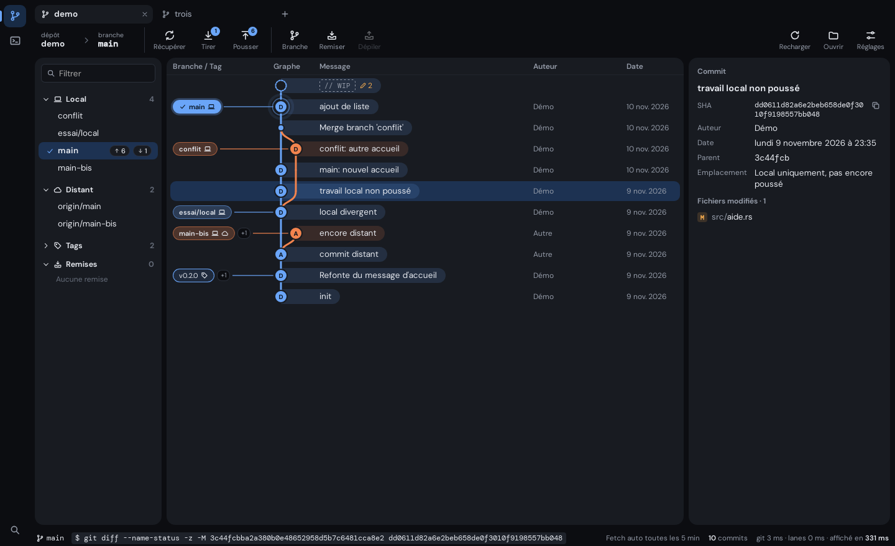
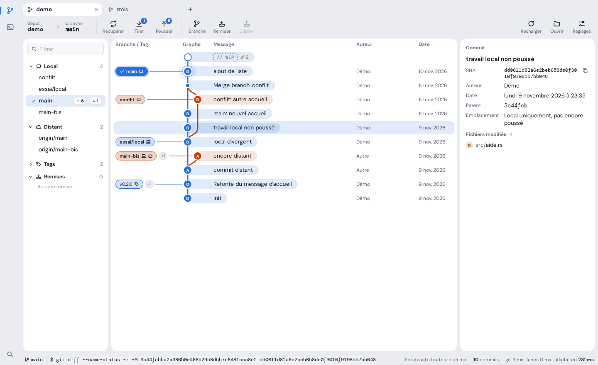

# Ramure design guidelines

The reference for Ramure's design. It sets the rules of the chosen direction, **Clairière**. How
that direction was chosen is told in [`design/directions.md`](design/directions.md).

- **Status:** version 1, under review.
- **Scope:** the whole interface, Git and SSH modules.
- **Ground rule:** when the code and the guidelines disagree, the guidelines are right. A rule
  changes in the guidelines first, through a pull request, and in the code second.

The tokens in the code follow these guidelines (issue #5) and the interface has the shape of
Clairière (issue #10). The screen-by-screen review, rule by rule, is issue #6.

The interface is in French, so the labels quoted in this document are in French.

| Dark | Light |
|---|---|
|  |  |

## Contents

1. [Principles](#1-principles)
2. [Colours](#2-colours)
3. [Typography](#3-typography)
4. [Spacing and dimensions](#4-spacing-and-dimensions)
5. [Shapes](#5-shapes)
6. [Surfaces and shadows](#6-surfaces-and-shadows)
7. [Icons](#7-icons)
8. [Motion](#8-motion)
9. [Components](#9-components)
10. [Commit graph](#10-commit-graph)
11. [Accessibility](#11-accessibility)
12. [Tone of the interface text](#12-tone-of-the-interface-text)
13. [Logo](#13-logo)
14. [Changing the guidelines](#14-changing-the-guidelines)

## 1. Principles

What the interface favours:

1. **Content first.** The graph, the diff and the terminal fill the screen. Everything else
   steps back: no decoration on working screens.
2. **Colour means something.** A bright colour stands for a branch, a state or the main action.
   Nothing else.
3. **Surfaces rather than lines.** Areas are separated by their background and by space. Lines
   are only used inside a card.
4. **One shape, one role.** A slightly rounded rectangle can be clicked. A pill or a circle
   informs.
5. **Dense and readable.** A lot of information on screen, but no text under 10.5 px and no
   target under 24 px.
6. **Calm.** A movement is brief and explains a change. Nothing moves without an action from the
   user.

What it forbids:

- a colour hard-coded in a component;
- a border or a shadow around a card;
- a coloured bar on the edge of a card or of a row, to mark a selection or a state;
- a pill for an element that can be clicked;
- an element that changes size when it is clicked, other than a button;
- a decorative gradient;
- text in all capitals;
- a looping animation, apart from the two cases of [section 8](#8-motion).

## 2. Colours

Every colour goes through a token, defined in `src/app.css`. The values below are those of the
default theme, **Ardoise**.

This holds for every token in these guidelines: colours, text sizes and weights, radii and
durations. `src/app.css` is the only file that writes those values, and `npm run check` rejects a
component that hard-codes one.

### 2.1 Tokens

| Token | Role | Light | Dark |
|---|---|---|---|
| `--side` | Window background: rail, tabs, toolbar, status bar, space between the cards. | `#eaecf1` | `#0c0d11` |
| `--panel` | Background of the cards and of the active tab. | `#ffffff` | `#181b21` |
| `--bg` | Recessed background, inside a card: input fields. | `#f6f7f9` | `#111318` |
| `--raised` | Background of buttons and of what floats: menus, dialogs, notifications. | `#ffffff` | `#20242c` |
| `--line` | Border of buttons, fields and floating elements. | `#d9dce3` | `#2b303a` |
| `--line-soft` | Discreet separator inside a card. | `#e7e9ee` | `#21252d` |
| `--ink` | Body text. | `#171a21` | `#e6e9ef` |
| `--muted` | Secondary text: captions, metadata, labels. | `#5c6370` | `#959ca9` |
| `--faint` | Hint in an empty field, disabled element, decorative marker. | `#8f95a1` | `#676e7b` |
| `--hover` | Background of a hovered element. | `#eef0f4` | `#1e222a` |
| `--sel` | Background of a selected element. | `#e1ecfb` | `#1d3252` |
| `--accent` | Main action, focus, active element, link. | `#2b6fdb` | `#6aa5f8` |
| `--accent-soft` | Accent-tinted background: hovered menu item, active module in the rail, pressed view button of the toolbar, row of a shortcut being recorded. | `#e4eefc` | `#182b45` |
| `--on-accent` | Text placed on the accent or on a branch colour. | `#ffffff` | `#08131f` |
| `--ok` / `--ok-soft` | Success, added line. | `#1f7a45` / `#e2f3e8` | `#5cc48d` / `#12301f` |
| `--warn` / `--warn-soft` | Warning, pending operation. | `#8f5708` / `#fbf0dc` | `#f0a94f` / `#3a2b14` |
| `--bad` / `--bad-soft` | Error, destructive action, removed line. | `#b42318` / `#fbe5e2` | `#f2776d` / `#3a1715` |
| `--term-bg` / `--term-ink` | Background and text of the terminal. | `#fbfbfc` / `#1c1f27` | `#0b0c10` / `#d5dae3` |
| `--scrim` | Veil behind a dialog. | `rgb(18 22 30 / 0.32)` | `rgb(0 0 0 / 0.55)` |

### 2.2 Branch colours

Eight colours, reserved for the graph. A branch takes the colour of its column: column 0 for
`--l0`, column 1 for `--l1`, and so on, starting again at `--l0` after `--l7`.

| Token | Light | Dark |
|---|---|---|
| `--l0` | `#2b6fdb` | `#6aa5f8` |
| `--l1` | `#c2410c` | `#f2844e` |
| `--l2` | `#1b7f53` | `#55c68b` |
| `--l3` | `#8447c7` | `#b98aeb` |
| `--l4` | `#8a6500` | `#e8be45` |
| `--l5` | `#c33a6f` | `#ee79a2` |
| `--l6` | `#0f808a` | `#3fc4cc` |
| `--l7` | `#5d6b17` | `#b0c25a` |

- `--l0` is the accent colour: the first column and the accent echo each other.
- Outside the graph, these colours are only used for a marker chosen by the user, such as the
  colour of an SSH host, and for the preview of the graph in the settings (9.19).

### 2.3 Rules of use

- No colour is hard-coded in a component. An intermediate shade is made with `color-mix()`
  between two tokens.
- **The accent** stands for one thing at a time: the main button of a view or of a dialog, the
  focus, the active element. Never two main buttons side by side.
- **State colours** (`--ok`, `--warn`, `--bad`) only say the state. They do not decorate.
- **`--faint`** never carries information that is needed: its contrast is too low for text that
  has to be read.
- A state-tinted background uses the `-soft` token, or 13 to 15% of the colour over the
  background.

### 2.4 Minimum contrasts

Every theme must meet them, in light and in dark.

| Pair | Minimum |
|---|---|
| `--ink` on `--panel`, `--bg`, `--sel`, `--hover` | 7:1 |
| `--ink` in a message capsule or a branch label, at rest and on hover | 7:1 |
| `--muted` on `--panel`, `--side`, `--sel` | 4.5:1 |
| `--on-accent` on `--accent`, `--bad` and each branch colour, at rest and on hover | 4.5:1 |
| `--ok`, `--warn`, `--bad` on `--panel` and `--bg` | 4.5:1 |
| `--accent` and each branch colour on `--panel` | 3:1 |

### 2.5 Colour themes

- Light or dark is a setting: "Système" (the default) follows the system, "Clair" and "Sombre"
  hold one whatever the system says. The choice applies at once, to the whole window.
- A colour theme redefines the tokens of sections 2.1 and 2.2, in light and in dark, and nothing
  else: no shape, no font, no size, no shadow. It does not change the colours of the logo either
  (section 13).
- Four themes: Ardoise (the default), Encre, Sous-bois and Braise. They are chosen under
  "Couleurs" in the settings, and the choice applies at once. Their values are in `src/app.css`,
  selected by the `data-palette` attribute: on the root for the whole window, on an element for
  a preview.
- A theme enters the application only if it meets the contrasts of section 2.4, in light and in
  dark. `npm run check` computes them for every theme, branch labels and capsules included.
- In the settings, "Thème" is the choice of light or dark, and "Couleurs" the choice of the
  colour theme. The interface keeps these two words.
- Worth knowing: in Sous-bois the accent is also the colour of success, and in Braise it is close
  to the warning colour. It is an exception to section 2.3, accepted for these two optional
  themes and said in the help text of their tile. Ardoise, the default, has neither flaw.

## 3. Typography

### 3.1 Fonts

| Use | Font | Token |
|---|---|---|
| Interface | DM Sans (variable) | `--f-ui` |
| Code | DM Mono | `--f-mono` |

- Both fonts are embedded in the application. No font is loaded from the network.
- **The code font** is for what gets copied or typed in a terminal: SHAs, git commands, file
  content (diff, conflict editor), the terminal, the name of the current branch in the toolbar.
- In a list of files, the path is in the interface font: the folder in `--muted`, the file name
  in `--ink`.
- DM Mono stops at weight 500. Emphasised code text is rendered at 500; the browser does not
  synthesise a fake bold.

### 3.2 Sizes

| Token | Size | Use |
|---|---|---|
| `--fs-micro` | 10.5 px | Counters, badges, shortcut keys. |
| `--fs-small` | 11.5 px | Captions, toolbar labels, status bar, graph labels, metadata. |
| `--fs-label` | 12 px | Field labels, column headers, section titles, secondary columns of a list (author, date). |
| `--fs-body` | 13.5 px | Text, list rows, buttons, menus. |
| `--fs-title` | 15 px | Title of a dialog, of a panel or of a section of the settings page, input of the command palette. |
| `--fs-display` | 24 px | Start page only. |
| `--fs-code` | 12 px | Diff, conflict editor, SHAs. |
| `--fs-term` | 13 px | Terminal: a whole number, so that the character grid stays sharp. |

- No other size. No text under 10.5 px.
- Line height: 1.35 for the interface.

### 3.3 Weights

Two weights, no more.

| Token | Weight | Use |
|---|---|---|
| `--fw-regular` | 400 | Body text. |
| `--fw-strong` | 650 | Titles, labels, main button, current element (active tab, current branch), label of a local branch. |

### 3.4 Rules

- A capital at the start of a sentence, and that is all: no title in capitals, no spaced
  capitals.
- Numbers that line up or that change (counters, dates, columns) use tabular figures
  (`font-variant-numeric: tabular-nums`).
- Text that is too long is cut on the right with an ellipsis, and its full value appears in a
  tooltip. The title of a notification is the one exception (section 9.11).

## 4. Spacing and dimensions

### 4.1 Scale

Margins and gaps take their values from this scale: **2, 4, 6, 8, 10, 12, 16, 20, 24 px**.

| Gap | Value |
|---|---|
| Between two cards, and between the cards and the edge of the window | 8 px |
| Inner margin of a card | 12 px |
| Between an icon and its text | 6 px |
| Between two buttons | 8 px |
| Between a label and its field | 6 px |
| Between two fields of a form | 12 px |

### 4.2 Screen structure

From left to right and from top to bottom:

| Area | Dimension | Background |
|---|---|---|
| Module rail (Git, SSH); at its foot, the search and the settings | 48 px wide | `--side` |
| Tab bar | tabs 30 px high | `--side` |
| Toolbar | full width | `--side` |
| Three cards: sidebar, centre, detail | 8 px apart; the two side cards can be resized (9.16) and hidden (9.17) | `--panel` |
| Status bar | 26 px high | `--side` |

- No line separates these areas: the background and the space are enough.
- The window is at least 1000 × 600 px; no area may overflow at that size.
- When a side card is hidden, the gap of its handle goes with it: the centre card sits 8 px from
  the edge of the window.
- The settings page takes the place of the module, to the right of the rail (9.18).

### 4.3 Heights

| Element | Height |
|---|---|
| Graph row | 34 px |
| Sidebar row | 28 px |
| Row of a file list | 24 px |
| Button | 30 px; 24 px for a small button |
| Field | 32 px |
| Branch label | 22 px |
| Clickable target, at least | 24 × 24 px |

## 5. Shapes

| Token | Radius | For |
|---|---|---|
| `--radius-xs` | 4 px | Small markers: shortcut key, file status letter, highlight inside a diff line; the 15 px checkbox. |
| `--radius-s` | 6 px | What can be clicked: buttons, fields, branch and tag labels, menu items. |
| `--radius` | 8 px | Selectable rows, tabs, notifications, rail buttons. |
| `--radius-l` | 12 px | What floats: dialogs, menus, command palette. |
| `--radius-card` | 14 px | Cards. |
| `--radius-pill` | 999 px | What informs: counters, the capsule of a commit message. |

- **Everything that can be clicked is a slightly rounded rectangle.** The pill is reserved for
  what informs without being clicked.
- The circle is reserved for the dot of a commit, the badge of a toolbar button, the icon of a
  notification and the waiting ring.
- An element placed inside another never has a larger radius than the one that contains it.

## 6. Surfaces and shadows

The interface has four levels. Each is recognised by its background.

| Level | Element | Background | Border | Shadow |
|---|---|---|---|---|
| 0 | Window | `--side` | none | none |
| 1 | Card | `--panel` | none | none |
| 2 | Button, field (inside a card) | `--raised`, `--bg` | 1 px `--line` | `--shadow-soft` for a button |
| 3 | Menu, dialog, notification, palette | `--raised` | 1 px `--line` | `--shadow-pop` |

| Token | Light | Dark |
|---|---|---|
| `--shadow-soft` | `0 1px 2px rgb(18 22 30 / 0.06)` | `0 1px 2px rgb(0 0 0 / 0.3)` |
| `--shadow-pop` | `0 18px 44px -14px rgb(18 22 30 / 0.3), 0 2px 6px rgb(18 22 30 / 0.08)` | `0 22px 50px -14px rgb(0 0 0 / 0.7), 0 2px 8px rgb(0 0 0 / 0.4)` |

- A shadow says "this floats". A card never has one.
- No card inside a card. Inside a card, things are separated by space or by a `--line-soft`
  line.
- Shadows are neutral: they do not take the tint of the theme.
- A dialog sits on the `--scrim` veil, with a 2 px blur.

## 7. Icons

- One set only, the application's own (`src/lib/ui/Icon.svelte`). No emoji, no icon from
  another library.
- Drawing: a 16 × 16 grid, a 1.4 stroke with no fill, rounded ends and corners, the colour of
  the text (`currentColor`).

| Size | Use |
|---|---|
| 14 px | In a label, a counter or a dense row. |
| 16 px | By default: menus, buttons, lists. |
| 18 px | Toolbar and rail. |

- One notion, one icon, everywhere: the computer for "local", the cloud for "remote", the tag
  for a tag.
- A button made of an icon alone has a tooltip and an accessible name (`aria-label`). An icon
  that accompanies text is hidden from screen readers (`aria-hidden`).
- An icon never carries a state on its own: it is backed by text or by a tooltip.

## 8. Motion

| Token | Value | Use |
|---|---|---|
| `--ease` | `cubic-bezier(0.2, 0.8, 0.2, 1)` | The only curve in the application. Only a continuous rotation or a continuous sweep is linear. |
| `--t-fast` | 110 ms | Hover, press, focus, colour change, disappearance. |
| `--t-med` | 200 ms | Appearance of a menu or a dialog, folding of a section. |
| `--t-slow` | 340 ms | Long move: the rail marker, reordering of a list. |
| `--t-step` | 14 ms | Delay between two elements of a staggered entrance. |
| `--t-spin` | 800 ms | One turn of the loading indicator. |
| `--t-wait` | 1.1 s | One cycle of a waiting bar or dot. |
| `--t-halo` | 2.4 s | One cycle of the halo of the current commit. |

Transitions written in script read the same tokens, through `src/lib/ui/motion.ts`.

**What is animated.** Opacity, position (`transform`) and colours. An appearance comes from
close by: an offset of 6 to 10 px at most.

**The press effect.** A button shrinks to 97% while it is clicked. This applies to buttons,
toolbar buttons and rail buttons, and to nothing else.

**What is not animated.**

- Branch and tag labels, list rows, tabs and menu items never change size, neither on click nor
  on hover.
- The scrolling of the graph, of the diff and of the terminal.
- The move of the selection from the keyboard: it is immediate.
- The width of a card that is hidden or shown: the graph would be laid out again at every frame.
- The text of a diff or of a terminal.

**The only two loops.** The waiting indicator, for as long as the operation or the wait lasts: a
spinning icon, a spinning ring, a bar, a blinking dot. The halo of the current commit in the
graph: a ring that widens and fades, in 2.4 s.

The waiting ring is 12 px, in `--accent` or in the colour of the text around it, and it appears
where the user asked for the operation: on the tab of the repository, on the label or the row of
the branch being switched to, in the status bar. It is the shared class `.spinner` of
`src/app.css`, whose `--spinner` property gives it another colour. Words always say the state
beside it, so the ring itself is hidden from screen readers.

**When a repository is opened** or after a full reload, the rows of the graph come in one after
the other, once. Never on scroll.

**Reduced motion.** When the system asks for less animation (`prefers-reduced-motion`),
durations drop to 1 ms and loops stop. No information may depend on an animation.

## 9. Components

States are the same everywhere:

| State | Rendering |
|---|---|
| Hover | `--hover` background, in `--t-fast`. |
| Keyboard focus | A 2 px outline in `--accent`, offset by 1 px. See the exceptions for fields and lists. |
| Selection | `--sel` background. |
| Disabled | 45% opacity, "not allowed" cursor, no reaction on hover. |

### 9.1 Buttons

| Variant | Rendering | Use |
|---|---|---|
| Standard | `--raised` background, `--line` border, `--shadow-soft` shadow. | Ordinary action. |
| Primary | `--accent` background, `--on-accent` text, weight 650. | The expected action. Only one per view or per dialog. |
| Danger | `--bad` background, `--on-accent` text, weight 650. | Confirming a destructive action, in a dialog. |
| Ghost | No background and no border at rest. | Secondary action, in a header or a row. |
| Small | 24 px high, 12 px text. | In a card header or a row. |

- 6 px corners. Inner margins: 5 px at the top and bottom, 12 px on the sides.
- Hover: `--hover` background and a stronger border. A primary or danger button moves 10%
  towards `--ink`, darker in light and lighter in dark, like the label of the current branch
  (9.4): its text gains contrast in both themes, where a lighter background lost it.
- Every button is at least 24 px high, the small one included, and a button made of an icon
  alone is at least 24 × 24 px.
- Press: shrinks to 97%.
- The label is a verb in the infinitive, with its object when the context does not give it:
  "Créer la branche" (create the branch), not "OK".
- A disabled button whose reason is not plain to see says why: a sentence in `--muted` at
  11.5 px next to it, repeated in its tooltip. If the user tries the action all the same, the
  sentence turns to `--warn` and takes the warning icon.

### 9.2 Toolbar

- Each action is an 18 px icon above an 11.5 px label, at least 58 px wide.
- At rest, no background and no border: the button sits on the window background. On hover, a
  `--hover` background and 6 px corners.
- A counter (commits to pull, to push) is a round badge in `--accent`, at the top right of the
  icon.
- During an operation, the icon spins and the button is disabled.
- The repository and the current branch are on the left, the branch in the code font. Each has
  a fixed width, 140 px and 200 px, so that the actions keep their place whatever the names. The
  two widths only yield to a narrow window, down to 70 px. The full name is always in a tooltip.
- Two view buttons close the toolbar, one at each end, each above the card it shows and hides:
  the branch list on the left, the detail panel on the right (9.17). They are an 18 px icon
  alone, in a 30 × 30 px button.
  - Pressed means that the card is shown: an `--accent-soft` background and the icon in
    `--accent`, like the active module in the rail. Released, the icon is in `--muted`.
  - The tint is not alone to say the state: the card itself is there or not, right under the
    button, the tooltip names what a click will do, and `aria-pressed` says it to screen readers.
  - Hover: a `--hover` background and the icon in `--ink`; on a pressed button, the tint gets a
    little stronger (12% of `--accent` over `--accent-soft`). Disabled, when no repository is
    open: 45%.

### 9.3 Fields

- `--bg` background, `--line` border, 6 px corners, inner margins of 6 px and 9 px.
- Hover: a stronger border.
- Focus: an `--accent` border and a 3 px halo in `--accent` at 25%. No outline on top of it.
- Error: a `--bad` border, and an 11.5 px message in `--bad` under the field.
- The label is above the field, in 12 px, weight 650, colour `--muted`. A hint inside the empty
  field never replaces the label. The hint is in `--faint`: it never reads as typed text, and it
  never carries what has to be read, which is the role of the label or of the accessible name.
- A checkbox is drawn by the application, never by the system, so that it reads the same in
  both themes. Its text follows it, 6 px away, and can be clicked too: the box and its text
  together are the target, 24 px high at least, and hovering the text is hovering the box.
  - Unchecked: a 15 px square with 4 px corners, a `--bg` background and a 1 px border in
    `--muted`.
  - Checked: the `--accent` background and border, and a check mark in `--on-accent`: the path
    of the "check" icon, drawn at 13 px with a 2 px stroke so that it reads at that size.
  - Hover: the border in `--ink`, or the accent 10% towards `--ink` when checked.
  - Focus: the focus ring of the application (11). Disabled: 45%, and its text too.
- A list is the control of the system, 32 px high like a field. Its look, closed and open, is
  the system's. It is for options that are many, or that are plain values; a few options that
  need a word of explanation are a choice (9.19).
- A filter field carries a 14 px magnifier on its left, in `--muted`; its hint names what it
  filters, and so does its accessible name.
- A unit follows the field it belongs to, 6 px away, in 12 px, `--muted`: "min".

### 9.4 Branch and tag labels

The labels of the "Branche / Tag" column of the graph. They are buttons, and have the shape of
buttons.

| Type | Rendering |
|---|---|
| Local branch | Background: 24% of the branch colour over `--panel`. Border: the same colour at 55%. `--ink` text, weight 650. "Computer" icon. |
| Current branch | Solid background in the branch colour, surrounded by a ring of the same colour. `--on-accent` text, weight 650, preceded by a check mark. |
| Remote branch | The same background as a local branch. Dashed border in the branch colour, weight 400. "Cloud" icon. |
| Tag | The same background as a local branch. Solid border in the branch colour, weight 400. "Tag" icon. |

- A rectangle with 6 px corners, 22 px high, 11.5 px text. **Never a pill.**
- Local branches, remote branches and tags share one background. The icon, the border and the
  weight tell them apart, never the tint.
- **A label never changes size**: not on click, not on hover, not when a branch is dragged onto
  it.
- Hover: the tint of the background gets stronger, 28% at most: beyond that, `--ink` falls
  under 7:1 in some dark themes. The solid background of the current branch moves 10% towards
  `--ink`, darker in light and lighter in dark, so that its text gains contrast in both themes.
- The icons of a label are 14 px.
- Drop target: a 2 px outline in `--accent`, offset by 2 px.
- A local branch and its remote branch on the same commit share one label, with both icons.
- When a commit carries several labels, the first is shown and the others are counted in a
  "+N" pill.
- Double-click: switch to the branch. Right-click: the branch menu.
- During the switch, the waiting ring takes the place of the icon of the label, centred in the
  same 14 px box.

### 9.5 Counters

- A pill on a `--sel` background, 10.5 px text in tabular figures.
- A counter informs: it cannot be clicked.

### 9.6 Rows and lists

Sidebar, file lists, graph, palette results.

- Hover: a rounded `--hover` background under the row, 8 px corners.
- Selection: the same background, in `--sel`. In the graph, it is inset 6 px from the edges of
  the card.
- **No coloured bar on the edge** to mark the selection.
- Keyboard focus: a 1.5 px inner ring in `--accent` on the selected row. **Never an outline
  around the whole list.** Focus stays on the list, which handles the arrow keys; if no row is
  selected when it receives focus, the first one becomes selected.
- The actions of a row (stage, discard) appear on hover and on focus, on the right.
- The state of a file is a letter on a tinted background (M, A, D, R), never a colour alone.
- A file that is only partly staged carries the words "en partie" after its name, in `--muted`
  at 11.5 px, in both lists.

### 9.7 Tabs

- The active tab is a small card: `--panel` background, 8 px corners, no frame and no line.
- An inactive tab is `--muted` text on the window background; on hover, a `--hover` background.
- 30 px high, at least 90 px wide. The name is cut with an ellipsis.
- The close cross is visible on the active tab, and on hover on the others.
- The "+" button follows the last tab.

### 9.8 Cards

- `--panel` background, 14 px corners, no border and no shadow.
- A card scrolls inside itself; its content never goes past its corners.
- The title of a card or of a section is in 12 px, weight 650.
- A column header is separated from the content by a `--line-soft` line.

### 9.9 Context menus

- Floating: `--raised` background, `--line` border, 12 px corners, `--shadow-pop` shadow.
  Between 220 and 380 px wide.
- An item: a 16 px icon in `--muted` in an 18 px column, then the text. 6 px corners.
- Hover and focus: `--accent-soft` background.
- A destructive action is in `--bad`, last, after a separator. Its hover is in `--bad-soft`.
- A label ends with "…" when the action opens a dialog.
- Keyboard: arrows to move, Enter to choose, Escape to close.
- Appears in `--t-fast`, from the point of the click.

### 9.10 Dialogs

- To confirm a destructive action, to enter a few values, or to offer a way through when an
  action would be refused ("Remiser et basculer"). Never for plain information: that is the role
  of a notification. Never for a setting: settings have their page (9.18).
- Floating: `--raised` background, `--line` border, 12 px corners, `--shadow-pop` shadow, 460 px
  wide at most.
- A 15 px title, weight 650: the name of the action ("Nouvelle branche", new branch).
  Explanatory text in `--muted`.
- A warning is a box on a `--warn-soft` background, with an icon.
- The buttons are at the bottom right: "Annuler" (cancel) first, the action second.
- Enter confirms, Escape cancels. A click on the veil cancels too.
- On opening, focus goes to the first field. For a destructive action, it goes to "Annuler".
- A destructive action says what will be lost, and whether it can be recovered.

### 9.11 Notifications

- At the bottom, in the centre of the window, 40 px from the edge. Five at most, stacked.
  480 px wide at most.
- Floating: `--raised` background, `--line` border, 8 px corners, `--shadow-pop` shadow.
- The state is carried by an icon in a tinted circle (success, warning, error), not by a
  coloured bar on the edge.
- A short title, then the detail. The output of git is shown as it is, in the code font at
  11.5 px.
- In the title, a word of more than 36 characters, such as the name of a branch or a path, is
  cut inside: its first 24 characters and its last 10 stay, around an ellipsis. The full title
  is in a tooltip, and it is what a screen reader reads. This is the one place where a text is
  not cut on the right. A title that is still too long runs over a second line.

- A notification may carry one action, a small button before its close button: it undoes what
  was just done ("Annuler"). A click runs the action and closes the notification.
- A notification stays for as long as the pointer or the focus is on it; its delay starts again
  when they leave. When what the action undoes was run from the keyboard, the focus goes to the
  button of the action: it is one key away.
- The close button is 24 × 24 px.

| Type | Duration |
|---|---|
| Success | 4.5 s; 9 s when it carries an action |
| Warning | 9 s |
| Error | Stays until it is closed. |

### 9.12 Command palette

- Floating, centred, 11% from the top of the window, 640 px wide at most.
- A 15 px input. Results as rows (9.6), with the shortcut of each command on the right.
- A shortcut key is drawn like a key: 10.5 px, 4 px corners, a thicker bottom edge.

### 9.13 Status bar

- 26 px high, 11.5 px text in `--muted`, on the window background.
- On the left, the branch and the last git command, in the code font. On the right, the
  timings.
- During an operation, the right side starts with the waiting ring and a few words:
  "Basculement sur main…", or "Opération en cours…".

### 9.14 Diff

- Code font, 12 px. Line numbers in `--muted`.
- Added line: a background at 14% of `--ok`, a "+" sign in `--ok`. Removed line: a background at
  13% of `--bad`, a "−" sign in `--bad`.
- The sign is always there: colour alone never says whether a line is added or removed.
- A line picked to be staged on its own has a stronger tint and its sign in bold. No coloured
  bar on its edge.
- From the keyboard, the lines behave like a list (9.6): ↑ and ↓ move from one changed line to
  the next, Home and End go to the first and to the last, with the inner ring on the line; Space
  picks the line, or lets go of it; Shift with any of these keys extends the choice; Enter
  stages what is picked, or the whole hunk when nothing is. A line of the diff is a band across
  the card: its ring has square corners.
- When only one half of a modified line is picked, the removed line or the added one, a warning
  says so under the lines: a box on a `--warn-soft` background, with the warning icon and a
  button that picks the other half. It sits under the lines so that they do not move while they
  are being picked. Two lines count as one modified line when they look alike; it holds for both
  layouts, and when lines are taken out of the index.

### 9.15 Terminal

- `--term-bg` background, `--term-ink` text, code font at 13 px.
- Terminal tabs follow the rule for tabs (9.7).

**Search.** Ctrl + Shift + F, or "Chercher dans le terminal" in the palette, opens a search bar
in the terminal of the current tab.

- The bar is a strip under the header of the session, on `--panel`, with a `--line-soft`
  separator: it pushes the terminal down and never hides its text.
- From left to right: a filter field (9.3), 240 px wide, whose hint is "Chercher dans le
  terminal"; the count of results, in 11.5 px, `--muted`, tabular figures ("3 sur 12", "Aucun
  résultat"); two buttons made of an icon alone, "Résultat précédent" and "Résultat suivant";
  two toggles, "Aa" for the case and ".*" for a regular expression, small ghost buttons that
  take an `--accent-soft` background and an `--accent` border when pressed, their text staying in
  `--ink`; and a close button.
- The search runs as the user types. Enter goes to the next result, Shift + Enter to the
  previous one, Escape closes the bar and gives the keyboard back to the terminal.
- Every result has an `--accent-soft` background; the current one has an `--accent` border too.
  Both are marked in the scroll bar of the terminal.
- A regular expression that is not valid turns the field to its error state, and the count says
  "Expression non valide".

### 9.16 Resize handle

Between two cards whose width can be set: in the view of a repository, on either side of the
centre card.

- The handle takes up the 8 px gap between the cards. At rest it cannot be seen: the window
  background already separates the cards.
- Hover: a 2 px vertical marker in `--faint`, and the resize cursor.
- During the drag and on focus: the same marker, in `--accent`. No frame around the handle.
- Keyboard: left and right arrows in steps of 16 px, Home and End for the minimum and maximum
  width, Enter for the default width.
- Double-click: the default width.
- Each card has a minimum and a maximum width, and the centre card always keeps 360 px. The
  chosen widths are restored at the next launch.
- The handle is only 8 px wide: it is the one exception to the 24 px target, and the keyboard
  makes up for it.
- A hidden card has no handle (9.17).

### 9.17 Hiding a side card

In the view of a repository, the branch list and the detail panel can each be hidden, to read
the graph on the whole width.

- Three ways, always: the view button of the toolbar (9.2), a command of the palette, and a
  shortcut, Ctrl + Shift + B for the branch list and Ctrl + Shift + E for the detail panel. A
  command of the palette hides or shows both at once.
- The tooltip of a view button names what a click does, with the shortcut: "Masquer la liste des
  branches (Ctrl + Maj + B)". Its accessible name does not change: "Liste des branches",
  "Panneau de détail".
- Hiding is immediate, and so is showing (8). The card comes back at the width it had.
- **Hiding is the user's choice: only a request to see the detail undoes it.** The detail panel
  comes back on "Voir les modifications en cours", on "Voir les fichiers" in the banner of a
  stopped operation, on a click on the "WIP" row, and on Enter or a double-click on a commit. It does not come back when the selection moves, by a click or from
  the keyboard, nor when an operation stops on its own. Nothing brings the branch list back but
  its own commands.
- The choice is shared by all the tabs and restored at the next launch, like the widths.
- What a hidden card holds is out of the tab order and out of the reach of screen readers. If
  the focus was in the card, it moves to the graph.

### 9.18 Settings page

Every setting of the application is on one page. It takes the place of the module, to the right
of the rail; the modules stay alive behind it, and an SSH session is not cut.

**Getting there and back.** The "Réglages" button at the foot of the rail, which behaves like a
module button (pressed while the page is shown); Ctrl + , ; the palette; and "Réglages" in the
toolbar of a repository, a shortcut that opens the page on its "Git" section. The same button,
the same shortcut, a module button or Escape bring back the module and the tab that were shown;
after Escape, the focus is on the "Réglages" button of the rail.

**Structure.** On `--side`, two cards 8 px apart and 8 px from the edges.

- On the left, the navigation: 220 px, not resizable. Its entries are rows (9.6), 28 px high;
  the current one is in `--sel`, weight 650. Up and down arrows move from one section to the
  next, and the section shows at once.
- On the right, the content, which scrolls on its own. Its column is 640 px wide at most and
  has an inner margin of 24 px.
- A section appears in the navigation when it holds its first setting: "Général", "Git",
  "Raccourcis clavier". No tabs at the top of the page: tabs are repositories.

**A section.** Its title in 15 px, weight 650, the one title of a section that is not in 12 px
(9.8): it heads the whole card. A note may follow it, in 11.5 px, `--muted`. On the right,
"Tout réinitialiser", a small ghost button, disabled while nothing differs from the defaults;
its tooltip then says so. Under the title, groups, each with a 12 px title, weight 650, in
`--muted`.

**A setting** is a row: its name in 13.5 px, `--ink`, a help text under it in 11.5 px,
`--muted`, and its control on the right, 240 px wide. 12 px between two rows. The name is a
noun, not a verb. The controls are those of section 9.3, and the choice (9.19): a choice sits
under the name of its setting, on the whole width of the column.

**A setting applies at once.** A list, as soon as the choice changes; a number, when the field
is left or on Enter.

- No "Enregistrer" and no "Annuler" button on the page, no main button, and no notification to
  say that a setting was saved: the control shows the state.
- "Tout réinitialiser" changes several settings at once, some of them not in view. It applies
  at once too, and a notification follows, the only one of the page: it names the section and
  offers "Annuler" for 9 s, which brings every setting of the section back.
- A value that is not valid is not applied: the field takes the error state of section 9.3,
  with its message under it.
- When applying takes time, the waiting ring (8) appears under the control, with words that say
  what is happening.

**Keyboard shortcuts** are a section. A row is the name of the action, its combination drawn as
keys (9.12), and a button that restores the default.

- A click on the combination starts recording: the row takes an `--accent-soft` background and
  says "Appuie sur les touches…", in `--ink`, weight 650; the accessible name of the button says
  that a combination is awaited. Backspace removes the shortcut, Escape cancels.
- When the new combination belonged to another action, a warning box says so under the row.
- A filter field above the list searches the names, the groups and the combinations.

### 9.19 Choice

A few options, all in view, for a setting whose options need a word of explanation or are
better seen than named: the theme, the way to pull, the style of the graph, the layout of the
diff. Nothing has to be opened to compare them.

- It is a group of radio buttons: one option is always chosen. Tab enters and leaves the group;
  the arrows move the choice, which applies at once.
- **Rows**: one option per row, its name in 13.5 px, and under it what it entails, in 11.5 px,
  `--muted`.
- **Tiles**: the options side by side, each with a preview 64 px high above its name. For what
  is seen rather than read. A tile has a `--line` border: it is a control, at the level of a
  button or a field (6), not a card, and neither is its preview.
- An option has 8 px corners and is at least 28 px high. Hover: a `--hover` background.
- The chosen option: a `--sel` background, its name in weight 650, and a check mark in
  `--accent` on its right. Never the colour alone, never a coloured bar on an edge. The place
  of the check mark is kept on the other options: an option never changes size.
- Keyboard focus: a 1.5 px inner ring in `--accent` on the chosen option, as on a row (9.6).
- A preview is drawn with the tokens, never with colours of its own. A preview of a theme
  carries `data-theme` and `data-palette`, which give it the tokens of that theme whatever the
  theme of the window.
- A tile may carry a help text under its name, in 11.5 px, `--muted`, when its options differ by
  more than their look: the colour themes say what sets each apart.
- A preview is a sketch, not the component it shows: a few bars and dots, with no text. It is
  hidden from screen readers, and the name of the option says what it is. The preview of the
  graph is the one place outside the graph where the branch colours are used (2.2).

## 10. Commit graph

### 10.1 Columns

In order: Branche / Tag (220 px), Graphe (420 px at most, 340 px in "Classique"), Message,
Auteur (150 px), Date (92 px) and SHA (66 px).

**The message comes first.** It wants 200 px. When it would get less, the other columns give
way, in this order, each only as far as needed:

1. the SHA goes (it stays in the detail panel and in the menu of the commit);
2. the name of the author goes; the "Classique" style keeps the 34 px of its initials, and
   "Ruban" already shows them on the graph;
3. the date goes;
4. "Branche / Tag" narrows, down to 164 px;
5. last, "Graphe" narrows, down to 72 px, until the message has 120 px. At the narrowest
   centre card (360 px, 9.16), the message takes what is left, 80 px at the least.

The lanes that no longer fit are cut at the right edge of "Graphe"; hiding a side card (9.17)
gives them back. A commit on a cut lane has no dot: its band starts at the edge of the column,
and the tooltip of its message adds its author.

These steps follow the room the message would really have, after the graph: a repository with
many parallel branches has a wide graph, and a card of the same width shows fewer columns.

### 10.2 Drawing

| Parameter | Value |
|---|---|
| Height of a row | 34 px |
| Width of a branch column | 24 px |
| Radius of a commit | 10 px |
| Radius of a merge commit | 5 px |
| Thickness of a line | 3 px |
| Band behind a commit | 24 px high, 15% of the branch colour |

- **A commit** is a round dot in the colour of its branch, with the initial of its author in
  `--on-accent`. A ring in the colour of the card sets it apart from the lines.
- **A merge commit** is a smaller point, with no initial.
- **Lines** are straight as long as the branch keeps its column. A change of column is a soft
  curve, with no corner.
- **The message** sits in a capsule: a background at 15% of the branch colour, rounded like a
  pill on the right, as wide as the text. A band of the same tint links it to the dot.
- **A label** is linked to its commit by a thin line in the branch colour.
- **The current commit** carries a halo (section 8), and the label of its branch is solid.
- **Changes in progress** take the first row: an empty circle, the words `// WIP` in the code
  font inside a dashed frame, and the number of changed files.

### 10.3 Rules

- The colour of a commit, of its line, of its capsule and of its label is the same.
- Hover and selection follow the rule for rows (9.6).
- The graph is not animated on scroll.
- No text on the lines, no gradient, no more than eight colours.
- The "Classique" style, offered in the settings, keeps points and more compact curves. It
  follows the same colours and the same selection rules.

## 11. Accessibility

- **Contrasts.** Those of section 2.4, checked in light and in dark.
- **Visible focus.** Every element that takes keyboard focus shows it. An outline is never
  removed without another marker replacing it.
- **Keyboard.** Every action is possible without a mouse. The tab order follows the visual
  order. Escape closes the topmost floating element.
- **Shortcuts.** A shortcut belongs to the whole application or to one module, Git or SSH. A
  combination has one role in each module: Ctrl + Shift + F fetches in the Git module and
  searches a terminal in the SSH module. In a terminal, only shortcuts with Shift, Alt or a
  function key are active: the others belong to the shell.
- **Targets.** 24 × 24 px at least.
- **Never colour alone.** A state is backed by an icon, a sign or text: "+" and "−" in a diff, a
  letter for the state of a file, an icon for local and remote.
- **Reduced motion.** See section 8.
- **Screen readers.** An icon on its own has an accessible name. An error is announced at once
  (`role="alert"`), other notifications without interrupting (`role="status"`). Menus and the
  palette declare their role.
- **Both themes.** A screen is not finished until it has been checked in light and in dark.

## 12. Tone of the interface text

The interface is written in French. These rules apply to that French text.

- **Address the user as "tu"**, in the imperative, in short sentences: "Indexe les fichiers à
  inclure dans le commit."
- **Buttons** are verbs in the infinitive: "Créer la branche", "Tout indexer". Never "OK" or
  "Oui".
- **Titles** name the action: "Nouvelle branche".
- **The name of a setting** is a noun, not a verb: "Récupération automatique", "Style du
  graphe". Its help text follows the rules above.
- **An error** says what happened, then what to do. The output of git follows, as it is. No
  "Oups", no exclamation mark, no blame.
- **A destructive action** says what will be lost, and whether it can be recovered.
- **The git commands** that are run are always shown as they are, in the status bar and in the
  command log.

Git vocabulary is translated when a French word exists and is understood. The English term is
recalled in brackets where it helps.

| Git | In the interface |
|---|---|
| fetch | Récupérer; la récupération |
| pull | Tirer; le tirage |
| push | Pousser |
| stash, stash pop | Remiser, dépiler; une remise |
| stage, unstage | Indexer, retirer |
| merge | Fusionner |
| rebase | Rebaser |
| checkout, switch | Basculer |
| remote | Distant |
| revert | Annuler (revert) |
| commit, tag, cherry-pick, reset, HEAD | Kept as they are. |

French typography:

- French quotation marks « », a curly apostrophe ’, an ellipsis as a single character …;
- a non-breaking space before ":", ";", "?" and "!";
- plurals agree: "1 commit", "10 commits";
- a short date is written "9 nov. 2026", a full date "lundi 9 novembre 2026 à 23:35".

## 13. Logo

Ramure's logo is a deer's head drawn in a single stroke. The muzzle is a commit dot; two lines
leave it, run along the head, spread apart and become the antlers. It shows a deer, and a commit
from which two branches start. How it was chosen is told in [`design/logo.md`](design/logo.md).

### 13.1 Versions

| Version | File | Use |
|---|---|---|
| Icon | [`logo/ramure-icone.svg`](logo/ramure-icone.svg) | The application: taskbar, window, start page. The symbol in white on a blue tile. |
| Icon, small sizes | [`logo/ramure-icone-petit.svg`](logo/ramure-icone-petit.svg) | The same, under 40 px. The drawing is simplified: one tine per side, a thicker stroke. |
| Logo | [`logo/ramure-logo.svg`](logo/ramure-logo.svg), [`logo/ramure-logo-sombre.svg`](logo/ramure-logo-sombre.svg) | The icon followed by the name. The "sombre" version has the name in a light colour, for a dark background. |
| Symbol | [`logo/ramure-symbole.svg`](logo/ramure-symbole.svg), [`logo/ramure-symbole-petit.svg`](logo/ramure-symbole-petit.svg) | The drawing alone, in a single colour, when the tile does not fit. |

### 13.2 Colours

| Token | Value | Role |
|---|---|---|
| `--brand` | `#2b6fdb` | The tile. |
| `--on-brand` | `#ffffff` | The symbol on the tile. |

- These two colours are fixed: they change neither in the dark theme nor with the colour theme.
  The icon is the same everywhere.
- The name is in `#171a21` on a light background, in `#e6e9ef` on a dark one.
- The symbol alone takes the colour of the text, the blue of the tile, or white. No other.

### 13.3 Construction

- **The tile** is a square whose corners are rounded by 22% of its side. The symbol is centred
  in it, with a margin of 16% of the side (12% for the simplified drawing).
- **The name** is "Ramure", in DM Sans, weight 650, with a tracking of −0.01 em. Its cap height
  is 45% of the height of the tile, and it is centred on the tile.
- **The gap** between the tile and the name is a quarter of the height of the tile.
- In the files, the name is converted to outlines: it displays without the font being installed.

### 13.4 Sizes and clear space

- The full drawing from 40 px up; the simplified drawing from 16 to 39 px; nothing under 16 px.
- The logo with the name is not used under 40 px high.
- Around the logo, a margin of at least a quarter of the height of the tile stays empty.

### 13.5 What is forbidden

- Distorting the logo, slanting it or rotating it.
- Changing the colour of the tile or of the symbol; adding a gradient, a shadow or an outline.
- Redrawing the symbol: adding or removing tines, changing the thickness of the stroke.
- Using the full drawing under 40 px.
- Placing the symbol alone on a photograph or a busy background: that is what the tile is for.
- Writing the name in another font, or changing its gap with the tile.

### 13.6 In the code

- `src/lib/ui/Logo.svelte` displays the symbol. It reads the files in `docs/logo`, which are the
  only source of the drawing.
- The icons in `src-tauri/icons` are derived from the same files by
  `scripts/generer-icones.cjs`. That script only needs to be run again if the drawing changes.

## 14. Changing the guidelines

- A rule changes through a pull request that edits this file. The code follows, in the same pull
  request or in the next one.
- Before creating a component, look for the one that already exists. If a new one is needed, it
  goes into section 9 with its states.
- A new token goes into the relevant section, with its role and its two values, then into
  `src/app.css`.
- `npm run check` rejects a colour, a text size, a weight, a radius or a duration hard-coded in
  a component.
- Every pull request that touches the interface is reviewed against these guidelines.
