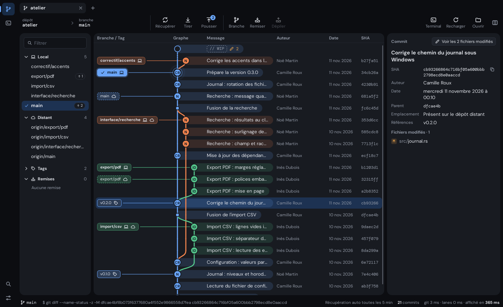
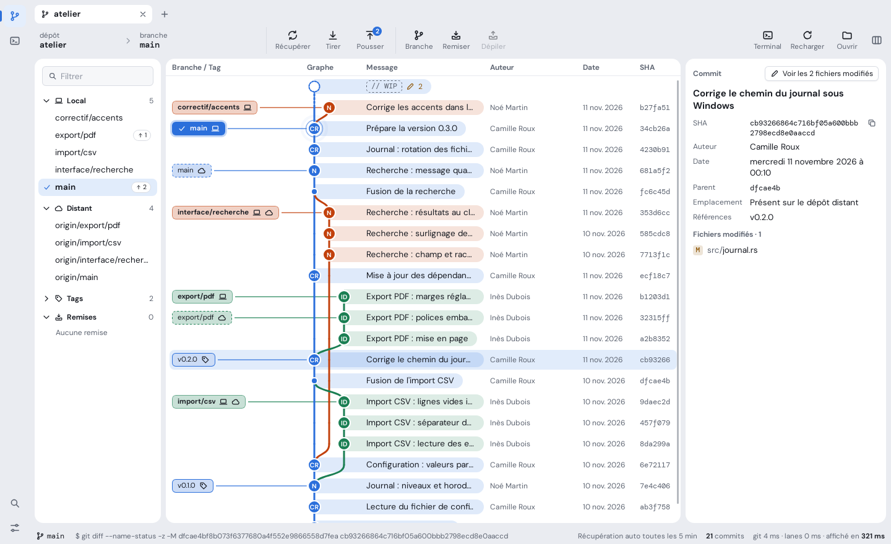
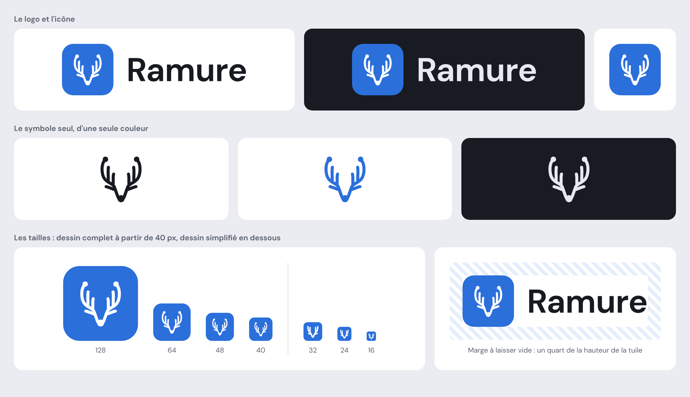

# Ramure design guidelines

The reference for Ramure's design: colours, type, spacing, shapes, motion, every component, the
tone of the interface text and the logo.

- **Scope:** the whole interface, Git and SSH modules.
- **Ground rule:** when the code and the guidelines disagree, the guidelines are right. A rule
  changes in the guidelines first, through a pull request, and in the code second
  ([section 14](#14-changing-the-guidelines)).
- **In the code:** the tokens are in `src/app.css`, and `npm run check` rejects a component that
  writes a value of its own.

The interface is in French, so the labels quoted in this document are in French.

| Dark | Light |
|---|---|
|  |  |

The two screenshots show the application as it is, on a demonstration repository.

## Contents

1. [Principles](#1-principles)
2. [Colours](#2-colours)
3. [Typography](#3-typography)
4. [Spacing and dimensions](#4-spacing-and-dimensions)
5. [Shapes](#5-shapes)
6. [Surfaces and shadows](#6-surfaces-and-shadows)
7. [Icons](#7-icons)
8. [Motion](#8-motion)
9. [Components](#9-components)
   - [9.1 Buttons](#91-buttons)
   - [9.2 Toolbar](#92-toolbar)
   - [9.3 Fields](#93-fields)
   - [9.4 Branch and tag labels](#94-branch-and-tag-labels)
   - [9.5 Counters](#95-counters)
   - [9.6 Rows and lists](#96-rows-and-lists)
   - [9.7 Tabs](#97-tabs)
   - [9.8 Cards](#98-cards)
   - [9.9 Context menus](#99-context-menus)
   - [9.10 Dialogs](#910-dialogs)
   - [9.11 Notifications](#911-notifications)
   - [9.12 Command palette](#912-command-palette)
   - [9.13 Status bar](#913-status-bar)
   - [9.14 Diff](#914-diff)
   - [9.15 Terminal](#915-terminal)
   - [9.16 Resize handle](#916-resize-handle)
   - [9.17 Showing and hiding cards](#917-showing-and-hiding-cards)
   - [9.18 Settings page](#918-settings-page)
   - [9.19 Choice](#919-choice)
   - [9.20 Terminal of a repository](#920-terminal-of-a-repository)
   - [9.21 Host form](#921-host-form)
10. [Commit graph](#10-commit-graph)
11. [Accessibility](#11-accessibility)
12. [Tone of the interface text](#12-tone-of-the-interface-text)
13. [Logo](#13-logo)
14. [Changing the guidelines](#14-changing-the-guidelines)
15. [History](#15-history)

## 1. Principles

What the interface favours:

1. **Content first.** The graph, the diff and the terminal fill the screen. Everything else
   steps back: no decoration on working screens.
2. **Colour means something.** A bright colour stands for a branch, a state or the main action,
   or for a marker that the user chose: the colour of an SSH host. Nothing else.
3. **Surfaces rather than lines.** Areas are separated by their background and by space. Lines
   are only used inside a card or a dialog.
4. **One shape, one role.** A slightly rounded rectangle can be clicked. A pill or a circle
   informs. One exception: a colour swatch, a round dot of colour that is chosen (9.21).
5. **Dense and readable.** A lot of information on screen, but no text under 10.5 px and no
   target under 24 px.
6. **Calm.** A movement is brief and explains a change. Nothing moves without an action from the
   user.

What it forbids:

- a colour hard-coded in a component;
- a border or a shadow around a card;
- a coloured bar on the edge of a card or of a row, to mark a selection or a state; the colour
  that the user gives an SSH host is the one exception (9.21): it names the host, never a state;
- a pill for an element that can be clicked;
- an element that changes size when it is clicked, other than a button;
- a decorative gradient;
- text in all capitals;
- a looping animation, apart from the two cases of [section 8](#8-motion).

## 2. Colours

Every colour goes through a token, defined in `src/app.css`. The values below are those of the
default theme, **Ardoise**.

This holds for every token in these guidelines: colours, text sizes and weights, radii and
durations. `src/app.css` is the only file that writes those values, and `npm run check` rejects a
component that hard-codes one.

### 2.1 Tokens

| Token | Role | Light | Dark |
|---|---|---|---|
| `--side` | Window background: rail, tabs, toolbar, status bar, space between the cards. | `#eaecf1` | `#0c0d11` |
| `--panel` | Background of the cards and of the active tab. | `#ffffff` | `#181b21` |
| `--bg` | Recessed background, inside a card: input fields. | `#f6f7f9` | `#111318` |
| `--raised` | Background of buttons and of what floats: menus, dialogs, notifications. | `#ffffff` | `#20242c` |
| `--line` | Border of buttons, fields and floating elements. | `#d9dce3` | `#2b303a` |
| `--line-soft` | Discreet separator inside a card. | `#e7e9ee` | `#21252d` |
| `--ink` | Body text. | `#171a21` | `#e6e9ef` |
| `--muted` | Secondary text: captions, metadata, labels. | `#5c6370` | `#959ca9` |
| `--faint` | Hint in an empty field, disabled element, decorative marker. | `#8f95a1` | `#676e7b` |
| `--hover` | Background of a hovered element. | `#eef0f4` | `#1e222a` |
| `--sel` | Background of a selected element. | `#e1ecfb` | `#1d3252` |
| `--accent` | Main action, focus, active element, link. | `#2b6fdb` | `#6aa5f8` |
| `--accent-soft` | Accent-tinted background: hovered menu item, active module in the rail, pressed "Terminal" action of the toolbar, row of a shortcut being recorded. | `#e4eefc` | `#182b45` |
| `--on-accent` | Text placed on the accent or on a branch colour. | `#ffffff` | `#08131f` |
| `--ok` / `--ok-soft` | Success, added line. | `#1f7a45` / `#e2f3e8` | `#5cc48d` / `#12301f` |
| `--warn` / `--warn-soft` | Warning, pending operation. | `#8f5708` / `#fbf0dc` | `#f0a94f` / `#3a2b14` |
| `--bad` / `--bad-soft` | Error, destructive action, removed line. | `#b42318` / `#fbe5e2` | `#f2776d` / `#3a1715` |
| `--term-bg` / `--term-ink` | Background and text of the terminal. | `#fbfbfc` / `#1c1f27` | `#0b0c10` / `#d5dae3` |
| `--scrim` | Veil behind a dialog. | `rgb(18 22 30 / 0.32)` | `rgb(0 0 0 / 0.55)` |

### 2.2 Branch colours

Eight colours, reserved for the graph. A branch takes the colour of its column: column 0 for
`--l0`, column 1 for `--l1`, and so on, starting again at `--l0` after `--l7`.

| Token | Light | Dark |
|---|---|---|
| `--l0` | `#2b6fdb` | `#6aa5f8` |
| `--l1` | `#c2410c` | `#f2844e` |
| `--l2` | `#1b7f53` | `#55c68b` |
| `--l3` | `#8447c7` | `#b98aeb` |
| `--l4` | `#8a6500` | `#e8be45` |
| `--l5` | `#c33a6f` | `#ee79a2` |
| `--l6` | `#0f808a` | `#3fc4cc` |
| `--l7` | `#5d6b17` | `#b0c25a` |

- `--l0` is the accent colour: the first column and the accent echo each other.
- Outside the graph, these colours are only used for a marker chosen by the user, such as the
  colour of an SSH host, and for the preview of the graph in the settings (9.19).

### 2.3 Rules of use

- No colour is hard-coded in a component. An intermediate shade is made with `color-mix()`
  between two tokens.
- **The accent** stands for one thing at a time: the main button of a surface (9.1,
  "Hierarchy"), the focus, the active element. Never two main buttons in one surface.
- **State colours** (`--ok`, `--warn`, `--bad`) only say the state. They do not decorate.
- **`--faint`** never carries information that is needed: its contrast is too low for text that
  has to be read.
- A state-tinted background uses the `-soft` token, or 13 to 15% of the colour over the
  background.

### 2.4 Minimum contrasts

Every theme must meet them, in light and in dark.

| Pair | Minimum |
|---|---|
| `--ink` on `--panel`, `--bg`, `--sel`, `--hover` | 7:1 |
| `--ink` in a message capsule or a branch label, at rest and on hover | 7:1 |
| `--muted` on `--panel`, `--side`, `--sel`, `--raised`, `--hover`, `--warn-soft` | 4.5:1 |
| `--on-accent` on `--accent`, `--bad` and each branch colour, at rest and on hover | 4.5:1 |
| `--ok`, `--warn`, `--bad` on `--panel`, `--bg` and `--raised` (the result of a test in a dialog) | 4.5:1 |
| `--bad` on `--bad-soft` and `--warn-soft` (ghost danger button, destructive menu item, the banner of an operation) | 4.5:1 |
| `--accent` and each branch colour on `--panel` | 3:1 |
| `--term-ink` on `--term-bg`, and on a search result of the terminal | 7:1 |
| Each terminal colour (2.6) on `--term-bg`, except black in dark and white in light | 4.5:1 |

### 2.5 Colour themes

- Light or dark is a setting: "Système" (the default) follows the system, "Clair" and "Sombre"
  hold one whatever the system says. The choice applies at once, to the whole window.
- A colour theme redefines the tokens of sections 2.1, 2.2 and 2.6, in light and in dark, and
  nothing else: no shape, no font, no size, no shadow. It does not change the colours of the logo
  either (section 13).
- Four themes: Ardoise (the default), Encre, Sous-bois and Braise. They are chosen under
  "Couleurs" in the settings, and the choice applies at once. Their values are in `src/app.css`,
  selected by the `data-palette` attribute: on the root for the whole window, on an element for
  a preview.
- A theme enters the application only if it meets the contrasts of section 2.4, in light and in
  dark. `npm run check` computes them for every theme, branch labels and capsules included.
- In the settings, "Thème" is the choice of light or dark, and "Couleurs" the choice of the
  colour theme. The interface keeps these two words.
- Worth knowing: in Sous-bois the accent is also the colour of success, and in Braise it is close
  to the warning colour. It is an exception to section 2.3, accepted for these two optional
  themes and said in the help text of their tile. Ardoise, the default, has neither flaw.

### 2.6 Terminal colours

Sixteen colours draw what a program asks for in a terminal: the eight ANSI colours (codes 30 to
37) and their bright versions (90 to 97), in text and in background. They are tokens like the
others, so they follow light and dark and the colour theme. The values below are those of
Ardoise.

| Token | Colour | Code | Light | Dark |
|---|---|---|---|---|
| `--ansi-0` | Black | 30 | `#1c1f27` | `#272a31` |
| `--ansi-1` | Red | 31 | `#ac190f` | `#e66c62` |
| `--ansi-2` | Green | 32 | `#046434` | `#38a46f` |
| `--ansi-3` | Yellow | 33 | `#7e4b02` | `#c7831f` |
| `--ansi-4` | Blue | 34 | `#0651ba` | `#5893e4` |
| `--ansi-5` | Magenta | 35 | `#7434b4` | `#ab7ddc` |
| `--ansi-6` | Cyan | 36 | `#076068` | `#09a1a8` |
| `--ansi-7` | White | 37 | `#d6dae5` | `#d5dae3` |
| `--ansi-8` | Bright black | 90 | `#3d4049` | `#91959e` |
| `--ansi-9` | Bright red | 91 | `#d33023` | `#fe9a8f` |
| `--ansi-10` | Bright green | 92 | `#138046` | `#53ca8e` |
| `--ansi-11` | Bright yellow | 93 | `#a06105` | `#f3a53b` |
| `--ansi-12` | Bright blue | 94 | `#1c6ae2` | `#85b7ff` |
| `--ansi-13` | Bright magenta | 95 | `#904bdb` | `#cea2fe` |
| `--ansi-14` | Bright cyan | 96 | `#077b85` | `#24c8d1` |
| `--ansi-15` | Bright white | 97 | `#585b65` | `#edf0f4` |

- **Every one is read on `--term-bg`**, at 4.5:1 at least, with two exceptions, which are
  backgrounds: black in dark and white in light, a shade of the terminal background. Text in
  those two colours stays readable all the same: see the safety net below.
- **Black and white swap their roles with the background.** In dark, the order from the background
  outwards is black, bright black, white, bright white. In light it is reversed: white, bright
  white, bright black, black. Bright black is the grey that programs use for what is secondary
  (a hint, a comment), so it reads in both. Bright black in dark and bright white in light stand
  at 6.5:1, well clear of the 4.5:1 to which the safety net raises black and white text: the two
  stay apart.
- **The bright version** of the six colours stands further from the background in dark (9.5:1
  against 6.2:1), and closer in light (4.8:1 against 7:1).
- **The hues come from the theme**: red is the hue of `--bad`, green that of `--ok`, yellow that
  of `--warn`; blue, magenta and cyan those of the branch colours (2.2) that come nearest. The
  greys take the hue of `--term-ink`.
- **The safety net.** Any text that would read under 4.5:1 on the background of its cell is
  lightened or darkened by the terminal until it reaches it: a text in any other colour (256
  colours, true colours), a text in black on the dark background or in white on the light one,
  and the default text on a coloured background.

## 3. Typography

### 3.1 Fonts

| Use | Font | Token |
|---|---|---|
| Interface | DM Sans (variable) | `--f-ui` |
| Code | DM Mono | `--f-mono` |

- Both fonts are embedded in the application. No font is loaded from the network.
- **The code font** is for what gets copied or typed in a terminal: SHAs, git commands, file
  content (diff, conflict editor), the terminal, the name of the current branch in the toolbar.
  The detail of a notification is in it too, whatever it says (9.11).
- In a list of files, the path is in the interface font: the folder in `--muted`, the file name
  in `--ink`.
- DM Mono stops at weight 500. Emphasised code text is rendered at 500; the browser does not
  synthesise a fake bold.

### 3.2 Sizes

| Token | Size | Use |
|---|---|---|
| `--fs-micro` | 10.5 px | Counters, badges, shortcut keys. |
| `--fs-small` | 11.5 px | Captions, toolbar labels, status bar, graph labels, metadata. |
| `--fs-label` | 12 px | Field labels, column headers, section titles, secondary columns of a list (author, date). |
| `--fs-body` | 13.5 px | Text, list rows, buttons, menus. |
| `--fs-title` | 15 px | Title of a dialog, of a panel or of a section of the settings page, input of the command palette. |
| `--fs-display` | 24 px | Start page only. |
| `--fs-code` | 12 px | Diff, conflict editor, SHAs. |
| `--fs-term` | 13 px | Terminal: a whole number, so that the character grid stays sharp. |

- No other size. No text under 10.5 px.
- Line height: 1.35 for the interface.

### 3.3 Weights

Two weights, no more.

| Token | Weight | Use |
|---|---|---|
| `--fw-regular` | 400 | Body text. |
| `--fw-strong` | 650 | Titles, labels, main button, current element (active tab, current branch), label of a local branch. |

### 3.4 Rules

- A capital at the start of a sentence, and that is all: no title in capitals, no spaced
  capitals.
- Numbers that line up or that change (counters, dates, columns) use tabular figures
  (`font-variant-numeric: tabular-nums`).
- Text that is too long is cut on the right with an ellipsis, and its full value appears in a
  tooltip. The title of a notification is the one exception (section 9.11).

## 4. Spacing and dimensions

### 4.1 Scale

Margins and gaps take their values from this scale: **2, 4, 6, 8, 10, 12, 16, 20, 24 px**.

| Gap | Value |
|---|---|
| Between two cards, and between the cards and the edge of the window | 8 px |
| Inner margin of a card | 12 px |
| Between an icon and its text | 6 px |
| Between two buttons | 8 px |
| Between a label and its field | 6 px |
| Between two fields of a form | 12 px |

### 4.2 Screen structure

From left to right and from top to bottom:

| Area | Dimension | Background |
|---|---|---|
| Module rail (Git, SSH); at its foot, the search and the settings | 48 px wide | `--side` |
| Tab bar | tabs 30 px high | `--side` |
| Toolbar | full width | `--side` |
| The cards of a repository: the branch list, the centre, the detail panel. The centre holds the graph and, under it, the terminal of the repository when it is shown (9.20) | 8 px apart; the two side cards can be resized (9.16); each card can be hidden (9.17) | `--panel` |
| Status bar | 26 px high | `--side` |

- No line separates these areas: the background and the space are enough.
- The window is at least 1000 × 600 px; no area may overflow at that size.
- When a side card is hidden, the gap of its handle goes with it: the centre card sits 8 px from
  the edge of the window.
- The settings page takes the place of the module, to the right of the rail (9.18).

### 4.3 Heights

| Element | Height |
|---|---|
| Graph row | 34 px |
| Sidebar row | 28 px |
| Row of a file list | 24 px |
| Button | 30 px; 24 px for a small button |
| Field | 32 px |
| Branch label | 22 px |
| Clickable target, at least | 24 × 24 px |

## 5. Shapes

| Token | Radius | For |
|---|---|---|
| `--radius-xs` | 4 px | Small markers: shortcut key, file status letter, highlight inside a diff line; the 15 px checkbox. |
| `--radius-s` | 6 px | What can be clicked: buttons, fields, branch and tag labels, menu items. |
| `--radius` | 8 px | Selectable rows, tabs, notifications, rail buttons. |
| `--radius-l` | 12 px | What floats: dialogs, menus, command palette. |
| `--radius-card` | 14 px | Cards. |
| `--radius-pill` | 999 px | What informs: counters, the capsule of a commit message. |

- **Everything that can be clicked is a slightly rounded rectangle**, except a colour swatch
  (below). The pill is reserved for what informs without being clicked.
- The circle is reserved for the dot of a commit, the badge of a toolbar button, the icon of a
  notification, the waiting ring, and the colour swatches of a choice of colour (the colour of
  an SSH host). A swatch is a dot of colour that can be clicked: it is round, and it is the one
  element that grows on hover (8).
- An element placed inside another never has a larger radius than the one that contains it.

## 6. Surfaces and shadows

The interface has four levels. Each is recognised by its background.

| Level | Element | Background | Border | Shadow |
|---|---|---|---|---|
| 0 | Window | `--side` | none | none |
| 1 | Card | `--panel` | none | none |
| 2 | Button, field (inside a card) | `--raised`, `--bg` | 1 px `--line` | `--shadow-soft` for a button |
| 3 | Menu, dialog, notification, palette | `--raised` | 1 px `--line` | `--shadow-pop` |

| Token | Light | Dark |
|---|---|---|
| `--shadow-soft` | `0 1px 2px rgb(18 22 30 / 0.06)` | `0 1px 2px rgb(0 0 0 / 0.3)` |
| `--shadow-pop` | `0 18px 44px -14px rgb(18 22 30 / 0.3), 0 2px 6px rgb(18 22 30 / 0.08)` | `0 22px 50px -14px rgb(0 0 0 / 0.7), 0 2px 8px rgb(0 0 0 / 0.4)` |

- A shadow says "this floats". A card never has one.
- No card inside a card. Inside a card, things are separated by space or by a `--line-soft`
  line; inside a dialog, by space or by a `--line` line, since `--line-soft` does not show on
  `--raised` in dark (9.6).
- Shadows are neutral: they do not take the tint of the theme.
- A dialog sits on the `--scrim` veil, with a 2 px blur.

## 7. Icons

- One set only, the application's own (`src/lib/ui/Icon.svelte`). No emoji, no icon from
  another library.
- Drawing: a 16 × 16 grid, a 1.4 stroke with no fill, rounded ends and corners, the colour of
  the text (`currentColor`).

| Size | Use |
|---|---|
| 14 px | In a label, a counter or a dense row. |
| 16 px | By default: menus, buttons, lists. |
| 18 px | Toolbar and rail, and the icon of a banner. |
| 20 px | The large button of the start page (9.1). |

- One notion, one icon, everywhere: the computer for "local", the cloud for "remote", the tag
  for a tag, the key for an SSH key, the arrow that enters a sheet for an import and the one that
  leaves it, the same sheet turned over, for an export, the sheet with lines for the journal of a
  session. An icon that stands for a git command (pull, push, stash) is never borrowed for
  something else.
- A button made of an icon alone has a tooltip and an accessible name (`aria-label`). An icon
  that accompanies text is hidden from screen readers (`aria-hidden`).
- An icon never carries a state on its own: it is backed by text or by a tooltip.

## 8. Motion

| Token | Value | Use |
|---|---|---|
| `--ease` | `cubic-bezier(0.2, 0.8, 0.2, 1)` | The only curve in the application. Only a continuous rotation or a continuous sweep is linear. |
| `--t-fast` | 110 ms | Hover, press, focus, colour change, disappearance. |
| `--t-med` | 200 ms | Appearance of a menu or a dialog, folding of a section. |
| `--t-slow` | 340 ms | Long move: the rail marker, reordering of a list. |
| `--t-step` | 14 ms | Delay between two elements of a staggered entrance. |
| `--t-spin` | 800 ms | One turn of the loading indicator. |
| `--t-wait` | 1.1 s | One cycle of a waiting bar or dot. |
| `--t-halo` | 2.4 s | One cycle of the halo of the current commit. |

Transitions written in script read the same tokens, through `src/lib/ui/motion.ts`.

**What is animated.** Opacity, position (`transform`) and colours. An appearance comes from
close by: an offset of 6 to 10 px at most. One scale besides the press effect: a colour swatch
grows to 112% on hover, in `--t-fast` (9.21).

**The press effect.** A button shrinks to 97% while it is clicked. This applies to buttons,
toolbar buttons and rail buttons, and to nothing else. A button made of an icon alone is a
button: the cross and the "+" of a tab bar, the close button of a notification or of a header.

**What is not animated.**

- Branch and tag labels, list rows, tabs and menu items never change size, neither on click nor
  on hover.
- The scrolling of the graph, of the diff and of the terminal.
- The move of the selection from the keyboard: it is immediate.
- The width of a card that is hidden or shown: the graph would be laid out again at every frame.
- The text of a diff or of a terminal.

**The only two loops.** The waiting indicator, for as long as the operation or the wait lasts: a
spinning icon, a spinning ring, a bar, a blinking dot. The halo of the current commit in the
graph: a ring that widens and fades, in 2.4 s.

The waiting ring is 12 px, in `--accent` or in the colour of the text around it, and it appears
where the user asked for the operation: on the tab of the repository, on the label or the row of
the branch being switched to, in the status bar, on the row and the tab of a host being connected
to. It is the shared class `.spinner` of
`src/app.css`, whose `--spinner` property gives it another colour. Words always say the state
beside it, so the ring itself is hidden from screen readers. One exception: on the tab of a host
being connected to, the ring stands alone in the place of the dot, and carries the name of the
state (9.15).

**When a repository is opened** or after a full reload, the rows of the graph come in one after
the other, once. Never on scroll.

**Reduced motion.** When the system asks for less animation (`prefers-reduced-motion`),
durations drop to 1 ms and loops stop. No information may depend on an animation.

## 9. Components

States are the same everywhere:

| State | Rendering |
|---|---|
| Hover | `--hover` background, in `--t-fast`. |
| Keyboard focus | A 2 px outline in `--accent`, offset by 1 px. See the exceptions for fields, lists and menus. |
| Selection | `--sel` background. |
| Disabled | 45% opacity, "not allowed" cursor, no reaction on hover. |

### 9.1 Buttons

| Variant | Rendering | Use |
|---|---|---|
| Standard | `--raised` background, `--line` border, `--shadow-soft` shadow. | Ordinary action. |
| Primary | `--accent` background, `--on-accent` text, weight 650. | The expected action. Only one per surface (see "Hierarchy" below). |
| Danger | `--bad` background, `--on-accent` text, weight 650. | Confirming a destructive action, in a dialog. |
| Ghost | No background and no border at rest. | What comes second to something else (see "Hierarchy" below). |
| Ghost danger | A ghost button whose text is in `--bad`; on hover, a `--bad-soft` background. | Opens a destructive action that a dialog then confirms, never the action itself: "Supprimer l’hôte…". Its label ends with "…". |
| Small | 24 px high, 12 px text. | In a card header or a row. |
| Large | A standard button, 12 px inner margins: a 20 px icon in `--muted`, with no square behind it, then its label, weight 650, over a line in `--muted` at 11.5 px that says from what or where. | The actions of the start page, the only thing to do there. Never mixed with buttons of another size. |

- 6 px corners, the large button included. Inner margins: 5 px at the top and bottom, 12 px on
  the sides; 12 px all around for the large button.
- A toggle is a small ghost button that keeps a state (`aria-pressed`). Pressed: an
  `--accent-soft` background and an `--accent` border, the text staying in `--ink`.
- Hover: `--hover` background and a stronger border. A primary or danger button moves 10%
  towards `--ink`, darker in light and lighter in dark, like the label of the current branch
  (9.4): its text gains contrast in both themes, where a lighter background lost it.
- Every button is at least 24 px high, the small one included, and a button made of an icon
  alone is at least 24 × 24 px.
- Press: shrinks to 97%.
- The label is a verb in the infinitive, with its object when the context does not give it:
  "Créer la branche" (create the branch), not "OK".
- A disabled button whose reason is not plain to see says why: a sentence in `--muted` at
  11.5 px next to it, repeated in its tooltip. If the user tries the action all the same, the
  sentence turns to `--warn` and takes the warning icon.

#### Hierarchy

The weight of a button says how much it matters. From the heaviest to the lightest: primary,
standard, ghost; danger and ghost danger are the destructive pair. A button takes the lightest
level that still does its job. Elsewhere in these guidelines, "main button" means the primary,
and "secondary button" a standard one.

A **surface** is a dialog, a panel laid over a terminal, a card, a banner or a strip: what holds
its own buttons.

- **Primary.** The action the user came to the surface to do. One per surface at most; two
  surfaces in view may each have theirs. It is never destructive, and never a mere way out. A
  surface where no action is expected more than the others has no primary: "Gérer les clés…" at
  rest, where one may copy a key, import one, create one or leave, and its "Fermer" is standard.
- **Standard.** Every other action that moves forward, a second way to do the main thing
  included ("Faire confiance cette fois" beside "Faire confiance et mémoriser", "Basculer sans
  mettre à jour" beside "Basculer et rebaser"), and the way out of a dialog ("Annuler",
  "Fermer"). In the header, a row or the foot of a card, the actions of the card are small
  standard buttons ("Tout indexer", "Ajouter un hôte…").
- **Ghost.** What comes second to something else: a toggle; a button that sits beside the
  sentence or the element it acts on ("Oublier le mot de passe", the cross of a tab); the
  actions that a row shows on hover; and the way out of a panel laid over a terminal or of a
  strip ("Annuler", "Fermer l’onglet", "Arrêter"), which have no veil to leave by.
- **Danger** confirms a destructive action, in a dialog only. It takes the place of the
  primary, last on the line, and repeats the verb of the title: "Supprimer" under "Supprimer
  atelier-prod du carnet ?". **Ghost danger** is the entry that opens that dialog: "Supprimer
  l’hôte…", or "Abandonner…" in the banner of a rebase, a merge, a cherry-pick or a revert that
  has stopped, whose dialog says what is lost and that git keeps it nowhere: "Les conflits déjà
  résolus seront perdus définitivement."
- **The last line of a dialog**, from left to right: the way out, then a secondary action if
  there is one, then the primary or the danger button, last, all at the right. A destructive
  entry stands alone at the far left. Four buttons at most: what does not fit goes into the
  body, on its own line above the last one ("Tester la connexion"). When the buttons do not fit
  on one line, the first ones go up a line, 8 px apart, each line aligned to the right: the
  primary stays last, at the bottom right. A dialog that parts from this order says why in its
  section.
- **The line of a panel, a strip or a banner** reads the other way: the main button first, at
  the left, then the others, the way out last (9.15, 9.20). In the banner of an operation that
  has stopped: "Continuer", "Passer", then "Abandonner…"; "Voir les fichiers" is a small ghost
  button after the sentence it acts on, "résous-les dans le panneau des modifications".
- **Labels.** A verb in the infinitive with its object (12). A button that does two things says
  both: "Enregistrer et connecter". "…" ends the label of a button that opens a dialog or the
  file picker of the system, as in a menu (9.9): "Supprimer l’hôte…", "Ajouter un hôte…",
  "Parcourir…". A form that opens in place, inside the same dialog, is not a dialog: "Générer
  une clé". The labels of the toolbar are short words under an icon (9.2), with neither verb nor
  "…".
- **Work in progress.** A button that starts an operation says so in its own label while it runs, in
  French and with the ellipsis once ("Test en cours…", "Création…", "Clonage en cours…"), and cannot
  be clicked again. The output of git goes beside it, as it is, never into the label. When the wait
  can last, the waiting ring (8) or a progress bar next to it shows it.
- **Keyboard.** In a dialog, Enter triggers the primary, unless the focus is on another button,
  which Enter then presses: for a destructive action the focus starts on the way out, so Enter
  leaves. Escape and a click on the veil leave (9.10). The tab order follows the visual order. A
  shortcut, when there is one, is in the tooltip: "Ctrl + Entrée".
- **The button just pressed does not move.** What it produces, a result, an error, a question, a
  progress, appears below it, or on the left of the last line of a dialog, the buttons staying at
  the top of that line (9.15, "Keys"), or in a place kept for it beforehand and as high as its
  usual size, and pushes down only what is under it; nothing above the button moves. On a line
  aligned to the right, the primary keeps its right edge: a label that changes while it works
  ("Clonage en cours…") may shift what stands to its left. A dialog is anchored at the top of the
  window for that reason (9.10). A form that opens in a dialog, as a new step, may push the last
  line down as it opens.
- **Toolbar.** No primary: every action has the same weight, icon above label (9.2), and the
  pressed state is its only emphasis.

### 9.2 Toolbar

- Each action is an 18 px icon above an 11.5 px label, at least 58 px wide.
- At rest, no background and no border: the button sits on the window background. On hover, a
  `--hover` background and 6 px corners.
- A counter (commits to pull, to push) is a round badge in `--accent`, at the top right of the
  icon.
- During an operation, the icon spins and the button is disabled.
- The repository and the current branch are on the left, at the edge of the toolbar, above the
  left edge of the cards; the branch in the code font. Each has a fixed width, 140 px and
  200 px, so that the actions keep their place whatever the names. The two widths only yield to
  a narrow window, down to 70 px. The full name is always in a tooltip.
- In the group on the right, before "Recharger", the "Terminal" action shows and hides the
  terminal of the repository (9.20). It is an action like the others, icon and label, and it is
  pressed while the terminal is shown, with the tint of the active module in the rail: an
  `--accent-soft` background, the icon in `--accent`, `aria-pressed`. On hover the tint gets a
  little stronger (12% of `--accent` over `--accent-soft`). While the terminal is hidden with
  shells still running, the badge of the action counts them.
- One view button closes the toolbar, on the right, above the right edge of the cards:
  "Affichage". It is an 18 px icon alone, in a 30 × 30 px button, and it opens the menu of the
  cards to show (9.17).
  - At rest, the icon is in `--muted`. On hover, and for as long as its menu is open: a `--hover`
    background and the icon in `--ink`. It has no pressed state: the menu says what is shown.
  - Its accessible name is "Affichage" and its tooltip "Choisir les cartes à afficher"; the
    tooltip keeps quiet while the menu is open, where it would cover the first item.
    `aria-haspopup` says that it opens a menu, `aria-expanded` whether the menu is open.
  - Disabled, at 45%, when no repository is open, and while the editor of a conflict covers the
    cards.

### 9.3 Fields

- `--bg` background, `--line` border, 6 px corners, inner margins of 6 px and 9 px.
- Hover: a stronger border.
- Focus: an `--accent` border and a 3 px halo in `--accent` at 25%. No outline on top of it.
- Error: a `--bad` border, and an 11.5 px message in `--bad` under the field.
- The label is above the field, in 12 px, weight 650, colour `--muted`. A hint inside the empty
  field never replaces the label. The hint is in `--faint`: it never reads as typed text, and it
  never carries what has to be read, which is the role of the label or of the accessible name.
- A checkbox is drawn by the application, never by the system, so that it reads the same in
  both themes. Its text follows it, 6 px away, and can be clicked too: the box and its text
  together are the target, 24 px high at least, and hovering the text is hovering the box.
  - Unchecked: a 15 px square with 4 px corners, a `--bg` background and a 1 px border in
    `--muted`.
  - Checked: the `--accent` background and border, and a check mark in `--on-accent`: the path
    of the "check" icon, drawn at 13 px with a 2 px stroke so that it reads at that size.
  - Partly checked, for a box that checks a whole list when only some of its rows are ("Tout
    cocher"): the same as checked, with a dash in place of the check mark, the path of the
    "minus" icon drawn the same way.
  - Hover: the border in `--ink`, or the accent 10% towards `--ink` when checked or partly
    checked.
  - Focus: the focus ring of the application (the states of section 9). Disabled: 45%, and its
    text too.
- A list is drawn by the application when it is closed, like the checkbox: the system's is
  taller than a field on Linux, and cannot be brought to 32 px without cutting its text. It is a
  field, 32 px high with its states, its value on the left, and on the right the "chevron" icon
  turned down, 14 px, in `--muted`, 9 px from the edge. The value never runs under the chevron:
  it is cut with an ellipsis. Open, its menu is the system's. A list is for options that are
  many, or that are plain values; a few options that need a word of explanation are a choice
  (9.19). In a dense row, where a choice would not fit (the action of each commit of an
  interactive rebase), a list keeps them, and the explanation of the chosen option is its
  tooltip.
- A filter field carries a 14 px magnifier on its left, in `--muted`; its hint names what it
  filters, and so does its accessible name.
- A unit follows the field it belongs to, 6 px away, in 12 px, `--muted`: "min".

### 9.4 Branch and tag labels

The labels of the "Branche / Tag" column of the graph. They are buttons, and have the shape of
buttons.

| Type | Rendering |
|---|---|
| Local branch | Background: 24% of the branch colour over `--panel`. Border: the same colour at 55%. `--ink` text, weight 650. "Computer" icon. |
| Current branch | Solid background in the branch colour, surrounded by a ring of the same colour. `--on-accent` text, weight 650, preceded by a check mark. |
| Remote branch | The same background as a local branch. Dashed border in the branch colour, weight 400. "Cloud" icon. |
| Tag | The same background as a local branch. Solid border in the branch colour, weight 400. "Tag" icon. |

- A rectangle with 6 px corners, 22 px high, 11.5 px text. **Never a pill.**
- Local branches, remote branches and tags share one background. The icon, the border and the
  weight tell them apart, never the tint.
- **A label never changes size**: not on click, not on hover, not when a branch is dragged onto
  it.
- Hover: the tint of the background gets stronger, 28% at most: beyond that, `--ink` falls
  under 7:1 in some dark themes. The solid background of the current branch moves 10% towards
  `--ink`, darker in light and lighter in dark, so that its text gains contrast in both themes.
- The icons of a label are 14 px.
- Drop target: a 2 px outline in `--accent`, offset by 2 px.
- A local branch and its remote branch on the same commit share one label, with both icons.
- When a commit carries several labels, the first is shown and the others are counted in a
  "+N" pill.
- Double-click: switch to the branch. Right-click: the branch menu.
- During the switch, the waiting ring takes the place of the icon of the label, centred in the
  same 14 px box.

### 9.5 Counters

- A pill on a `--sel` background, 10.5 px text in tabular figures.
- A counter informs: it cannot be clicked.

### 9.6 Rows and lists

Sidebar, file lists, graph, palette results, lists inside a dialog.

- Hover: a rounded `--hover` background under the row, 8 px corners.
- Selection: the same background, in `--sel`. In the graph, it is inset 6 px from the edges of
  the card.
- **No coloured bar on the edge** to mark the selection.
- Keyboard focus: a 1.5 px inner ring in `--accent` on the selected row. **Never an outline
  around the whole list.** Focus stays on the list, which handles the arrow keys; if no row is
  selected when it receives focus, the first one becomes selected.
- The actions of a row (stage, discard) appear on hover and on keyboard focus, on the right.
- A click leaves no hover behind: a row that keeps the focus of a click shows neither the hover
  background nor its actions once the pointer has left. Only the keyboard focus shows them. This
  holds for the rows that hold a button of their own: the host book, the file lists, the recent
  repositories of the start page.
- The state of a file is a letter on a tinted background (M, A, D, R), never a colour alone.
- A file that is only partly staged carries the words "en partie" after its name, in `--muted`
  at 11.5 px, in both lists.
- **A list inside a dialog** (the keys of "Gérer les clés…", the commits of an interactive
  rebase) is made of plain rows: no border and no background of their own, since a framed row
  inside a dialog would be a card in a card (6). The rows are separated by a `--line` line: on
  `--raised`, `--line-soft` does not show in dark. A form that opens under the list ("Générer une
  clé") is separated from it the same way. A row that cannot be selected takes no hover
  background. A row being dragged keeps its place in the list at half opacity, while the system
  draws it under the pointer. In the interactive rebase, a commit melded into the one above it
  (squash, fixup) is indented by 24 px, the width of the grip and its gap, and a dropped commit
  keeps its subject, struck through, in `--muted`.

### 9.7 Tabs

- The active tab is a small card: `--panel` background, 8 px corners, no frame and no line.
- An inactive tab is `--muted` text on the window background; on hover, a `--hover` background.
- 30 px high, at least 90 px wide. The name is cut with an ellipsis.
- A terminal that records its journal carries the "journal" icon, 14 px in `--muted`, between its
  name and its cross, with "Journal en cours d’enregistrement" as tooltip and accessible name
  (9.15).
- The close cross is visible on the active tab, and on hover on the others. On hover it takes
  a `--line` background, not `--hover`: it sits on a tab that is hovered or active, where
  `--hover` would not show.
- The same goes for the cross of a row that appears on hover, such as a recent repository on the
  start page: `--line` on hover, since it sits on a hovered row.
- The "+" button follows the last tab: an icon alone, 28 × 28 px, no background at rest and
  `--hover` on hover. It stays in view when the tabs overflow. Its tooltip and its accessible
  name say what it opens, with the shortcut: "Nouveau terminal local (Ctrl + Maj + N)".
- A tab bar keeps 4 px around its tabs, so that the focus ring is never cut by its scrolling.
  The ring of a tab follows its 8 px corners.
- When the tabs overflow, the bar scrolls to the active tab, and to a tab that takes the focus,
  so that it stays whole to the left of the "+": the bar keeps 40 px of scroll room on its right,
  the width of the "+" and its margins (a derived value, not a gap of 4.1). The "+" covers the
  room on its right with the window background, a flat shadow in `--side` that no one sees as a
  shadow: no tab shows past it.

### 9.8 Cards

- `--panel` background, 14 px corners, no border and no shadow.
- A card scrolls inside itself; its content never goes past its corners.
- The title of a card or of a section is in 12 px, weight 650.
- A column header is separated from the content by a `--line-soft` line.

### 9.9 Context menus

- Floating: `--raised` background, `--line` border, 12 px corners, `--shadow-pop` shadow.
  Between 220 and 380 px wide.
- An item: a 16 px icon in `--muted` in an 18 px column, then the text. 6 px corners.
- Hover and focus: `--accent-soft` background, and no outline: the background is the marker.
  Only one item shows it at a time. Hovering an item gives it the focus; once an arrow key is
  pressed, the item that has the focus shows it alone, until the pointer moves again.
- Opened with the mouse, a menu has no current item: Space and Enter do nothing until an item
  is hovered or reached, and ↓ goes to the first one, ↑ to the last. Opened from the keyboard,
  its first item has the focus.
- A destructive action is in `--bad`, last, after a separator. Its hover is in `--bad-soft`.
- A label ends with "…" when the action opens a dialog.
- Keyboard: arrows to move, Enter to choose, Escape to close.
- Appears in `--t-fast`, from the point of the click.
- A menu may also open under a button, such as "Affichage" in the toolbar (9.2): 4 px below it,
  its right edge on the right edge of the button, and it appears from that corner. Escape, or a
  click outside, closes it and gives the focus back to the button; after Escape, the button
  shows its focus ring.
- An item may recall the shortcut of its action, on its right, drawn as keys (9.12).
- A checkable item (`menuitemcheckbox`) shows or hides something. Its check mark is on the
  right, after the shortcut, 16 px, in `--accent`; its place is kept when the item is unchecked,
  as in a choice (9.19). Choosing it applies at once and leaves the menu open, to change several
  in a row; Space and Enter check it. An item that cannot be unchecked is disabled, and its
  tooltip says why.

### 9.10 Dialogs

- To confirm a destructive action, to enter a few values, or to offer a way through when an
  action would be refused ("Remiser et basculer"). Never for plain information: that is the role
  of a notification. Never for a setting: settings have their page (9.18).
- Floating: `--raised` background, `--line` border, 12 px corners, `--shadow-pop` shadow. 460 px
  wide at most for a confirmation or a few values; a dialog that holds a list or a longer form
  takes the width it needs, up to 760 px: the clone 560 px, the form of a host 600 px (9.21),
  "Gérer les clés…" and the export to `~/.ssh/config` 640 px, the interactive rebase 760 px.
- **Place.** Centred across the window, and anchored 11% from its top, as the command palette
  (9.12): when a dialog grows, a result or a question appearing in it, only what is below the
  change moves (9.1, "Hierarchy"). Its height stops 24 px above the bottom of the window: past
  it, its content scrolls, and its last line of buttons stays in view.
- A 15 px title, weight 650: the name of the action ("Nouvelle branche", new branch).
  Explanatory text in `--muted`.
- A warning is a box on a `--warn-soft` background, with an icon.
- The buttons are on the last line, in the order of 9.1 ("Hierarchy"): "Annuler" (cancel), then
  the action, at the right.
- Enter triggers the main button; for a destructive action the focus is on "Annuler", and Enter
  cancels. Escape cancels. A click on the veil cancels too, when it is pressed and released on
  the veil, not at the end of a drag that started in the dialog; except while an operation runs
  in the dialog, a clone for instance: a stray click must not stop it, Escape and the button do.
  What was typed in the dialog is lost, without a question.
- On opening, focus goes to the first field. For a destructive action, it goes to "Annuler".
- A destructive action says what will be lost, and whether it can be recovered.

### 9.11 Notifications

- At the bottom, in the centre of the window, 40 px from the edge. Five at most, stacked.
  480 px wide at most.
- **Never for an action done in a dialog.** A modal dialog lays its veil over the notifications
  and makes them unreachable: a click on one falls on the veil and closes the dialog. The dialog
  says the result itself, in its body or on the left of its last line (9.15, "Keys"; 9.21). One
  exception: a dialog that closes once its action is done, to offer undoing it (the export to
  `~/.ssh/config`, 9.15).
- Floating: `--raised` background, `--line` border, 8 px corners, `--shadow-pop` shadow.
- The state is carried by an icon in a tinted circle (success, warning, error), not by a
  coloured bar on the edge.
- A short title, then the detail, in the code font at 11.5 px whatever it says: the output of
  git as it is, a path, or the reason of a failure with what to do.
- In the title, a word of more than 36 characters, such as the name of a branch or a path, is
  cut inside: its first 24 characters and its last 10 stay, around an ellipsis. The full title
  is in a tooltip, and it is what a screen reader reads. This is the one place where a text is
  not cut on the right. A title that is still too long runs over a second line.
- A notification may carry one action, a small button before its close button: it undoes what
  was just done ("Annuler"). A click runs the action and closes the notification.
- A notification stays for as long as the pointer or the focus is on it; its delay starts again
  when they leave. When what the action undoes was run from the keyboard, the focus goes to the
  button of the action: it is one key away.
- The close button is 24 × 24 px.

| Type | Duration |
|---|---|
| Success | 4.5 s; 9 s when it carries an action |
| Warning | 9 s |
| Error | Stays until it is closed. |

### 9.12 Command palette

- Floating, centred, 11% from the top of the window, 640 px wide at most.
- A 15 px input. Results as rows (9.6), with the shortcut of each command on the right.
- A shortcut key is drawn like a key: 10.5 px, 4 px corners, a thicker bottom edge.

### 9.13 Status bar

- 26 px high, 11.5 px text in `--muted`, on the window background.
- On the left, the branch and the last git command, in the code font. On the right, the
  timings.
- During an operation, the right side starts with the waiting ring and a few words:
  "Basculement sur main…", or "Opération en cours…".

### 9.14 Diff

- Code font, 12 px. Line numbers in `--muted`.
- Added line: a background at 14% of `--ok`, a "+" sign in `--ok`. Removed line: a background at
  13% of `--bad`, a "−" sign in `--bad`.
- The sign is always there: colour alone never says whether a line is added or removed.
- A line picked to be staged on its own has a stronger tint and its sign in bold. No coloured
  bar on its edge.
- From the keyboard, the lines behave like a list (9.6): ↑ and ↓ move from one changed line to
  the next, Home and End go to the first and to the last, with the inner ring on the line; Space
  picks the line, or lets go of it; Shift with any of these keys extends the choice; Enter
  stages what is picked, or the whole hunk when nothing is. A line of the diff is a band across
  the card: its ring has square corners.
- When only one half of a modified line is picked, the removed line or the added one, a warning
  says so under the lines: a box on a `--warn-soft` background, with the warning icon and a
  button that picks the other half. It sits under the lines so that they do not move while they
  are being picked. Two lines count as one modified line when they look alike; it holds for both
  layouts, and when lines are taken out of the index.

### 9.15 Terminal

- `--term-bg` background, `--term-ink` text, code font at 13 px.
- The colours a program asks for are those of section 2.6: they change with light and dark and
  with the colour theme, at once, in the open terminals too.
- Terminal tabs follow the rule for tabs (9.7).

**A local terminal.** The shell of the user on their own machine (PowerShell on Windows, the
`SHELL` of the user on Ubuntu), in their home folder. It is a tab of the SSH module, with the same
terminal, colours, search and resizing as a session. A repository has local terminals of its
own, under its graph (9.20).

- Opened by Ctrl + Shift + N or "Nouveau terminal local" in the palette, from either module (the
  SSH module is then shown); by the "+" after the last tab (9.7); and from the empty screen of the
  module, by "Ouvrir un terminal local", next to "Ajouter un hôte…".
- Its tab carries the "computer" icon instead of the dot of a host (7: the computer means
  "local"), and its tooltip and accessible name say "Terminal local". Its title is "Terminal",
  then "Terminal 2", "Terminal 3", the smallest free number.
- Its header has the same height as that of a session: the computer icon, "Terminal local" in
  weight 650, the name of the shell in the code font and `--muted`, and "ouvert dans" with its
  starting folder. No "Déconnecter": the cross of the tab closes it.
- A shell that is left closes its tab: `exit` or Ctrl + D, whatever the exit code, which is only
  that of the last command. The tab stays when the shell cannot start, is stopped by a signal, or
  stops on an error before anything was typed in it: its text stays under the veil, and the
  panel says "Shell arrêté", the exit code, the signal or the reason, what to do, and offers
  "Relancer" (main button) and "Fermer l’onglet". A signal is named as the system names it
  ("Killed"), like the output of git. A local terminal is never "reconnected": it is
  started again.
- Closing the tab of a local terminal stops its shell, and the program that runs in it. When a
  program runs there, other than the shell, a dialog asks first (9.10): "Fermer ce terminal ?",
  "Un programme tourne dans ce terminal. Il sera arrêté et sa sortie perdue.", with "Annuler",
  which has the focus, and "Fermer le terminal", a danger button. A shell waiting at its prompt
  closes without a question.
- Closing the window asks the same way when a program runs in a local terminal, here or under a
  repository (9.20): "Quitter Ramure ?", and "Quitter". The text agrees with the number of
  terminals: "Des programmes tournent dans 2 terminaux. Ils seront arrêtés et leur sortie
  perdue."
- On Windows, the application cannot tell whether a program runs. The tab of one terminal, which
  the user is looking at, closes without a question; closing the window, or the tab of a
  repository, asks as soon as a shell is open: "Un terminal est ouvert…".
- A stopped local terminal shows its icon in `--faint` on its tab, as a closed session shows a
  grey dot; its tooltip and accessible name then say "Terminal local arrêté".
- Whenever a panel appears over a terminal, connection lost or ended, shell stopped, the focus goes
  to its main button: the terminal keeps the Tab key for the shell. A panel that asks for a
  secret gives it to its field. Under a repository, where the state of the shell is a strip, the
  rule is that of 9.20.

**Search.** Ctrl + Shift + F, or "Chercher
  dans le terminal" in the palette, opens a search bar
in the terminal of the current tab.

- The bar is a strip under the header of the session, on `--panel`, with a `--line-soft`
  separator: it pushes the terminal down and never hides its text.
- From left to right: a filter field (9.3), 240 px wide, whose hint is "Chercher dans le
  terminal"; the count of results, in 11.5 px, `--muted`, tabular figures ("3 sur 12", "Aucun
  résultat"); two buttons made of an icon alone, "Résultat précédent" and "Résultat suivant";
  two toggles, "Aa" for the case and ".*" for a regular expression, small ghost buttons that
  take an `--accent-soft` background and an `--accent` border when pressed, their text staying in
  `--ink`; and a close button.
- The search runs as the user types. Enter goes to the next result, Shift + Enter to the
  previous one. Escape, from anywhere in the bar, closes it and gives the keyboard back to the
  terminal. Ctrl + Shift + F while the bar is open brings the focus back to its field.
- Every result has a background of the accent at 30% over `--term-bg`; the current one has an
  `--accent` border too. Both are marked in a thin margin on the right of the terminal.
- A regular expression that is not valid turns the field to its error state, border and halo in
  `--bad`, and the count says "Expression non valide", announced at once (`role="alert"`). In
  this bar the message stands beside the field rather than under it: the bar is one line high.

**Connecting.** The wait shows at once, where the user has just acted and where the terminal
will be. It lasts until the session is open, has failed, or asks for something (a fingerprint, a
password).

- On the row of the host in the book, the address gives way to the waiting ring (8) and
  "Connexion en cours…", in `--muted`. The row keeps its height. It follows the session, not the
  terminal: it shows on the click, before the tab has appeared.
- On the tab and in the header of the session, the ring takes the place of the dot, in the same
  place: the title does not move. The header says "connexion…" beside it. On the tab, where no
  word stands beside it, the ring carries the name of the state, "Connexion en cours", as the
  dot does.
- Over the terminal, the panel says "Connexion à deploy@serveur…", with the ring.
- When a lost connection is being opened again, the row says "Reconnexion en cours…" the same
  way; the tab and the header keep their dot, which blinks in `--warn` (below), and the header
  says "reconnexion…" during a try.
- A connection that fails says why in French when the reason is known, as below.

**An unknown server.** A server that is not in `known_hosts` stops the connection: a panel over
the terminal, "Serveur inconnu", shows its fingerprint in the code font, with "Faire confiance et
mémoriser", "Faire confiance cette fois" and "Annuler". Remembering it adds one line at the end
of `known_hosts`, as OpenSSH does, and only if the key is not there yet. If the file cannot be
written, the session opens all the same: its header says "empreinte acceptée pour cette session",
and a warning notification says "L’empreinte n’a pas pu être mémorisée", then why and what to do:
in French when the cause is known (access refused, a read-only or full disk, a folder or a file
in the way), "accès refusé. Vérifie que le fichier n’est pas en lecture seule…", otherwise the
text of the system as it is; the test of the host form says it in its result line instead (9.21).
A fingerprint that has changed blocks the connection, and names the line of `known_hosts` to look
at.

**Secrets.** A password or the passphrase of a key is asked for by a panel over the terminal: its
title says what is asked ("Mot de passe de deploy", "Phrase secrète de la clé"), a line in
`--muted` says for what, and the field is a password field, which takes the keyboard when the
panel shows.

- **Keeping it.** Under the field, a checkbox (9.3): "Retenir dans le trousseau du système". It
  is unchecked when the panel first shows, and keeps the choice of the user when the secret is
  refused and asked again. The keyring is that of the system: the Credential Manager on Windows,
  the Secret Service (GNOME Keyring, KWallet) on Ubuntu. The secret is kept only once it has
  worked.
- **Without a keyring**, nothing is offered, and a line in `--muted` says so in place of the
  checkbox: "Le trousseau du système ne répond pas : ce mot de passe sera redemandé à chaque
  connexion.", or "… cette phrase secrète sera redemandée à chaque connexion."
- **A secret that is refused** puts the field in its error state (9.3): a `--bad` border, and
  the reason under it, in 11.5 px, announced at once.
- **A secret that is kept is used without a question.** The header of the session says where it
  came from: "mot de passe du trousseau", "clé id_ed25519, phrase secrète du trousseau".
- **A kept secret that is refused is forgotten**, so that it is not offered to the server a
  second time, and the panel asks again, with the reason under the field: "Le serveur a refusé
  le mot de passe retenu. Il a été oublié."
- **What a secret belongs to.** A password belongs to an account on a server (user, address,
  port): two hosts of the book on the same account share it. Changing the user, the address or
  the port of a host never carries its password to the new account: the password of the old one
  is forgotten, unless another host uses it. A passphrase belongs to its key file, and is good
  for every host that uses that key.
- **Seeing and forgetting.** The form of a host shows what is kept for it (9.21). "Gérer les
  clés…" says, under a protected key, "Sa phrase secrète est retenue dans le trousseau du
  système.", with "Oublier la phrase secrète" under the sentence, a small ghost button whose
  accessible name names the key. Deleting a host forgets the password of its account, unless
  another host uses it, and the confirmation says so: "… ni l’un ni l’autre ne pourra être
  récupéré."
- **A secret is never shown or written**: not in the host book, not in a notification, not in
  the header. If the keyring refuses to keep one, a warning notification says "Le secret n’a pas
  pu être retenu" and why; the session stays open.

**Keys.** "Gérer les clés…" lists the keys of `~/.ssh` that have their `.pub`. They stay there:
Ramure keeps no copy of them. Its last line, at rest: "Fermer", "Importer une clé…", "Générer une
clé", all standard, since no action is expected more than the others (9.1).

- **Generating** opens a form in the dialog, under the list (9.6).
- **Importing** opens the file picker of the system, "Choisir une clé privée". The key is copied
  into `~/.ssh` under the same name, readable by its owner only, with its public key: the `.pub`
  beside it, or the one the private key carries. A PuTTY key (`.ppk`) without a passphrase is
  converted to the OpenSSH format, which `ssh` reads; one with a passphrase is refused, with the
  way to export it from PuTTYgen. Nothing is ever overwritten.
- **The result** sits on the left of the last line, before the buttons, in 11.5 px, never in a
  notification (9.11). Success: the check icon and the sentence in `--ok`, "Clé importée :
  ~/.ssh/id_portable", "Clé créée : ~/.ssh/id_ed25519_2", "Clé publique de id_portable copiée,
  à coller sur le serveur ou la forge.", announced as a status.
  Failure: the warning icon and why and what to do in `--bad`, announced at once: "C’est une clé
  publique : choisis le fichier sans « .pub ».", "Un fichier nommé « id_ed25519 » existe déjà dans
  ~/.ssh : renomme la clé avant de l’importer." The line stays until the next action. It wraps
  under itself while the buttons stay at the top of the line: they do not move (9.1). A key
  imported or generated takes its row in the list, in the order of the names: the list grows by
  one row and pushes the last line down with it, since what the action produced is that row.

**Exporting to `~/.ssh/config`.** So that a host of the book opens with `ssh <name>` too, in a
terminal or in any tool that reads that file. "Exporter vers ~/.ssh/config…", a small standard
button in the foot of the book under "Importer ~/.ssh/config", opens a dialog for every host; the
same entry in the menu of a host opens it for that host alone. It is an export done when asked,
never a synchronisation: nothing is written before the dialog has shown what will change.

- **The dialog**, "Exporter vers ~/.ssh/config", says what Ramure does: "Ramure ajoute ou met à
  jour ces hôtes. Le reste du fichier n’est pas touché, et l’ancien fichier est copié dans
  ~/.ssh/config.ramure.bak." Then a list inside a dialog (9.6), one row per host to add, to change
  or that cannot be exported: a checkbox, the name, its state in words, and under them a line in
  11.5 px. "Ajouté", with what will be written, in the code font: `deploy@10.0.0.9 · port 2222 ·
  clé ~/.ssh/id_ed25519`. "Modifié", with only what changes, in the code font: `Port 22 → 2222`.
  "Non exporté", in `--warn` with the warning icon in place of the checkbox, with why and what to
  do, in `--muted`. The hosts already up to date are not listed: a line in `--muted` under the
  list counts them, "3 hôtes sont déjà à jour dans le fichier." A detail line wraps rather than
  being cut: what changes and why are read whole. The list and the last line show once the file
  has been read, at once: their buttons never change under the pointer.
- **Checked at first**: the hosts to add. The hosts to change are not, since the file may have
  been edited by hand, and a sentence under the text says so: "Une entrée modifiée garde la
  version du fichier tant que tu ne la coches pas." Opened from the menu of a host, its row is
  checked. "Tout cocher" heads the list when it has more than one row to check. Enter on a
  checkbox exports, as Enter in a field does.
- **What is written**: only HostName, User, Port and IdentityFile, in the block `Host <name>` of
  the host, each line keeping its indentation and the spelling of its keyword; a missing line is
  added at the end of the block, and a new block before `Host *`, since for ssh the first value
  found wins. Nothing is ever deleted. A host whose name has a space or a pattern character, that
  goes through a bastion, or whose name shares its `Host` line with others, is not exported. A
  host with a password is exported without a key: the password is never written.
- **The last line**: "Annuler", then the main button, which counts what it writes, "Exporter 2
  hôtes". With nothing checked it is disabled, and the left of the line says why, as its tooltip
  does: "Coche au moins un hôte."; Enter all the same turns the sentence to `--warn` with the
  warning icon, announced. When every row is "Non exporté", the left of the line says "Aucun de
  ces hôtes ne peut être exporté." and the line has only "Fermer". An empty book says "Le carnet
  est vide : rien à exporter.". With nothing to export, the list gives way to one sentence, "Tous
  les hôtes sont déjà à jour dans ~/.ssh/config.", and the line has only "Fermer".
- **The result.** A failure is said on the left of the last line, with what to do, the dialog
  staying open (9.11); while it writes, the main button says "Export en cours…", and neither a
  click on the veil, Escape nor "Annuler" closes the dialog: a write cannot be stopped halfway,
  and lasts an instant (9.10). Once written, the dialog closes and a notification says "2 hôtes
  exportés vers ~/.ssh/config", with the copy of the old file in its detail and "Annuler", which
  puts the old file back, unless it has changed since. One host gives "vps exporté vers
  ~/.ssh/config"; a file that did not exist gives "~/.ssh/config a été créé." in the detail.
  Undoing says "~/.ssh/config est revenu comme avant l’export", or "~/.ssh/config a été retiré"
  for a file the export had created; when it cannot, an error notification says why. When the
  export was started from the keyboard, the focus goes to "Annuler" (9.11).

**The journal of a session.** What a terminal showed, kept in a text file beyond its 5,000 lines
and after its tab is closed. Only what is shown is written, never what is typed on its own: a
password typed without echo is not in it.

- **On demand**: "Enregistrer le journal", a small ghost toggle (9.1), in the header of the
  session before "Déconnecter", at the right of the header of a local terminal; and in the
  palette, "Enregistrer le journal du terminal", which becomes "Arrêter le journal du terminal"
  while it records. Its tooltip says "Enregistre ce qui est affiché et la suite, dans un fichier
  texte.", and while it records "Arrête l’enregistrement : le fichier reste.": a journal started
  during a session begins with what the terminal shows already. A shortcut can be given to it in
  "Raccourcis clavier" (9.18); it has none by default.
- **For every session of a host**: the checkbox of its form, "Enregistrer le journal de chaque
  session" (9.21). The session opens recording. The toggle stops that session only: the next one
  records again.
- **While it records**, the toggle is pressed; the header says "journal en cours", in `--muted`
  like its other words, its tooltip giving the path of the file; the tab carries the "journal"
  icon (9.7). No colour of its own and no animation: `--bad` is for errors (2.3), and nothing
  loops (8). While a lost connection is being retried, the journal stays "en cours": it goes on in
  the same file as soon as the session is back.
- **Stopping**, with the toggle or the palette, closes the file, and a notification says "Journal
  enregistré", the path in its detail. Closing the tab, or the end of the session, closes it too,
  without a question: nothing is lost. Then the header says "journal enregistré", in `--muted`,
  its tooltip giving the path, until a journal starts again. After a lost connection comes back,
  by itself or with "Reconnecter" (9.15, "A lost connection"), the same file goes on, after the
  line "— connexion perdue, reprise à 23:07 —". A session that ended by itself or by "Déconnecter"
  is over: reopened in the same tab, it is a new session, with a new file when its host records
  every session. A journal that cannot be opened does not stop the session: a warning notification
  says why and what to do ("accès refusé. Choisis dans les réglages un dossier où ton compte peut
  écrire."), or gives the text of the system when the cause is not known.
- **The file**: one per session, named after the host, the date and the time,
  `serveur-test_2026-11-11_23-05-12.log` (`terminal-local_…` for a local terminal; a character
  that a file name cannot hold becomes "_"), in the folder chosen in the settings (9.18),
  `Documents/Ramure/Journaux` by default, or `Ramure/Journaux` in the personal folder when the
  system has no Documents folder. Its first line: "Journal de serveur-test, commencé le 11 nov.
  2026 à 23:05". The control sequences are removed, a progress bar keeps its last state, and the
  display of a full-screen program (vim, htop, less) gives way to one line, "[affichage plein
  écran omis]". On Linux, only its owner can read it.
- **The header gives way.** Its words are cut with an ellipsis before its buttons, which stay in
  view down to a window 1000 px wide, and their tooltip gives them whole (3.4). The header speaks
  in `--muted`; its buttons keep the text of a button, in `--ink`.
- The terminals of a repository (9.20) have no header: they do not record a journal yet.

**A lost connection.** A session can end three ways: closed by the user ("Déconnecter", closing
the tab), ended by the server (`exit`, end of the shell), or lost (network cut, sleep, the server
no longer answering). Only a lost connection comes back on its own, and only if "Reconnexion
automatique" is on in the settings.

- Five tries, 2, 5, 10, 20 and 30 s apart. While it waits, the terminal keeps its text under
  the veil, and a panel over the veil, like the one that shows the connection, says "Connexion
  perdue", when the next try comes and which one it is ("Nouvelle tentative dans 4 s, 2 sur
  5."), why the last one failed, and offers "Reconnecter maintenant" (main button) and "Arrêter".
  The line of the reason keeps its place, so that the buttons do not move from one try to the
  next.
- When the panel appears, the focus goes to "Reconnecter maintenant": the terminal keeps the
  Tab key for the shell, and the keyboard could not reach the panel otherwise.
- The countdown changes every second and is not read; a screen reader hears one sentence per
  try ("Connexion perdue. Tentative 2 sur 5 dans 5 secondes.").
- The dot of the tab and of the header blinks in `--warn` while it waits and tries; its tooltip
  and its accessible name say "Reconnexion en cours". The dot always says the state in words
  this way, whatever the state, and so does the ring that stands for it during a first
  connection.
- The reasons the system gives in English are said in French when they are known (the server
  refuses, does not answer, cannot be reached, cut the connection); others are shown as they
  are, like the output of git.
- A try that needs the user stops the series: a password or a passphrase that is not kept, a
  server fingerprint. The card asks for it once and waits. A kept secret needs no one: the
  series goes on.
- After five failed tries, the card says so, with "Reconnecter" and "Fermer l’onglet".
- When the session comes back, the terminal keeps the text it had, and the startup command of
  the host runs again.

### 9.16 Resize handle

Between two cards whose size can be set: in the view of a repository, on either side of the
centre card, and between the centre card and the terminal under it (9.20). The latter is a
horizontal handle: what is said here of the width holds for its height, with the up and down
arrows, a horizontal marker and the vertical resize cursor.

- The handle takes up the 8 px gap between the cards. At rest it cannot be seen: the window
  background already separates the cards.
- Hover: a 2 px vertical marker in `--faint`, and the resize cursor.
- During the drag and on focus: the same marker, in `--accent`. No frame around the handle.
- Keyboard: left and right arrows in steps of 16 px, Home and End for the minimum and maximum
  width, Enter for the default width.
- Double-click: the default width.
- Each card has a minimum and a maximum width, and the centre card always keeps 360 px. The
  chosen widths are restored at the next launch.
- The handle is only 8 px wide: it is the one exception to the 24 px target, and the keyboard
  makes up for it.
- A hidden card has no handle (9.17).

### 9.17 Showing and hiding cards

The view of a repository has four cards: the branch list, the graph, the terminal of the
repository (9.20) and the detail panel. Hiding the side cards gives the graph the whole width;
hiding the graph gives the terminal the whole height.

- **The "Affichage" menu** of the toolbar (9.2) holds one checkable item (9.9) per card, in the
  order of the screen: "Liste des branches", "Graphe des commits", "Terminal" and "Panneau de
  détail". Each has its icon and recalls its shortcut.
- Three ways, always: the menu, a command of the palette, and a shortcut, Ctrl + Shift + B for
  the branch list, Ctrl + Shift + E for the detail panel, Ctrl + Shift + J for the terminal.
  The graph has no shortcut at first: one can be given in the settings. A command of the palette
  hides or shows both side cards at once. The terminal also keeps its action in the toolbar.
- **The centre is never empty**: it holds the graph, the terminal, or both. In the menu, the item
  of the one that is alone there is disabled, and its tooltip says why: "Le graphe reste affiché
  tant que le terminal ne l’est pas.", or "Le terminal reste affiché tant que le graphe ne
  l’est pas." The command of the palette that hides the graph is disabled the same way, and
  says "le terminal doit être affiché". Hiding the terminal another way, by its action, by its
  shortcut or by the end of its last shell, brings the graph back.
- **Hiding the graph belongs to the repository**, like its terminal: it holds for that tab, and
  nothing of it is kept at the next launch. Opening a diff, which shows on the card of the
  graph, brings the graph back.
- Hiding is immediate, and so is showing (8). A side card comes back at the width it had.
- **Hiding is the user's choice: only a request to see the detail undoes it.** The detail panel
  comes back on "Voir les modifications en cours", on "Voir les fichiers" in the banner of a
  stopped operation, on a click on the "WIP" row, and on Enter or a double-click on a commit. It
  does not come back when the selection moves, by a click or from the keyboard, nor when an
  operation stops on its own. Nothing brings the branch list back but its own commands.
- The choice of the side cards is shared by all the tabs and restored at the next launch, like
  the widths.
- What a hidden card holds is out of the tab order and out of the reach of screen readers. If
  the focus was in the card, it moves to the graph, or to the terminal when the graph is the
  card that goes.

### 9.18 Settings page

Every setting of the application is on one page. It takes the place of the module, to the right
of the rail; the modules stay alive behind it, and an SSH session is not cut.

**Getting there and back.** The "Réglages" button at the foot of the rail, which behaves like a
module button (pressed while the page is shown); Ctrl + , ; and the palette. No other button
opens the page: one setting, one place to reach it. The page opens on the section of the module
it is opened from, "Git" or "Terminal et SSH"; the other sections are one click away in its
navigation. One exception: the palette command "Raccourcis clavier" opens the page on the
section of that name, the one it names. The same button, the same shortcut, a module button or
Escape bring back the module and the tab that were shown; after Escape, the focus is on the
"Réglages" button of the rail.

**Structure.** On `--side`, two cards 8 px apart and 8 px from the edges.

- On the left, the navigation: 220 px, not resizable. Its entries are rows (9.6), 28 px high;
  the current one is in `--sel`, weight 650. Up and down arrows move from one section to the
  next, and the section shows at once.
- On the right, the content, which scrolls on its own. Its column is 640 px wide at most and
  has an inner margin of 24 px.
- A section appears in the navigation when it holds its first setting: "Général", "Git",
  "Terminal et SSH", "Raccourcis clavier". No tabs at the top of the page: tabs are repositories.

**A section.** Its title in 15 px, weight 650, the one title of a section that is not in 12 px
(9.8): it heads the whole card. A note may follow it, in 11.5 px, `--muted`. On the right,
"Tout réinitialiser", a small ghost button, disabled while nothing differs from the defaults;
its tooltip then says so. Under the title, groups, each with a 12 px title, weight 650, in
`--muted`.

**A setting** is a row: its name in 13.5 px, `--ink`, a help text under it in 11.5 px,
`--muted`, and its control on the right, 240 px wide. 12 px between two rows. The name is a
noun, not a verb. The controls are those of section 9.3, and the choice (9.19): a choice sits
under the name of its setting, on the whole width of the column.

**A setting applies at once.** A list, as soon as the choice changes; a number, when the field
is left or on Enter.

- No "Enregistrer" and no "Annuler" button on the page, no main button, and no notification to
  say that a setting was saved: the control shows the state.
- "Tout réinitialiser" changes several settings at once, some of them not in view. It applies
  at once too, and a notification follows, the only one of the page: it names the section and
  offers "Annuler" for 9 s, which brings every setting of the section back.
- A value that is not valid is not applied: the field takes the error state of section 9.3,
  with its message under it.
- When applying takes time, the waiting ring (8) appears under the control, with words that say
  what is happening.

**A folder** is a setting like the others: its control is the path, in a read-only field in the
code font, cut with an ellipsis and whole in its tooltip; under it, "Parcourir…", a small
standard button that opens the folder picker of the system, and "Ouvrir le dossier", a small
ghost button that shows it in the file manager. Empty, the setting shows the folder used by
default. A folder chosen applies at once. A failure of "Parcourir…" or "Ouvrir le dossier" is
said under the control, with what to do, and announced; the field keeps its look, its value not
being at fault. In "Terminal et SSH", group "Journaux de session": "Dossier des journaux", "Là où
Ramure écrit un fichier par session enregistrée." (9.15).

**Keyboard shortcuts** are a section. A row is the name of the action, its combination drawn as
keys (9.12), and a button that restores the default.

- A click on the combination starts recording: the row takes an `--accent-soft` background and
  says "Appuie sur les touches…", in `--ink`, weight 650; the accessible name of the button says
  that a combination is awaited. Backspace removes the shortcut, Escape cancels.
- When the new combination belonged to another action, a warning box says so under the row.
- A filter field above the list searches the names, the groups and the combinations.
- A group whose shortcuts act in one module only says so after its name, in weight 400:
  "Synchronisation · module Git", "Terminal · module SSH" (11).

### 9.19 Choice

A few options, all in view, for a setting whose options need a word of explanation or are
better seen than named: the theme, the way to pull, the style of the graph, the layout of the
diff. Nothing has to be opened to compare them.

- It is a group of radio buttons: one option is always chosen. Tab enters and leaves the group;
  the arrows move the choice, which applies at once.
- **Rows**: one option per row, its name in 13.5 px, and under it what it entails, in 11.5 px,
  `--muted`.
- **Tiles**: the options side by side, each with a preview 64 px high above its name. For what
  is seen rather than read. A tile has a `--line` border: it is a control, at the level of a
  button or a field (6), not a card, and neither is its preview.
- An option has 8 px corners and is at least 28 px high. Hover: a `--hover` background.
- The chosen option: a `--sel` background, its name in weight 650, and a check mark in
  `--accent` on its right. Never the colour alone, never a coloured bar on an edge. The place
  of the check mark is kept on the other options: an option never changes size.
- Keyboard focus: a 1.5 px inner ring in `--accent` on the chosen option, as on a row (9.6).
- A preview is drawn with the tokens, never with colours of its own. A preview of a theme
  carries `data-theme` and `data-palette`, which give it the tokens of that theme whatever the
  theme of the window.
- A tile may carry a help text under its name, in 11.5 px, `--muted`, when its options differ by
  more than their look: the colour themes say what sets each apart.
- A preview is a sketch, not the component it shows: a few bars and dots, with no text. It is
  hidden from screen readers, and the name of the option says what it is. The preview of the
  graph is the one place outside the graph where the branch colours are used (2.2).

### 9.20 Terminal of a repository

A local terminal under the graph, opened in the folder of the repository, to run a command
(a build, the tests, a git command Ramure does not have) without leaving the repository.

- **Place.** A card of its own under the centre card, as wide as it, 8 px below it: the window
  background separates them, the handle of 9.16 sits in that gap. The side cards keep their full
  height. Hiding a side card gives its width to the graph and to the terminal alike. When the
  graph is hidden (9.17), the terminal takes the whole height of the centre, with no handle.
- **Getting there and back.** The "Terminal" action of the toolbar (9.2); the "Terminal" item
  of the "Affichage" menu (9.17); Ctrl + Shift + J; and "Afficher le terminal" or "Masquer le
  terminal" in the palette. The shortcut works from the terminal too, and it does three things:
  when the terminal is hidden, it shows it and gives it the keyboard; when it is shown and the
  focus is elsewhere, it gives it the keyboard; when the focus is in it, it hides it and the
  focus goes to the graph. The button, the menu and the palette only show and hide.
  "Nouveau terminal dans le dépôt", in the palette, opens one more.
- **The first time.** Showing the terminal of a repository that has none opens one. Nothing is
  started at launch: the terminal of a repository comes back hidden, and its shells are new.
- **Header.** One line, 35 px high, on `--panel`, with a `--line-soft` separator above the
  terminal. On the left, the tabs and the "+"; on the right, "Masquer le terminal", an icon alone
  in a 28 × 28 px button, whose tooltip carries the shortcut. No other header: the shell and the
  starting folder are in the tooltip of the tab ("Terminal local · bash · ouvert dans
  ~/projets/demo"), and the prompt of the shell shows them.
- **Tabs.** As in 9.7, at the size of the header: 26 px high, at least 90 px wide, the
  "computer" icon and the title, "Terminal", then "Terminal 2", the smallest free number in this
  repository. The active tab, which sits on a card already, has a `--sel` background and its
  title in weight 650; the others are in `--muted`, `--hover` on hover. The cross is visible on
  the active tab and on hover on the others; a middle click closes a tab too. The "+" is 24 ×
  24 px, "Nouveau terminal dans le dépôt".
- **Each repository has its own terminals.** They belong to the tab of the repository: switching
  tabs or modules, or hiding the terminal, does not stop them. Closing the tab of the repository
  stops them. They are not tabs of the SSH module, and Ctrl + Shift + N still opens a terminal
  there, in the home folder.
- **Closing.** Closing the last tab, or the end of the last shell, hides the terminal: it has no
  empty state. Closing a tab where a program runs asks first, as in 9.15. So does closing the
  tab of the repository, whose terminals may be out of sight: "Fermer le dépôt demo ?", "Un
  programme tourne dans le terminal de ce dépôt. Il sera arrêté et sa sortie perdue.", with
  "Annuler", which has the focus, and "Fermer le dépôt", a danger button. With several, the
  text agrees: "Des programmes tournent dans 2 terminaux de ce dépôt…".
- **The state of the shell is a strip**, not a panel over a veil: under the graph the terminal
  can be five lines high, and a panel would hide the last lines of output, the ones that say why
  the shell stopped. The strip is one line under the terminal, on `--panel`, with a `--line-soft`
  separator, in 11.5 px.
  - While the shell starts: the waiting ring and "Ouverture du terminal local…", in `--muted`.
  - When it has stopped (9.15): "Shell arrêté (code de sortie 3).", or its signal, in `--muted`,
    then "Relancer", a small main button, and "Fermer l’onglet", a small ghost button. A shell
    that could not start says why, in `--bad`. The text is cut with an ellipsis, and whole in a
    tooltip.
  - "Relancer" takes the focus only when the keyboard was in that terminal: a shell that stops
    while the user types elsewhere does not take the keyboard away.
- **Height.** 240 px by default, 40% of the room when the window is low; 130 px at the least,
  the header and five lines. The graph always keeps 200 px. The height is set by the handle
  (9.16), shared by all the repositories and restored at the next launch.
- **The graph follows.** After a command in the terminal, the repository is read again on its
  own: when its output has been quiet for 600 ms, at most once every 2 s, and when the terminal
  is hidden. No notification: the graph, the counters and the "WIP" row change, and that is the
  answer.
- **Keyboard.** The terminal never takes the keyboard on its own: not when the tab of the
  repository is shown again, not when it is shown by the button, even when that opens its first
  shell. It takes it on the shortcut, on "+", on "Nouveau terminal dans le dépôt" and on
  "Relancer". In it, as in every terminal, only the shortcuts with Shift, Alt or a function key
  act (11). No search bar here for now: Ctrl + Shift + F stays "Récupérer".
- **What it does not cover.** The editor of a conflict covers the view, the terminal with it.
  While it is open, the "Terminal" action, its shortcut and its commands are disabled, and so
  is the "Affichage" button: nothing opens under it.

### 9.21 Host form

The dialog that adds a host to the book or changes one (9.10). It is 600 px wide: its fields
need the room.

- **The journal.** Under "Commande au démarrage", the checkbox "Enregistrer le journal de chaque
  session" (9.3), with its help under it, in 11.5 px, `--muted`: "Un fichier texte par session,
  dans le dossier des journaux des réglages. Il contient tout ce que le terminal affiche, données
  sensibles comprises." No folder in the form: a setting has one place (9.18).
- **Buttons.** "Tester la connexion", a secondary button, alone on its line under the fields,
  with its result right under it. Below, 24 px apart, the last line follows the common order
  (9.1, "Hierarchy"): "Supprimer l’hôte…" alone on the left for a host already in the book
  (below); on the right "Annuler", then one main button. For a host being added, or a copy, it
  is "Enregistrer et connecter": a host one has just added is nearly always connected to at
  once. For a host being edited, it is "Enregistrer". Enter triggers it. Nothing opens a session
  without saving the host: a host one connects to belongs in the book.
- **Closing.** "Annuler", Escape and a click on the veil close the form, and what was typed is
  lost, without a question (9.10). There is no cross in its corner: no dialog has one. A test of
  the connection is not an operation that the veil spares: it lasts a few seconds, and stops
  with the form.
- **Deleting.** The form of a host already in the book has "Supprimer l’hôte…", a ghost danger
  button (9.1), alone at the left of its last line. It opens the confirmation that the
  menu of the host opens too (9.10): what is lost, the password kept for its account included
  (9.15). Confirmed, the host is deleted, the form closes and the focus goes to the filter field
  of the book, which is always there, the row of the host being gone; cancelled, the focus is
  back on the button, with its ring. A host being added, or a copy, has no such button: it is not
  in the book yet.
- **A failure** to save or to delete the host is said on the left of the last line, between
  "Supprimer l’hôte…" and the buttons on the right, never in a notification (9.11): the warning
  icon and "L’hôte n’a pas pu être enregistré", then why, in `--bad` at 11.5 px, announced at
  once. The form stays open with what was typed, and the buttons do not move. The failure goes
  away at the next try, and when the form is opened again.
- **Testing.** "Tester la connexion" connects with the values of the form as they are, saved or
  not, authenticates, and closes the connection at once: no terminal opens, nothing is saved.
- **Until the form is valid** (a name and an address), "Tester la connexion" and the main button
  are disabled, and a sentence in 11.5 px, `--muted`, beside the test says what is missing:
  "Indique un nom et une adresse." It stands for both buttons, the test being the first of them,
  and is also their tooltip (9.1). Enter in a field of an incomplete form saves nothing: the
  sentence turns to `--warn`, takes the warning icon and is announced.
- **While it runs**, the button says "Test en cours…" with the 12 px waiting ring and cannot be
  clicked; the form stays usable. "Annuler" closes the dialog and the result of the test is
  dropped.
- **The result** sits in a line under "Tester la connexion", never in a notification: the dialog
  is where the user looks.
  - Success: the check icon and "Connexion réussie", in `--ok`, then how it authenticated, in
    `--muted` ("clé id_ed25519", "agent SSH", "mot de passe") and how long it took.
  - Success with a fingerprint that could not be remembered ("Faire confiance et mémoriser", and
    `known_hosts` cannot be written): under the success, a second line, the warning icon and
    "L’empreinte n’a pas pu être mémorisée" in `--warn`, then why and what to do, in the code font
    and `--muted`. It is announced with the success.
  - Failure: the warning icon and the reason in `--bad`, in French when it is known (the server
    refuses, does not answer, cannot be reached, the key or the password is refused), as in
    9.15.
  - Success is announced as a status (`role="status"`), failure as an alert (`role="alert"`).
  - The result goes away as soon as a field of the connection changes: the address, the port,
    the user, the authentication, the key, the bastion. The name, the group, the tags, the colour
    and the startup command do not touch it.
- **What a connection asks, the test asks too**, in the same line, in place of the result:
  - an unknown server: its fingerprint in the code font, with "Faire confiance et mémoriser"
    and "Faire confiance cette fois", as when a session connects (9.15); a fingerprint that has
    changed blocks the test, as it blocks a connection;
  - a protected key or a password: a password field and "Tester", Enter tests. A test uses a
    secret that is kept, as a connection does (9.15), and never keeps one: what is typed for a
    test is forgotten after it, whatever its result. A secret that is refused asks again, with
    the field in its error state (9.3): `--bad` border, the message under it.
  - The question sits in a box on `--bg`, 6 px corners, 10 px and 12 px of inner margins. Its
    sentence says what is asked and stands for the label of the field, whose accessible name
    repeats it.
- **Kept secrets.** Under "Authentification", the form says what the keyring of the system
  keeps for this host (9.15), in 11.5 px, `--muted`, and offers to forget it with a small ghost
  button under the sentence, its text aligned with that of the sentence:
  - with a password: "Le mot de passe de ce compte est retenu dans le trousseau du système." and
    "Oublier le mot de passe"; when none is kept, "Demandé à la connexion, où tu peux le faire
    retenir par le trousseau du système."; without a keyring, the sentence of 9.15;
  - with a key file whose passphrase is kept: "La phrase secrète de cette clé est retenue dans
    le trousseau du système." and "Oublier la phrase secrète". When none is kept, the line under
    the key says, as before, that the passphrase is asked for at connection time: nothing more
    is said there without a keyring, the panel that asks says it.
  - The sentence follows the fields: it is read again when the user, the address, the port or
    the key changes. Forgetting is done at once, without saving the form; the focus then goes
    to the field the secret depends on.
- **The keyboard.** The field of a secret takes the focus when it appears. When the test ends
  and the focus has nowhere to be (the button clicked is gone, or "Tester la connexion" was
  disabled while the test ran), it goes back to "Tester la connexion".
- **A low window.** The dialog never leaves the screen: past the height of the window, its fields
  scroll and its last line stays in view (9.10). It is anchored at the top, so a result of the
  test pushes down only what is under it.
- **A host behind a bastion** (ProxyJump) cannot be tested yet: the button is disabled, and the
  warning of the form already says why.
- **The colour of the host** is a row of swatches, a group of radio buttons: "Aucune", a dashed
  circle in `--line`, then the eight branch colours (2.2). A swatch is a 24 px circle. Hover: it
  grows to 112%, in `--t-fast`; the colour itself says what it is, so no `--hover` background.
  Chosen: a 2 px ring of its own colour (of `--muted` for "Aucune"), 2 px away from it, drawn
  with a flat shadow, not an elevation. Keyboard focus: the ring of the application, 2 px of
  `--accent` offset by 1 px. Each swatch has a tooltip and an accessible name, "Couleur 3".
- **In the host book**, the chosen colour is a 4 px bar with round ends on the left of the row, as
  high as the row. It names the host and never says its state, which is why it is the one coloured
  bar allowed on the edge of a row (1): the selection is the background of the row (9.6), and the
  state of a session is the dot of its tab. It is hidden from screen readers, since the name of
  the host says which it is. A host without a colour keeps the place empty, so that the names stay
  aligned.

## 10. Commit graph

### 10.1 Columns

In order: Branche / Tag (220 px), Graphe (420 px at most, 340 px in "Classique"), Message,
Auteur (150 px), Date (92 px) and SHA (66 px).

**The message comes first.** It wants 200 px. When it would get less, the other columns give
way, in this order, each only as far as needed:

1. the SHA goes (it stays in the detail panel and in the menu of the commit);
2. the name of the author goes; the "Classique" style keeps the 34 px of its initials, and
   "Ruban" already shows them on the graph;
3. the date goes;
4. "Branche / Tag" narrows, down to 164 px;
5. last, "Graphe" narrows, down to 72 px, until the message has 120 px. At the narrowest
   centre card (360 px, 9.16), the message takes what is left, 80 px at the least.

The lanes that no longer fit are cut at the right edge of "Graphe"; hiding a side card (9.17)
gives them back. A commit on a cut lane has no dot: its band starts at the edge of the column,
and the tooltip of its message adds its author.

These steps follow the room the message would really have, after the graph: a repository with
many parallel branches has a wide graph, and a card of the same width shows fewer columns.

### 10.2 Drawing

| Parameter | Value |
|---|---|
| Height of a row | 34 px |
| Width of a branch column | 24 px |
| Radius of a commit | 10 px |
| Radius of a merge commit | 5 px |
| Thickness of a line | 3 px |
| Band behind a commit | 24 px high, 15% of the branch colour |

- **A commit** is a round dot in the colour of its branch, with the initial of its author in
  `--on-accent`. A ring in the colour of the card sets it apart from the lines.
- **A merge commit** is a smaller point, with no initial.
- **Lines** are straight as long as the branch keeps its column. A change of column is a soft
  curve, with no corner.
- **The message** sits in a capsule: a background at 15% of the branch colour, rounded like a
  pill on the right, as wide as the text. A band of the same tint links it to the dot.
- **A label** is linked to its commit by a thin line in the branch colour.
- **The current commit** carries a halo (section 8), and the label of its branch is solid.
- **Changes in progress** take the first row: an empty circle, the words `// WIP` in the code
  font inside a dashed frame, and the number of changed files.

### 10.3 Rules

- The colour of a commit, of its line, of its capsule and of its label is the same.
- Hover and selection follow the rule for rows (9.6).
- The graph is not animated on scroll.
- No text on the lines, no gradient, no more than eight colours.
- The "Classique" style, offered in the settings, keeps points and more compact curves. It
  follows the same colours and the same selection rules.

## 11. Accessibility

- **Contrasts.** Those of section 2.4, checked in light and in dark.
- **Visible focus.** Every element that takes keyboard focus shows it. An outline is never
  removed without another marker replacing it. A focus given by the application, to the main
  button of a panel or back to the button of a menu, shows the same ring as one reached with
  Tab.
- **Keyboard.** Every action is possible without a mouse. The tab order follows the visual
  order. Escape closes the topmost floating element.
- **Shortcuts.** A shortcut belongs to the whole application or to one module, Git or SSH. A
  combination has one role in each module: Ctrl + Shift + F fetches in the Git module and
  searches a terminal in the SSH module. In a terminal, only shortcuts with Shift, Alt or a
  function key are active: the others belong to the shell.
- **Targets.** 24 × 24 px at least.
- **Never colour alone.** A state is backed by an icon, a sign or text: "+" and "−" in a diff, a
  letter for the state of a file, an icon for local and remote.
- **Reduced motion.** See section 8.
- **Screen readers.** An icon on its own has an accessible name. An error is announced at once
  (`role="alert"`), other notifications without interrupting (`role="status"`). Menus and the
  palette declare their role.
- **Both themes.** A screen is not finished until it has been checked in light and in dark.

## 12. Tone of the interface text

The interface is written in French. These rules apply to that French text.

- **Address the user as "tu"**, in the imperative, in short sentences: "Indexe les fichiers à
  inclure dans le commit."
- **Buttons** are verbs in the infinitive: "Créer la branche", "Tout indexer". Never "OK" or
  "Oui".
- **Titles** name the action: "Nouvelle branche".
- **The name of a setting** is a noun, not a verb: "Récupération automatique", "Style du
  graphe". Its help text follows the rules above.
- **An error** says what happened, then what to do. The output of git follows, as it is. No
  "Oups", no exclamation mark, no blame.
- **A destructive action** says what will be lost, and whether it can be recovered.
- **The git commands** that are run are always shown as they are, in the status bar and in the
  command log.

Git vocabulary is translated when a French word exists and is understood. The English term is
recalled in brackets where it helps.

| Git | In the interface |
|---|---|
| fetch | Récupérer; la récupération |
| pull | Tirer; le tirage |
| push | Pousser |
| stash, stash pop | Remiser, dépiler; une remise |
| stage, unstage | Indexer, retirer |
| merge | Fusionner |
| rebase | Rebaser |
| checkout, switch | Basculer |
| remote | Distant |
| revert | Annuler (revert), for the action: "Annuler ce commit (revert)". The operation in progress keeps the word: "Revert en cours", "Abandonner le revert", where "l’annulation" would stand beside an "Annuler" button. |
| commit, tag, cherry-pick, reset, HEAD | Kept as they are. |

French typography:

- French quotation marks « », a curly apostrophe ’, an ellipsis as a single character …;
- a non-breaking space before ":", ";", "?" and "!";
- plurals agree: "1 commit", "10 commits";
- a short date is written "9 nov. 2026", a full date "lundi 9 novembre 2026 à 23:35".

## 13. Logo

Ramure's logo is a deer's head drawn in a single stroke. The muzzle is a commit dot; two lines
leave it, run along the head, spread apart and become the antlers. It shows a deer, and a commit
from which two branches start. In French, "ramure" means both the antlers of a deer and the
branches of a tree: the logo draws the first as the second, with the stroke of the icons (7) and
the curves of the graph (10).

### 13.1 Versions

| Version | File | Use |
|---|---|---|
| Icon | [`logo/ramure-icone.svg`](logo/ramure-icone.svg) | The application: taskbar, window, start page. The symbol in white on a blue tile. |
| Icon, small sizes | [`logo/ramure-icone-petit.svg`](logo/ramure-icone-petit.svg) | The same, under 40 px. The drawing is simplified: one tine per side, a thicker stroke. |
| Logo | [`logo/ramure-logo.svg`](logo/ramure-logo.svg), [`logo/ramure-logo-sombre.svg`](logo/ramure-logo-sombre.svg) | The icon followed by the name. The "sombre" version has the name in a light colour, for a dark background. |
| Symbol | [`logo/ramure-symbole.svg`](logo/ramure-symbole.svg), [`logo/ramure-symbole-petit.svg`](logo/ramure-symbole-petit.svg) | The drawing alone, in a single colour, when the tile does not fit. |

### 13.2 Colours

| Token | Value | Role |
|---|---|---|
| `--brand` | `#2b6fdb` | The tile. |
| `--on-brand` | `#ffffff` | The symbol on the tile. |

- These two colours are fixed: they change neither in the dark theme nor with the colour theme.
  The icon is the same everywhere.
- The name is in `#171a21` on a light background, in `#e6e9ef` on a dark one.
- The symbol alone takes the colour of the text, the blue of the tile, or white. No other.

### 13.3 Construction

- **The tile** is a square whose corners are rounded by 22% of its side. The symbol is centred
  in it, with a margin of 16% of the side (12% for the simplified drawing).
- **The name** is "Ramure", in DM Sans, weight 650, with a tracking of −0.01 em. Its cap height
  is 45% of the height of the tile, and it is centred on the tile.
- **The gap** between the tile and the name is a quarter of the height of the tile.
- In the files, the name is converted to outlines: it displays without the font being installed.

### 13.4 Sizes and clear space

- The full drawing from 40 px up; the simplified drawing from 16 to 39 px; nothing under 16 px.
- The logo with the name is not used under 40 px high.
- Around the logo, a margin of at least a quarter of the height of the tile stays empty.

### 13.5 What is forbidden

- Distorting the logo, slanting it or rotating it.
- Changing the colour of the tile or of the symbol; adding a gradient, a shadow or an outline.
- Redrawing the symbol: adding or removing tines, changing the thickness of the stroke.
- Using the full drawing under 40 px.
- Placing the symbol alone on a photograph or a busy background: that is what the tile is for.
- Writing the name in another font, or changing its gap with the tile.

### 13.6 In the code

- `src/lib/ui/Logo.svelte` displays the symbol. It reads the files in `docs/logo`, which are the
  only source of the drawing.
- The icons in `src-tauri/icons` are derived from the same files by
  `scripts/generer-icones.cjs`. That script only needs to be run again if the drawing changes.

## 14. Changing the guidelines

- A rule changes through a pull request that edits this file. The code follows, in the same pull
  request or in the next one.
- Before creating a component, look for the one that already exists. If a new one is needed, it
  goes into section 9 with its states.
- A new token goes into the relevant section, with its role and its two values, then into
  `src/app.css`.
- `npm run check` rejects a colour, a text size, a weight, a radius or a duration hard-coded in
  a component.
- Every pull request that touches the interface is reviewed against these guidelines.
- The two screenshots at the top of this file show the view of a repository. A pull request that
  changes that view takes them again, in light and in dark, with `scripts/ecran.sh`.

## 15. History

- **The look** was chosen on 10 November 2026, among four proposals shown on the real
  application: Sous-bois, Encre and Braise first, then Clairière, which was kept. Clairière has
  the cards and the graph of Sous-bois, without its borders, its pill-shaped buttons and its
  green. Its colours are the default theme, Ardoise; the colours of the other three became the
  themes Sous-bois, Encre and Braise (2.5).
- **The logo** was chosen the same day, among three drawings on the theme of a deer's antlers.
- The record of both choices, with the screenshots and the sketches of every proposal, was in
  `docs/design/`. It was removed once these guidelines had become the only reference. Git keeps
  it: `git show 72eb9ec:docs/design/directions.md` for the look, and
  `git show 72eb9ec:docs/design/logo.md` for the logo.
