# Direction visuelle de Ramure

Ce document garde la trace du choix de la direction visuelle de Ramure. Tout est montré sur
l'application réelle.

**Décision : D. Clairière, retenue le 10 novembre 2026,** avec le thème de couleurs Ardoise par
défaut. Elle sert de base à la charte graphique (#4).

## Où on en est

1. Trois directions complètes ont été comparées : A. Sous-bois, B. Encre, C. Braise. Elles sont
   gardées [plus bas](#premières-directions).
2. Premier retour : les cartes de Sous-bois plaisent, mais pas ses boutons, ni son vert, ni la
   bordure autour de la carte des commits.
3. **D. Clairière** reprend ce qui a plu et corrige le reste. Elle ajoute des
   [thèmes de couleurs](#thèmes-de-couleurs) au choix.
4. Clairière est retenue, avec un dernier ajustement : dans la liste des commits, les étiquettes
   de branches et de tags sont des rectangles légèrement arrondis, comme les boutons, et ne
   rétrécissent pas au clic.

## D. Clairière, la direction retenue

**Intention.** Une clairière, c'est le sous-bois ouvert. On garde les cartes et le graphe de
Sous-bois, on retire les bordures, on reprend les boutons de l'interface actuelle, et les
couleurs par défaut redeviennent neutres.

### Retours pris en compte

| Retour | Réponse |
|---|---|
| Les sections en cartes de Sous-bois plaisent. | Gardées : la barre latérale, le graphe et le détail sont trois cartes arrondies, séparées par le fond de la fenêtre. |
| Les boutons de l'interface actuelle sont préférés. | Boutons, champs, boîtes de dialogue et barre d'outils sont ceux de l'interface actuelle : angles de 6 px, icône au-dessus du libellé. Plus aucun bouton en pilule. |
| Les couleurs tirent trop sur le vert. | Le thème par défaut, Ardoise, est fait de gris neutres, avec l'accent bleu actuel. Le vert ne dit plus que « succès » et « ligne ajoutée ». |
| La bordure de la carte des commits gêne. | Aucune carte n'a de bordure. Le cadre de couleur qui entourait toute la liste quand on la parcourt au clavier est retiré : le repère est porté par le commit sélectionné. La sélection est un fond arrondi, en retrait des bords de la carte. |
| Pouvoir changer les couleurs par la suite. | Voir [Thèmes de couleurs](#thèmes-de-couleurs). |
| Dans la liste des commits, les étiquettes doivent avoir la forme des autres boutons, et ne pas rétrécir au clic. | Les étiquettes de branches et de tags sont des rectangles à angles de 6 px. Plus de pilule, plus de rétrécissement au clic. |

### Parti pris

| Élément | Parti pris | Vient de |
|---|---|---|
| Police | DM Sans, 13,5 px ; DM Mono pour le code. Titres de section en minuscules. | Sous-bois |
| Onglets | L'onglet actif est une petite carte, de la même matière que les panneaux. Pas de cadre. | nouveau |
| Barre d'outils | Icône au-dessus du libellé, posée sur le fond de la fenêtre. | interface actuelle |
| Boutons et champs | Angles de 6 px, comme aujourd'hui. Boîtes de dialogue inchangées. | interface actuelle |
| Panneaux | Trois cartes à angles de 14 px, sans bordure, écartées de 8 px. | Sous-bois, sans la bordure |
| Graphe | Pastilles à initiales, courbes souples de 3 px, message dans une capsule. Lignes de 34 px. | Sous-bois |
| Sélection | Un fond arrondi sous la ligne, en retrait de 6 px. Aucun trait sur le bord. | nouveau |
| Étiquettes | Rectangles à angles de 6 px, teintés de la couleur de la branche ; la branche courante est pleine. Pas de rétrécissement au clic. | interface actuelle pour la forme, Sous-bois pour les teintes |
| Couleurs | Thème Ardoise : gris neutres, accent bleu. | nouveau |

| Graphe, sombre | Graphe, clair |
|---|---|
|  |  |

| Modifications et diff | Boîte de dialogue |
|---|---|
| 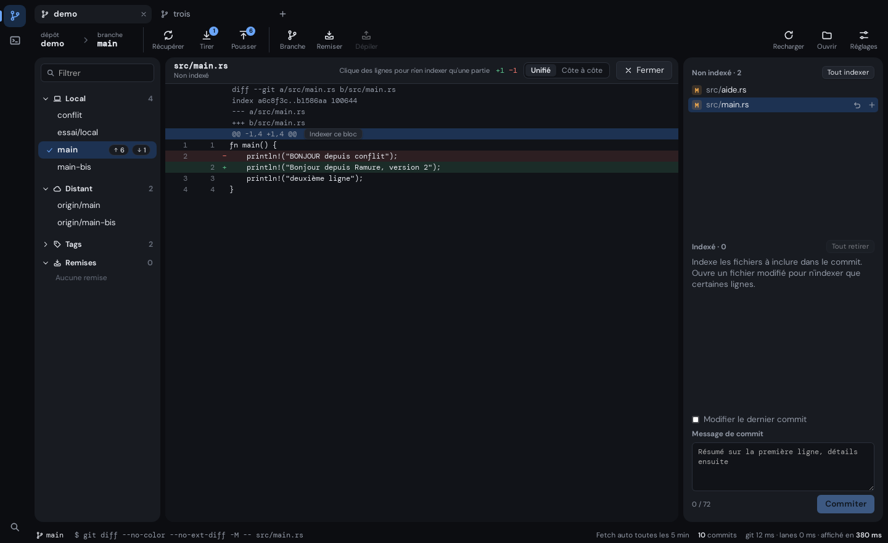 | 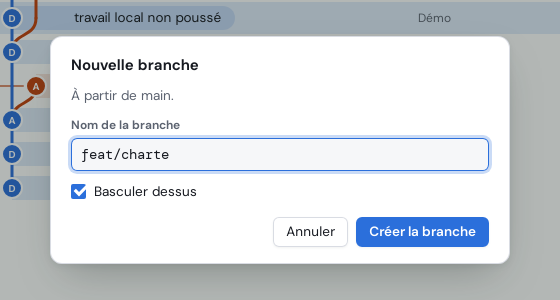 |

### Validé avec la proposition

Ces points venaient de Sous-bois ou étaient nouveaux. Ils sont retenus tels que montrés :

- **La police.** DM Sans, et DM Mono pour le code.
- **Le graphe.** Courbes souples et messages en capsule.
- **Les onglets en cartes.**
- **La densité.** 21 commits visibles sur un écran de 880 px, contre 23 dans l'interface de départ.

## Thèmes de couleurs

Un thème de couleurs ne change que les couleurs : fonds, textes, traits, accent, couleurs d'état,
couleurs des branches et du terminal. La disposition, les formes, la police et les tailles ne
bougent pas. Chaque thème existe en clair et en sombre.

| Thème | Fonds | Accent |
|---|---|---|
| **Ardoise** (par défaut) | gris neutres | bleu |
| Encre | gris presque noirs, ou blancs | indigo |
| Sous-bois | verts très sombres, ou papier chaud | vert mousse |
| Braise | charbon, ou crème | ambre |

Ardoise est montré dans les captures de Clairière ci-dessus. Les trois autres, sur le même écran :

| | Sombre | Clair |
|---|---|---|
| Encre | 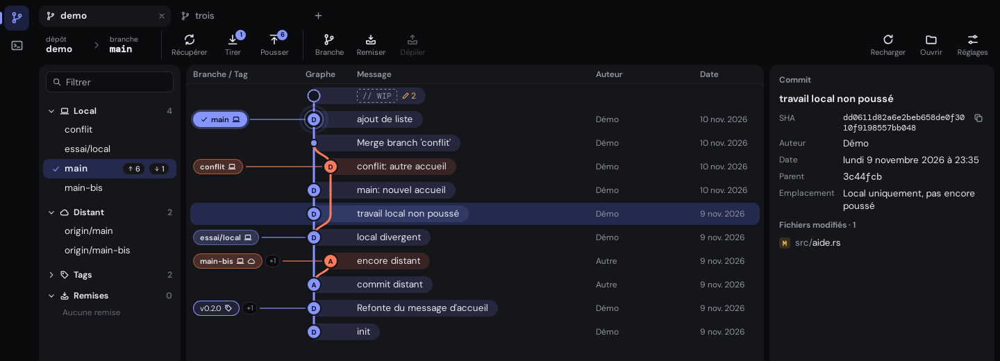 | 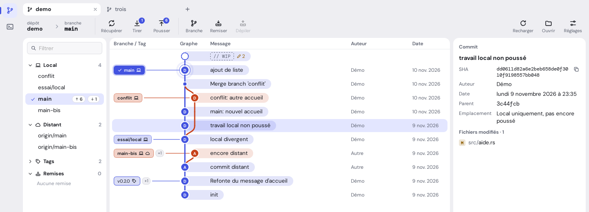 |
| Sous-bois | 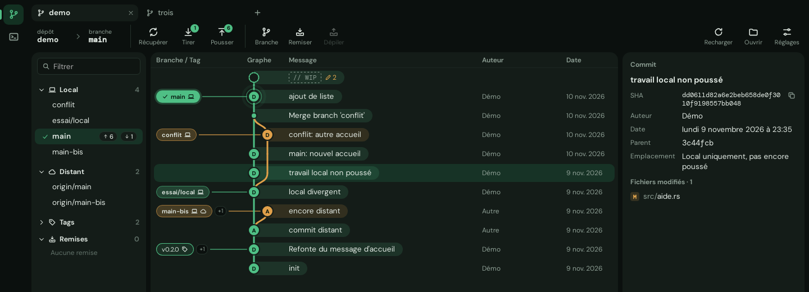 | 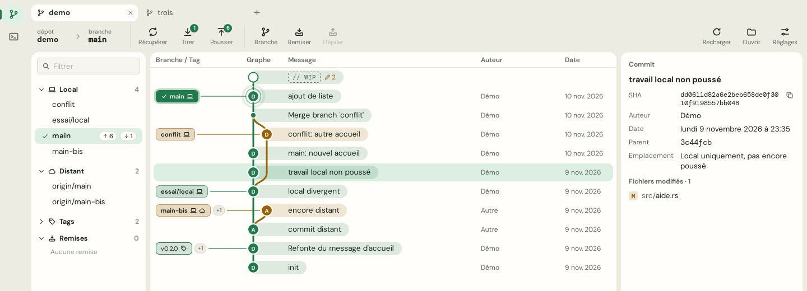 |
| Braise | 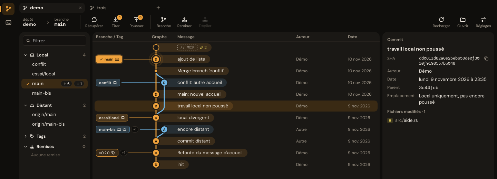 | 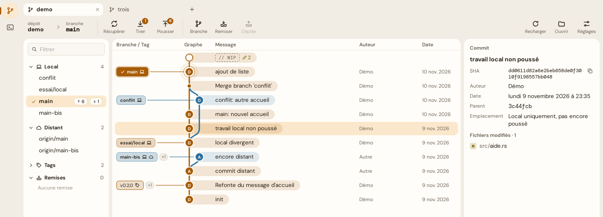 |

**Comment cela marcherait.**

- Un réglage « Thème de couleurs » dans les Réglages. Le changement est immédiat et mémorisé.
- Un thème est un bloc de jetons de couleur ([`themes.css`](themes.css)), choisi par un attribut
  sur la racine de la page. C'est possible parce que les composants passent déjà par ces jetons.
- Un thème n'entre dans l'application que s'il respecte les contrastes fixés par la charte. Les
  quatre proposés les respectent.

**À savoir.** Dans le thème Sous-bois, l'accent est aussi la couleur du succès ; dans Braise, il
est voisin de la couleur d'avertissement. Ce sont des thèmes au choix : Ardoise, le thème par
défaut, n'a pas ce défaut.

La mise en œuvre est suivie dans l'issue #9. Elle vient après l'alignement des jetons (#5).

## Suite

- La [charte graphique](../charte-graphique.md) fixe les règles de Clairière : issue #4.
- Les jetons du code sont alignés sur la charte : issue #5.
- La direction est appliquée à l'interface : issue #10. Les captures de ce document viennent d'un
  aperçu temporaire ; le code de l'application n'a pas encore changé.
- Le choix du thème de couleurs arrive dans les Réglages : issue #9.

## Premières directions

Les trois directions comparées au départ. Chacune est un parti pris complet : police, onglets,
barre d'outils, boutons, panneaux, dessin du graphe et couleurs. Leurs couleurs sont devenues les
thèmes Sous-bois, Encre et Braise.

### En un coup d'œil

| | Actuelle | A. Sous-bois | B. Encre | C. Braise |
|---|---|---|---|---|
| Idée | point de départ | organique | technique | chaleureuse |
| Police | celle du système | DM Sans | Inter | Rubik |
| Onglets | cadre attaché | pilules | texte souligné | intercalaires |
| Barre d'outils | icône sur libellé | pilules, icône et libellé côte à côte | une ligne compacte | groupes pleins |
| Boutons | angles de 6 px | pilules | angles de 4 px | angles de 10 px, bord inférieur épais |
| Panneaux | séparés par des traits | cartes flottantes | séparés par des traits | séparés par des traits |
| Commit dans le graphe | pastille à initiales | pastille à initiales | point | grande pastille à initiales |
| Tracé des branches | angles arrondis | courbes souples | angles nets, trait fin | angles très arrondis, trait épais |
| Lien commit-message | ruban qui s'estompe | capsule autour du message | aucun | ligne entière colorée |
| Hauteur d'une ligne | 32 px | 34 px | 26 px | 36 px |
| Commits visibles sur un écran de 880 px | 23 | 21 | 29 | 20 |
| Accent | bleu | vert mousse | indigo | ambre |

Ce qui ne change pas d'une direction à l'autre : l'organisation de l'écran, les icônes, les
fonctions. Le mouvement (durées, courbes d'animation) n'est pas montré par des captures ; il sera
réglé dans la charte.

### Repère : l'interface actuelle

| Sombre | Clair |
|---|---|
| 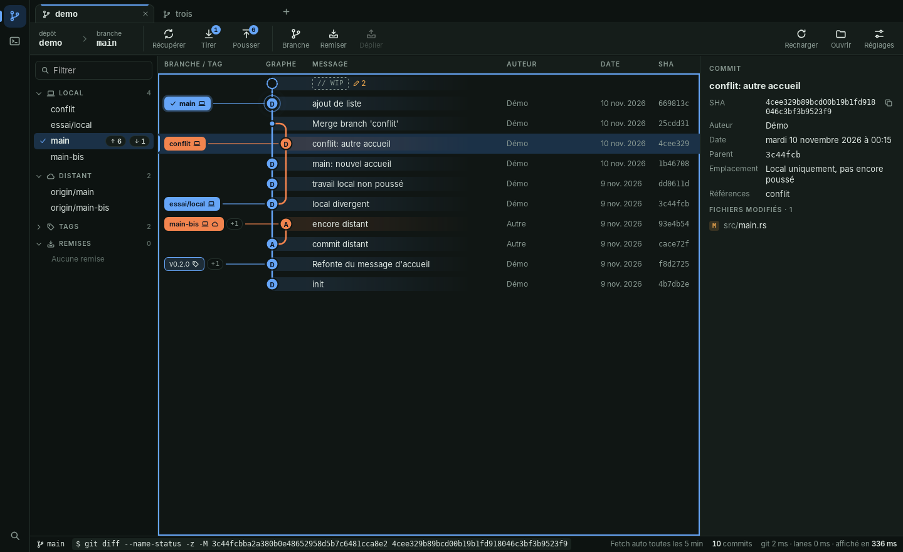 | 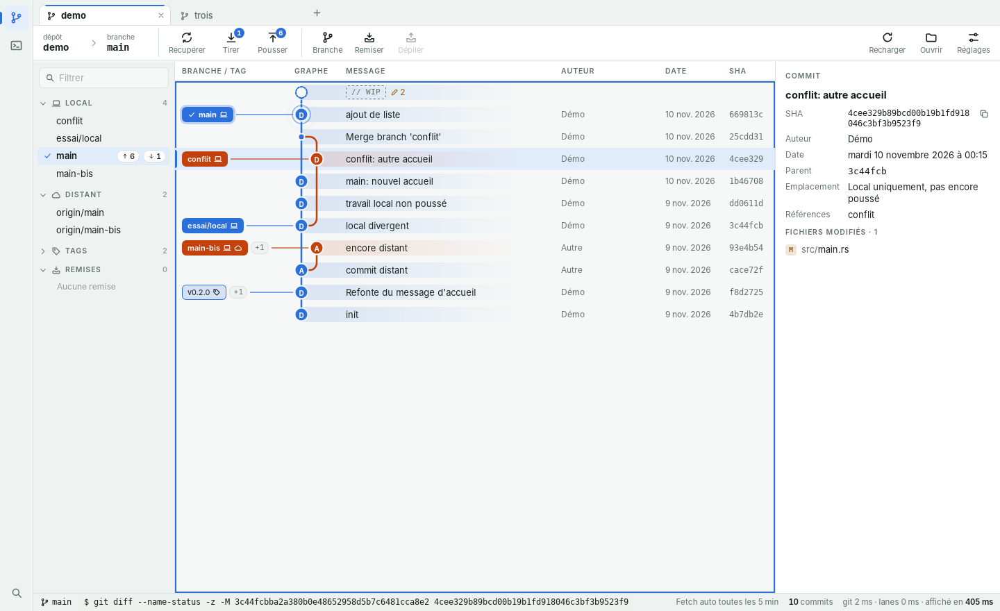 |

### A. Sous-bois

**Intention.** Tirer l'identité du nom : une ramure, ce sont des branches. Tout est arrondi et
souple, les panneaux flottent sur le fond comme des cartes, et chaque message de commit est une
capsule de la couleur de sa branche, accrochée à une courbe.

| Élément | Parti pris |
|---|---|
| Police | DM Sans, 13,5 px ; DM Mono pour le code. Titres de section en minuscules, sans capitales espacées. |
| Onglets | Des pilules posées sur le fond ; l'onglet actif est une pilule teintée de l'accent. |
| Barre d'outils | Chaque action est une pilule bordée, icône et libellé côte à côte. |
| Boutons et champs | Boutons en pilule ; champs à angles de 10 px ; boîtes de dialogue à angles de 20 px. |
| Panneaux | Barre latérale, graphe et détail sont trois cartes arrondies, séparées par le fond. |
| Graphe | Pastilles à initiales, courbes souples de 3 px, message dans une capsule. Lignes de 34 px. |
| Étiquettes | Pilules teintées ; la branche courante en pilule pleine. |
| Couleurs | Fonds vert très sombre ou papier chaud, accent vert mousse, branches en teintes de nature. |

**Ce qu'elle apporte.** La plus reconnaissable : aucun autre client Git ne ressemble à cela. Le
lien entre un commit et son message est le plus lisible des trois.

**Ce qu'elle coûte.** Les cartes et les capsules prennent de la place : moins de commits à
l'écran, et les marges entre cartes retirent quelques pixels à chaque panneau. L'accent vert est
aussi la couleur du succès et des lignes ajoutées dans un diff.

| Graphe, sombre | Graphe, clair |
|---|---|
| 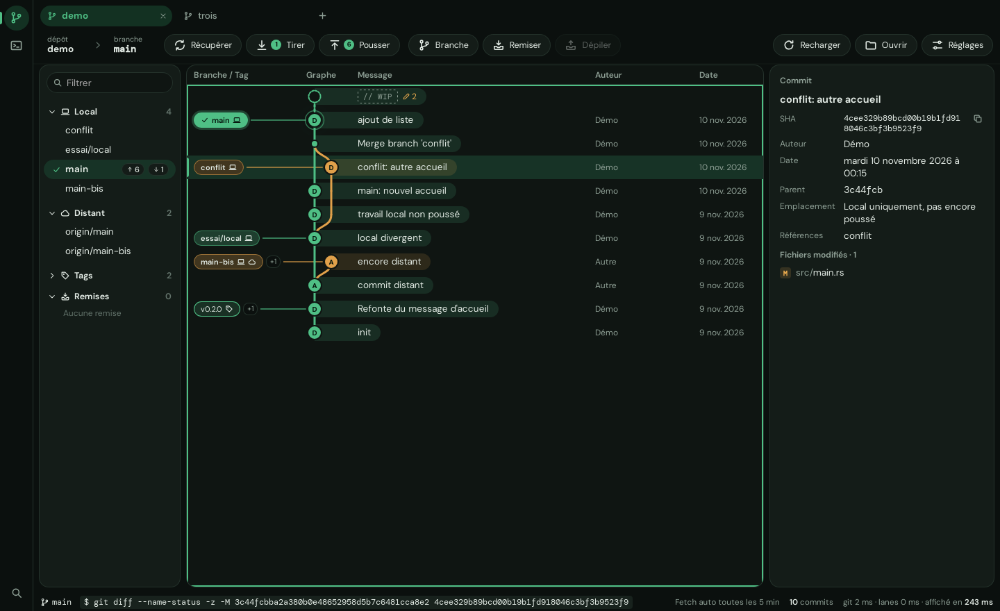 | 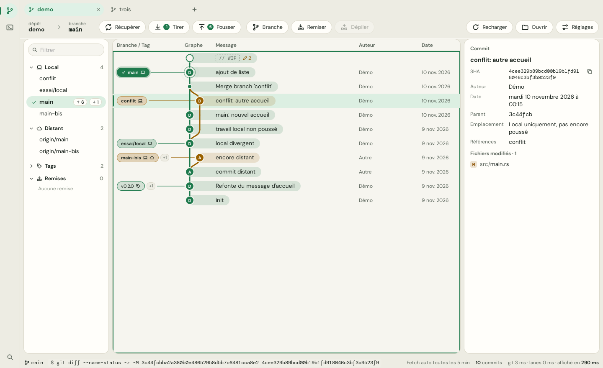 |

| Modifications et diff | Boîte de dialogue |
|---|---|
| 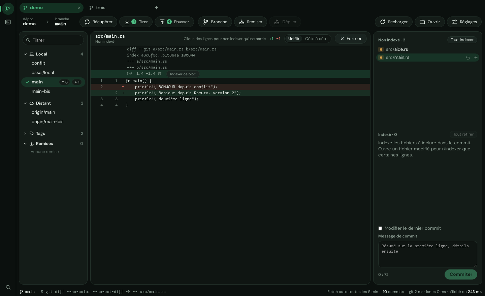 | 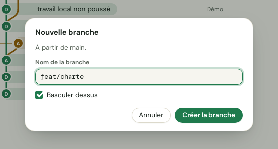 |

### B. Encre

**Intention.** Un outil d'abord. Tout est plat, dense et net, dans des gris presque sans teinte :
les seules couleurs vives de l'écran sont celles des branches.

| Élément | Parti pris |
|---|---|
| Police | Inter, 12,5 px ; JetBrains Mono pour le code. Titres de section en petites capitales espacées. |
| Onglets | Du texte, et un trait de 2 px sous l'onglet actif. Pas de cadre. |
| Barre d'outils | Une seule ligne compacte, icône et libellé côte à côte, sans fond. |
| Boutons et champs | Angles de 4 px, sans ombre ; boîtes de dialogue à angles de 8 px. |
| Panneaux | Bord à bord, séparés par des traits fins. |
| Graphe | Points de 9 px, traits de 2 px à angles nets, aucun ruban. L'avatar de l'auteur revient dans sa colonne. Lignes de 26 px. |
| Étiquettes | Rectangles en police de code, avec une barre de couleur à gauche ; la branche courante est pleine. |
| Couleurs | Gris neutres, accent indigo, branches en couleurs vives. |

**Ce qu'elle apporte.** La plus dense : un quart de commits en plus à l'écran. L'indigo n'est la
couleur d'aucun état (succès, avertissement, erreur), donc l'accent désigne toujours une action.
La plus proche des habitudes prises avec GitKraken.

**Ce qu'elle coûte.** La moins singulière des trois, et celle qui a le moins d'impact visuel : le
graphe est précis, mais discret.

| Graphe, sombre | Graphe, clair |
|---|---|
| 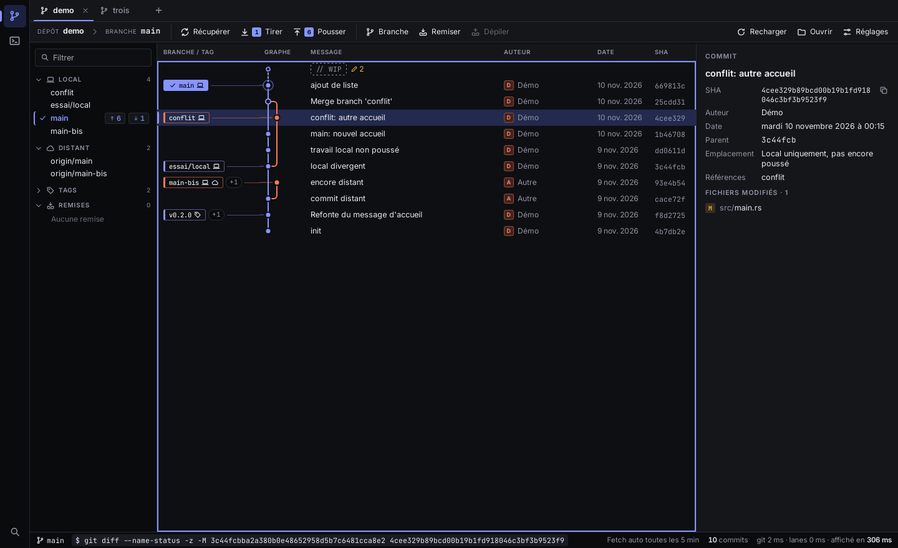 | 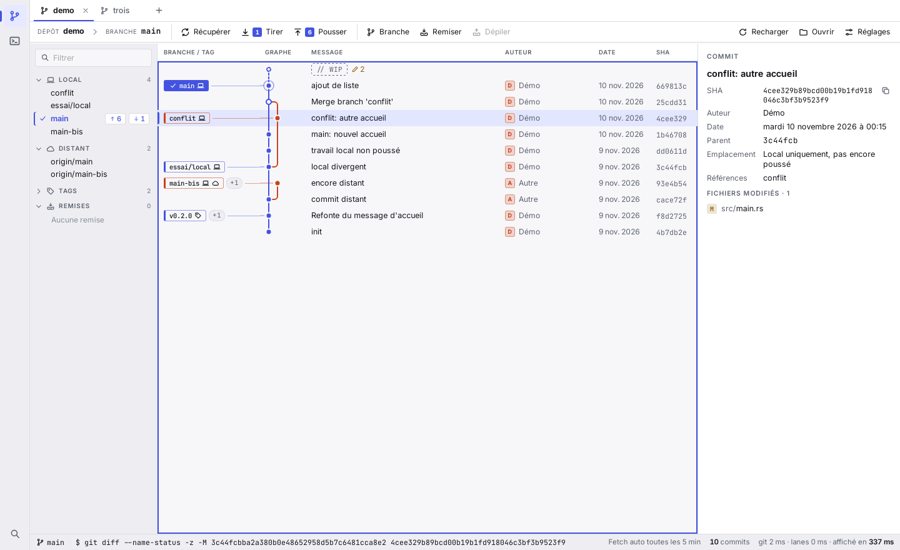 |

| Modifications et diff | Boîte de dialogue |
|---|---|
| 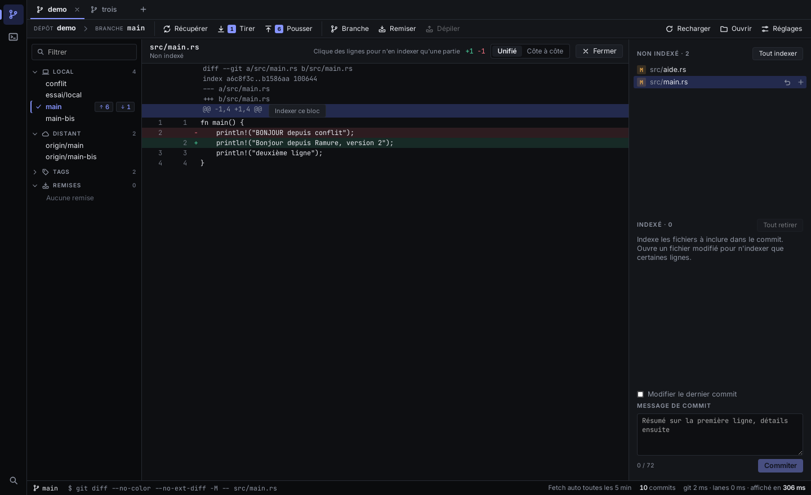 | 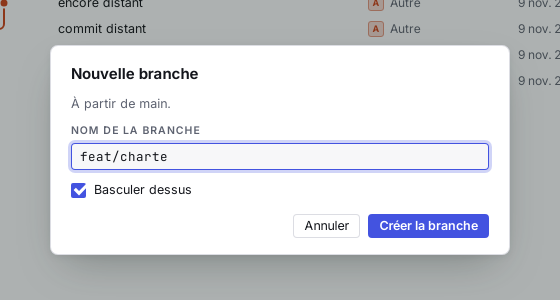 |

### C. Braise

**Intention.** Une interface chaude et tactile : formes généreuses, groupes pleins, gros traits.
L'ambre évoque le bois sans reprendre le vert attendu.

| Élément | Parti pris |
|---|---|
| Police | Rubik, 13,5 px ; Fira Code pour le code. Titres de section en capitales, de la couleur de l'accent. |
| Onglets | Des intercalaires de classeur, larges, à coins de 12 px. |
| Barre d'outils | Les actions sont regroupées dans des blocs pleins et arrondis ; icônes de la couleur de l'accent. |
| Boutons et champs | Angles de 10 px, bord inférieur épais qui donne du relief ; boîtes de dialogue à angles de 18 px. |
| Panneaux | Bord à bord, séparés par des traits. |
| Graphe | Grandes pastilles à initiales, traits de 3,5 px à angles très arrondis, ligne entière teintée de la couleur de la branche. Messages en caractères demi-gras. Lignes de 36 px. |
| Étiquettes | Pilules pleines, plus hautes. |
| Couleurs | Fonds charbon ou crème, accent ambre. |

**Ce qu'elle apporte.** Le graphe le plus spectaculaire : chaque branche se lit d'un bord à
l'autre de l'écran. Chaleureuse, confortable en thème sombre.

**Ce qu'elle coûte.** La moins dense. L'ambre est voisin de la couleur d'avertissement : un
bouton principal et une mise en garde se ressemblent. Sur un dépôt à nombreuses branches, les
lignes teintées peuvent charger l'écran.

| Graphe, sombre | Graphe, clair |
|---|---|
| 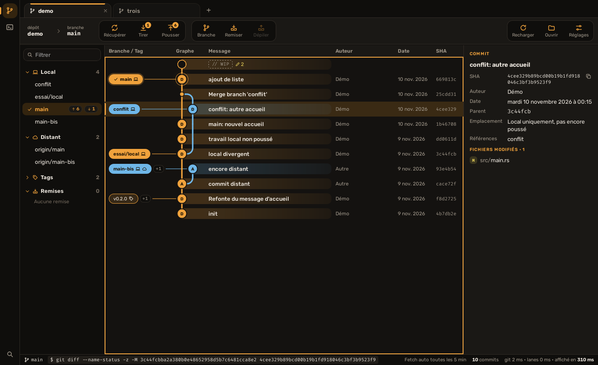 | 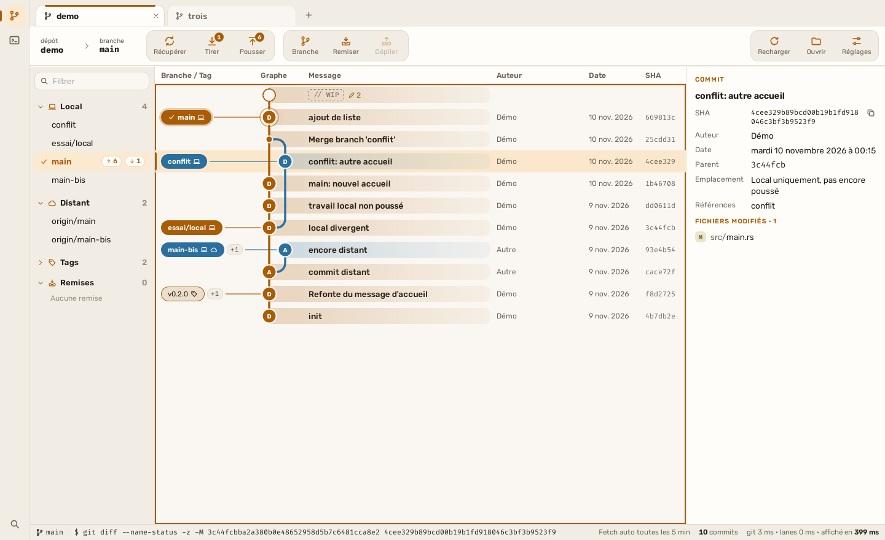 |

| Modifications et diff | Boîte de dialogue |
|---|---|
| 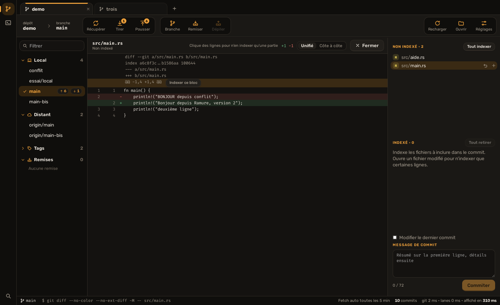 | 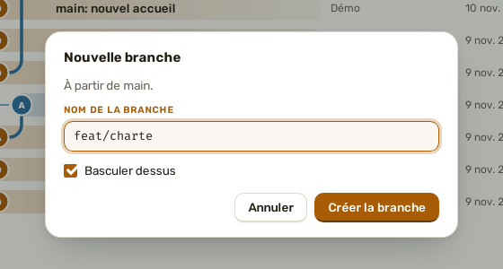 |

### Recommandation d'origine

**Sous-bois**, pour la structure et les formes. C'est la seule direction qui donne à Ramure un
visage à lui, et la capsule est la meilleure réponse au défaut de départ : le lien entre un
commit et son message.

Deux réserves, qui peuvent se régler par un mélange :

- **La densité.** Si 21 commits à l'écran sont trop peu, on peut garder les formes de Sous-bois
  avec la hauteur de ligne d'Encre.
- **L'accent vert.** S'il gêne à côté du vert des succès, l'indigo d'Encre fonctionne sur les
  fonds de Sous-bois.

Encre reste le bon choix si la priorité est l'efficacité plutôt que l'identité.

## Fichiers

- [`themes.css`](themes.css) : les quatre thèmes de couleurs.
- [`directions.css`](directions.css) : les couleurs et les rayons des trois premières directions.
- [`esquisses/`](esquisses) : les règles d'interface qui ont servi aux captures (police, onglets,
  barre d'outils, panneaux, étiquettes). Ce sont des esquisses, pas du code à reprendre tel quel.
- Dessin du graphe, par direction :

| | Clairière | Sous-bois | Encre | Braise |
|---|---|---|---|---|
| Hauteur de ligne | 34 px | 34 px | 26 px | 36 px |
| Largeur d'une colonne | 24 px | 24 px | 14 px | 26 px |
| Rayon d'un commit | 10 px | 10 px | 4,5 px | 11,5 px |
| Épaisseur du trait | 3 px | 3 px | 2 px | 3,5 px |
| Changement de colonne | courbe | courbe | angle de 5 px | angle de 14 px |
| Bande derrière le commit | 24 px, opacité 15 % | 24 px, opacité 15 % | aucune | 26 px, opacité 20 % |

## Notes

- Toutes les couleurs respectent les contrastes WCAG : 7:1 pour le texte courant, 4,5:1 pour le
  texte secondaire et le texte posé sur une couleur, 3:1 pour les traits du graphe. Pour
  Clairière, ils sont aussi vérifiés sur le fond des cartes, sur la sélection et dans les capsules.
- Les polices proposées sont libres (SIL Open Font License) et seraient embarquées dans l'application.
- Les captures viennent de l'interface de la PR #2, sous Ubuntu.
