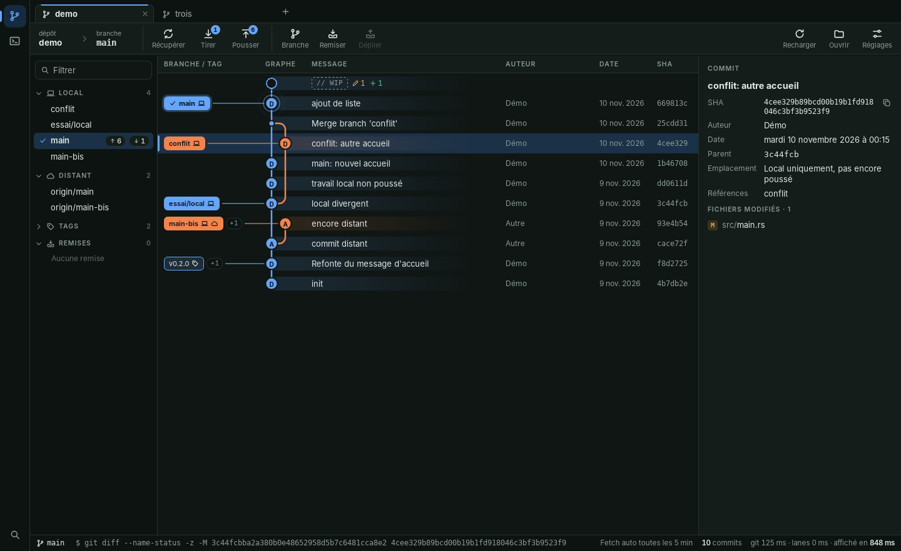
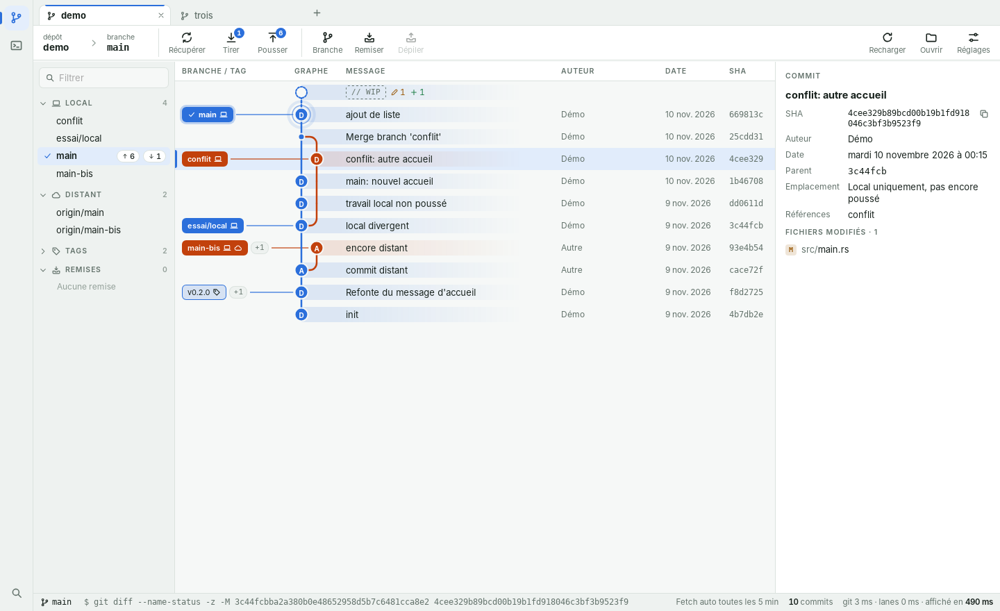
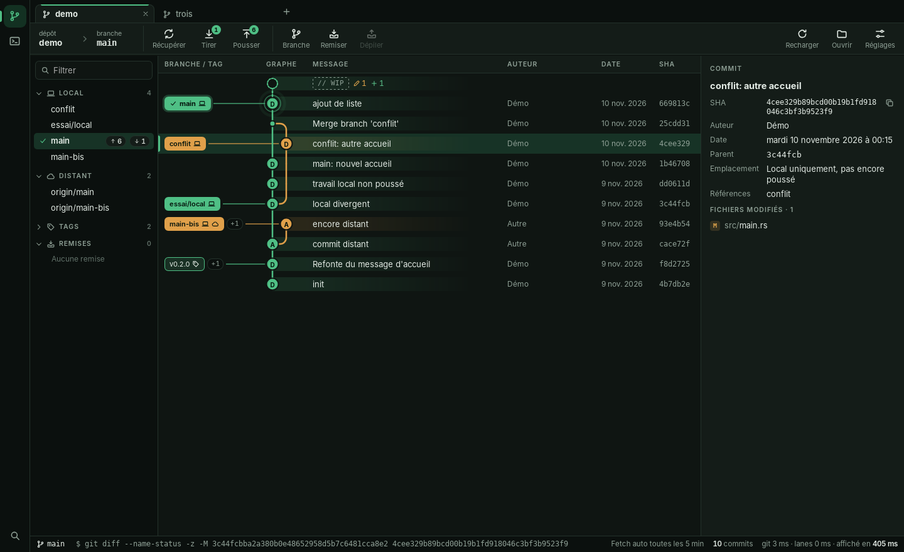
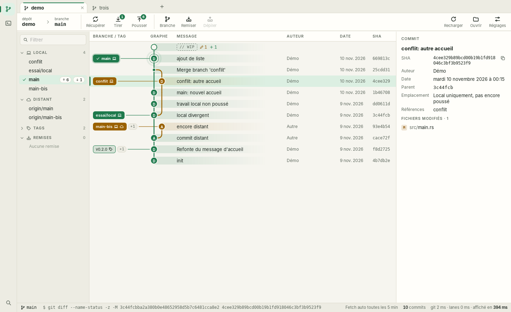
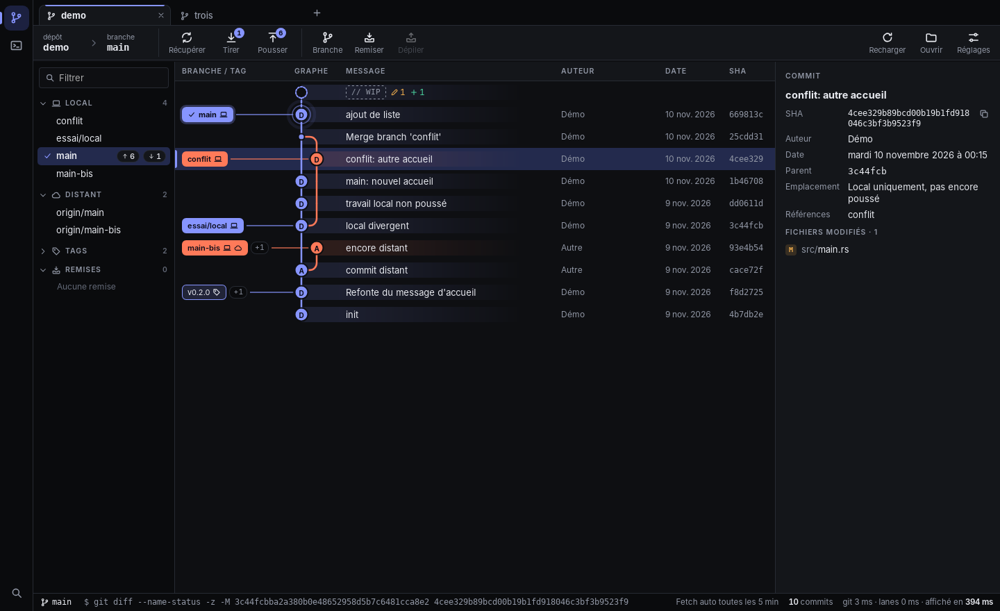
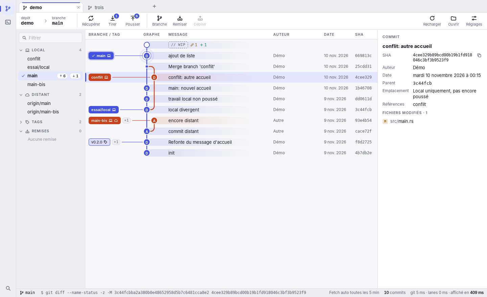
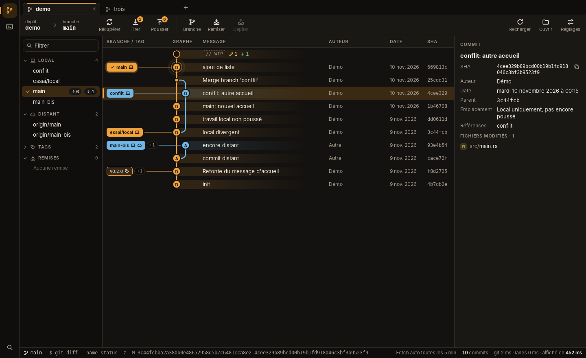
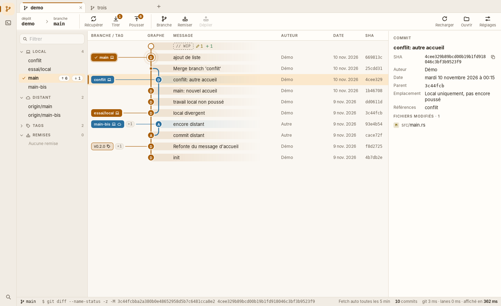

# Direction visuelle de Ramure

Trois directions à comparer, avant d'écrire la charte graphique. Chacune est montrée sur le vrai
écran du graphe, en thème sombre et en thème clair, avec l'interface actuelle comme repère.

**Décision : à prendre.** Une fois la direction choisie (ou un mélange précis de deux), elle est
inscrite ici et sert de base à la charte.

## Ce qui change d'une direction à l'autre, et ce qui ne change pas

Seuls les jetons de couleur et les rayons changent : fonds, textes, accent, sélection, couleurs
des branches du graphe, arrondi des angles. La structure de l'écran, le graphe « Ruban », les
icônes et les animations sont les mêmes partout.

La typographie, le logo et le ton des textes ne sont pas tranchés ici : ils le seront dans la
charte.

Toutes les couleurs proposées respectent les contrastes WCAG : 7:1 pour le texte courant, 4,5:1
pour le texte secondaire et le texte posé sur une couleur, 3:1 pour les traits du graphe.

Les captures viennent de l'interface de la PR #2. Les jetons complets sont dans
[`directions.css`](directions.css).

## Repère : l'interface actuelle

Accent bleu sur des gris légèrement verts. C'est le point de départ, pas une proposition.

| Sombre | Clair |
|---|---|
|  |  |

## A. Sous-bois

**Intention.** Tirer l'identité du nom : une ramure, ce sont des branches. Fonds vert très sombre
ou papier chaud, accent vert mousse, branches du graphe dans des teintes de nature (ambre, ciel,
terre cuite, lichen).

**Ce qu'elle apporte.** La plus reconnaissable : aucun autre client Git ne ressemble à cela.
Calme, lisible longtemps.

**Ce qu'elle coûte.** L'accent vert est aussi la couleur du succès et des lignes ajoutées dans un
diff : l'accent ne peut plus servir à distinguer une action d'un état.

| Sombre | Clair |
|---|---|
|  |  |

| Rôle | Sombre | Clair |
|---|---|---|
| Fond | `#0f1512` | `#f6f5ef` |
| Panneau | `#141c18` | `#fffefa` |
| Texte | `#e3ebe5` | `#1b241e` |
| Texte secondaire | `#8fa096` | `#5f695f` |
| Accent | `#4fbf85` | `#1f7a4d` |
| Sélection | `#173326` | `#dcefe2` |
| Branches du graphe | `#4fbf85` `#e0a04a` `#6fb3d9` `#d98162` … | `#1f7a4d` `#9a6100` `#2a6f9e` `#b1502f` … |
| Rayons | 8 px et 6 px | idem |

## B. Encre

**Intention.** Un outil d'abord : des gris neutres, presque sans teinte, pour que les seules
couleurs vives de l'écran soient celles des branches. Accent indigo, angles plus nets.

**Ce qu'elle apporte.** Le graphe ressort le plus : c'est la direction qui a le plus d'impact
visuel. L'indigo n'est la couleur d'aucun état (succès, avertissement, erreur), donc l'accent
désigne toujours une action. La plus proche des habitudes prises avec GitKraken.

**Ce qu'elle coûte.** La moins singulière des trois : sobre, mais proche de ce que font d'autres
outils de développement.

| Sombre | Clair |
|---|---|
|  |  |

| Rôle | Sombre | Clair |
|---|---|---|
| Fond | `#0e0f12` | `#f7f7f9` |
| Panneau | `#14161a` | `#ffffff` |
| Texte | `#e8eaf0` | `#14161c` |
| Texte secondaire | `#9197a5` | `#5d6270` |
| Accent | `#8795ff` | `#4353e0` |
| Sélection | `#232a4d` | `#e3e6ff` |
| Branches du graphe | `#8795ff` `#ff7a59` `#2fd6a3` `#c77dff` … | `#4353e0` `#c8431b` `#0a8460` `#8a3fd6` … |
| Rayons | 5 px et 4 px | idem |

## C. Braise

**Intention.** Une interface chaude : fonds charbon ou crème, accent ambre, angles plus ronds.
L'ambre évoque le bois, sans reprendre le vert attendu.

**Ce qu'elle apporte.** Chaleureuse et singulière, confortable en thème sombre.

**Ce qu'elle coûte.** L'ambre est voisin de la couleur d'avertissement : un bouton principal et
une mise en garde se ressemblent, et l'avertissement doit glisser vers le jaune pour s'en
distinguer.

| Sombre | Clair |
|---|---|
|  |  |

| Rôle | Sombre | Clair |
|---|---|---|
| Fond | `#141210` | `#faf7f2` |
| Panneau | `#1a1815` | `#fffdf9` |
| Texte | `#efe9e1` | `#241d14` |
| Texte secondaire | `#a39a8d` | `#6c6256` |
| Accent | `#f0a23c` | `#a85c05` |
| Sélection | `#3a2a14` | `#fbe8cc` |
| Branches du graphe | `#f0a23c` `#6fb7e8` `#7fce8a` `#e58573` … | `#a85c05` `#2a6f9e` `#2c7a4b` `#b23a2a` … |
| Rayons | 10 px et 8 px | idem |

## En résumé

| | Sous-bois | Encre | Braise |
|---|---|---|---|
| Identité | forte, tirée du nom | sobre | forte, chaleureuse |
| Impact du graphe | moyen | le plus fort | fort |
| Accent distinct des états | non (vert = succès) | oui | non (ambre ≈ avertissement) |
| Proximité avec GitKraken | faible | forte | faible |

## Recommandation

**Encre**, pour deux raisons. Le graphe est le cœur de l'application, et c'est sur des fonds
neutres que ses couleurs portent le mieux. Et son accent ne se confond avec aucun état, ce qui
évite une règle d'exception dans la charte.

Si l'identité compte plus que la neutralité, **Sous-bois** est le meilleur second choix. Un
mélange est possible aussi : les gris neutres d'Encre avec l'accent vert de Sous-bois.
