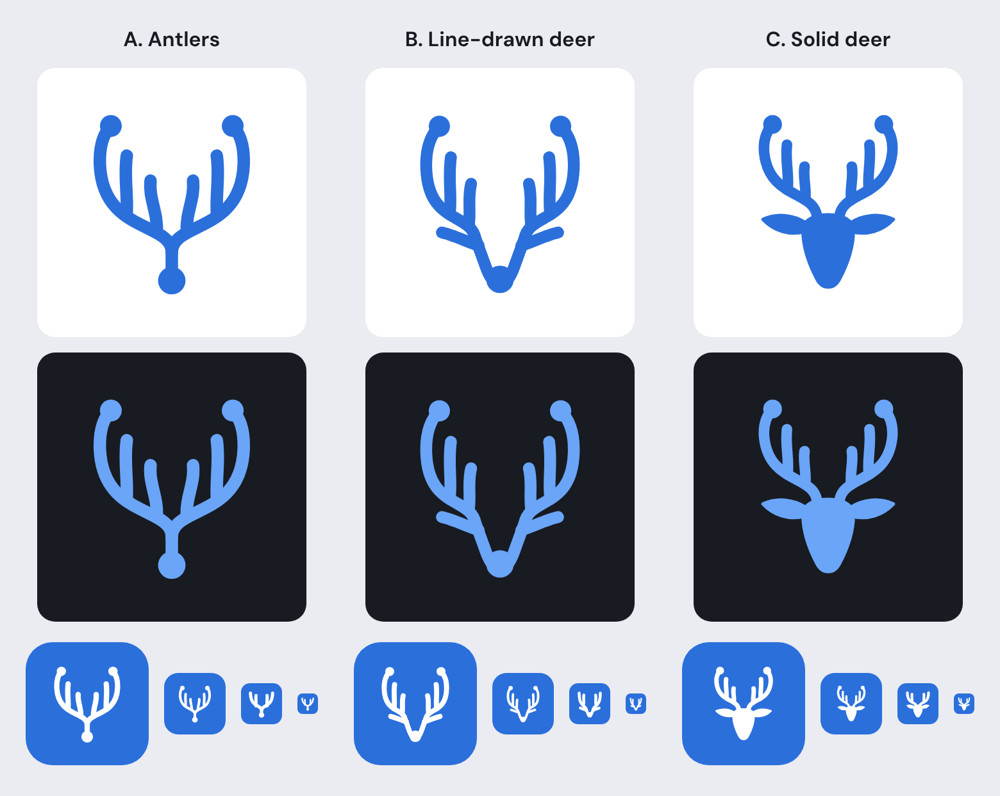
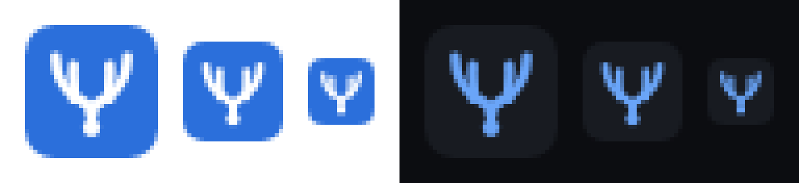
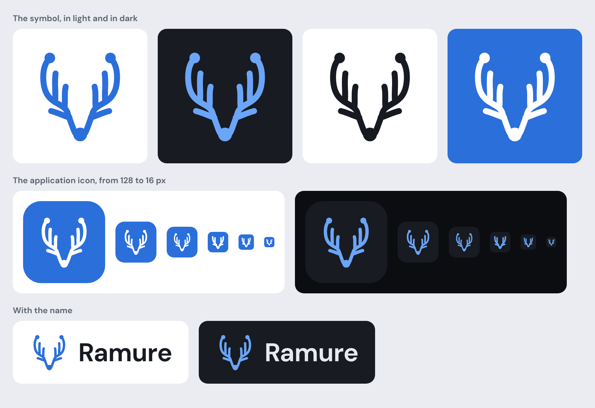
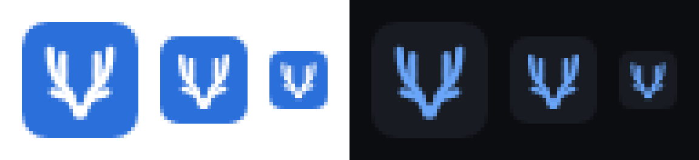
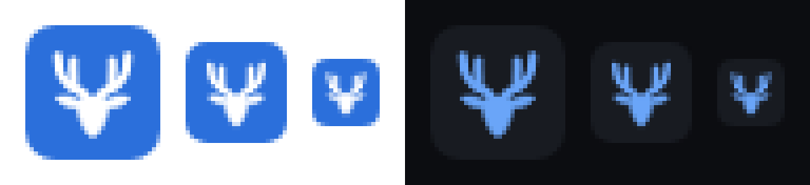

# Ramure's logo

This document keeps the record of how the logo was chosen. Three options were compared, on the
theme of a deer's antlers.

**Decision: B. Line-drawn deer, chosen on 10 November 2026,** with the symbol in white on a blue
tile for the application icon. The final logo is in [`../logo/`](../logo), and its rules of use
are in the [design guidelines](../design-guidelines.md#13-logo).

## The shared idea

In French, "ramure" means both a deer's antlers and the branches of a tree. So all three options
draw the antlers as Git branches, with the vocabulary of the application:

- a stroke with rounded ends, like the icons;
- soft curves, like the graph;
- a dot for a commit;
- a single colour, no gradient.

Each option has two drawings: the full drawing, from 48 px up, and a simplified drawing for small
sizes (one tine fewer on each side, a thicker stroke).

The drawings are original, made for this project.

## At a glance

| | A. Antlers | B. Line-drawn deer | C. Solid deer |
|---|---|---|---|
| What you see | A pair of antlers growing from a commit. | A deer's head in a single stroke: the muzzle is the first commit, each side of the head a branch that becomes an antler. | A solid deer's head, seen from the front. |
| Link with Git | The strongest: it is a graph. | Strong: two branches start from a commit. | Weak: only the dots at the tips of the antlers recall it. |
| Link with the deer | Through the antlers alone. | Clear: muzzle, ears, antlers. | Immediate. |
| At 16 px | A "Y" with two prongs. Readable, but can pass for a plant. | A branching "V". | The most recognisable outline. |
| Distinctiveness | Strong. | Strong. | Weaker: a deer's head seen from the front is a common motif. |
| Fit with the interface | The same stroke as the icons. | The same stroke as the icons. | A solid shape, where the icons are line-drawn. |

## A. Antlers

A pair of antlers, and nothing else. The trunk starts from a commit, splits into two branches
that spread apart and rise, and each branch carries its tines. It is a Git graph in the shape of
a set of antlers.

**What it brings.** The most abstract option, and the one that says "branches" best. It scales
down well: a crisp "Y" remains.

**What it costs.** Without a head, the deer is guessed rather than seen. Small, the shape can
suggest a plant or a fork.

The small sizes (32, 24 and 16 px), enlarged six times:

## B. Line-drawn deer

The head and the antlers in a single stroke. Everything starts from the muzzle, which is a commit
dot: two lines run up along the head, spread apart and become the antlers. Two short strokes make
the ears.

**What it brings.** You see a deer, and it is still a graph: one commit, two branches. The
drawing is made of the same stroke as the application's icons.

**What it costs.** It is the drawing with the most strokes. At 16 px, the ears blend into the
antlers: a branching "V" remains.

The small sizes, enlarged six times:

## C. Solid deer

A deer's head seen from the front, as a solid shape, topped with line-drawn antlers. The antlers
keep a dot at their tip.

**What it brings.** The most readable: a deer is recognised at every size, including 16 px.

**What it costs.** The least distinctive. A deer's head seen from the front is a common motif
(hunting, outdoors, drinks), and the link with Git is thin. The solid shape clashes with the
line-drawn icons of the interface.

The small sizes, enlarged six times:

## What was chosen

- **Option B**, untouched: it is the only one that says both things at once. You see a deer, and
  the drawing remains a commit from which two branches start.
- **The blue tile**, with the symbol in white, for the application icon.
- **The name** "Ramure" in DM Sans, weight 650, to the right of the icon.

The sheets above also show the dark tile and the bare symbol next to the name: those two variants
were not chosen.

## Files

The final logo is in [`../logo/`](../logo). The files below are those of the three options, kept
for the record.

- [`logo/piste-a.svg`](logo/piste-a.svg), [`logo/piste-b.svg`](logo/piste-b.svg),
  [`logo/piste-c.svg`](logo/piste-c.svg): the full drawings.
- [`logo/piste-a-petit.svg`](logo/piste-a-petit.svg),
  [`logo/piste-b-petit.svg`](logo/piste-b-petit.svg),
  [`logo/piste-c-petit.svg`](logo/piste-c-petit.svg): the drawings for small sizes.

The SVG files take the colour of the surrounding text (`currentColor`).
